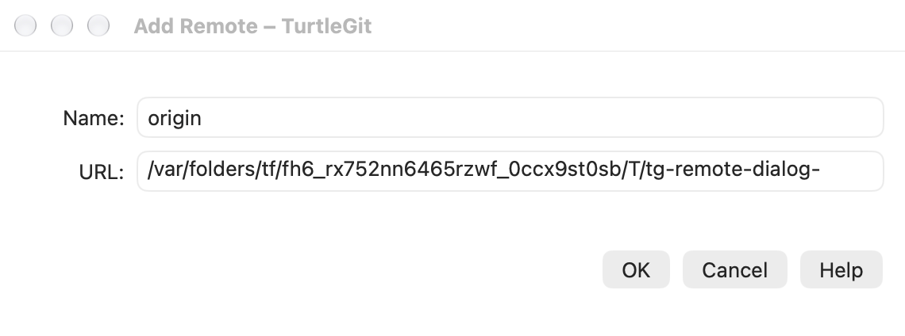
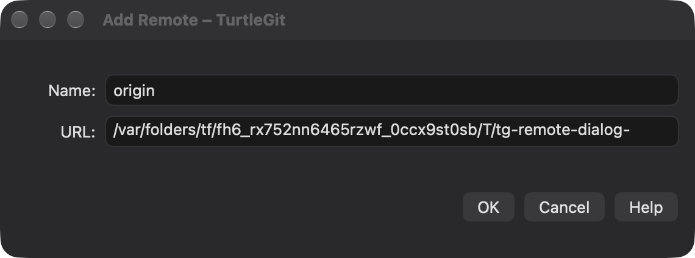
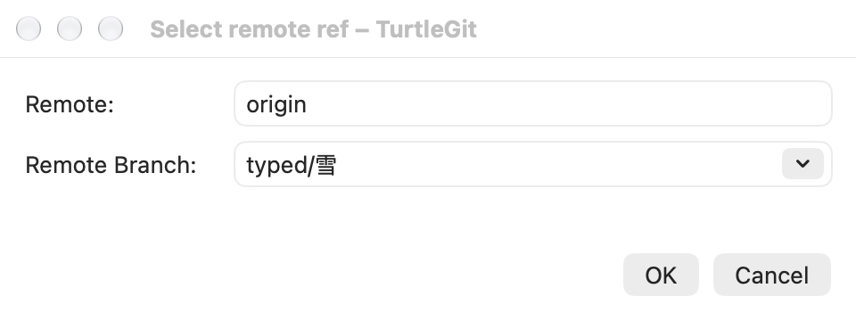
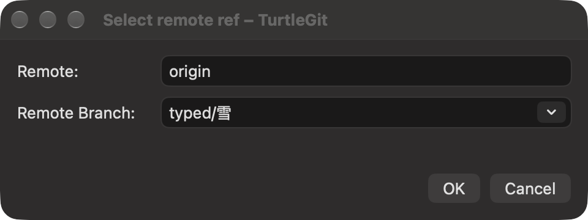

# Add Remote and Select Remote Ref

Pinned reference: `7338078f8ddd924b8cddee35f512f2286072136d`,
`AddRemoteDlg.cpp`, `SelectRemoteRefDlg.cpp`, `PullFetchDlg.cpp` and the
corresponding `IDD_ADD_REMOTE` / `IDD_SELECTREMOTEREF` resources.

Add Remote has Name, URL, OK/Cancel/Help in a compact native sheet owned by
Browse References. Its original-icon Add Remote entry appears in the remotes
folder beside Manage Remotes. Accepted inputs are captured before asynchronous
work. Git validates/adds the local remote without overwriting an existing one,
changing unrelated settings or fetching. Errors retain the draft; closing or
retiring cancels owned work and the parent refreshes after settlement.

The pinned AddRemote form only returns its fields; BrowseRefs has a dormant
handler that opens it and refreshes, with no add operation or emitted menu entry.
The native fork deliberately completes that intended workflow through the
existing remote-settings backend. It does not reproduce the source no-op.

Fetch and Pull now own Select remote ref as a separate native sheet. It shows the
captured Remote read-only, an editable Remote Branch combo, OK and Cancel.
Loading clears old values; successful loading selects the first result. An empty
or failed query disables OK; F5 refreshes. Case-sensitive typed values are kept.
Lists use exact UTF-8 identity, including canonically equivalent names.

The source CLI uses `ls-remote --refs`, excludes tags, strips `refs/heads/` and
keeps other namespaces. The new backend follows that contract, validates returned
OID/UTF-8 records, and applies natural ordering with a byte tie-breaker. Exact
Windows logical ordering for every locale remains unverified. Merely listing
remote refs does not fetch or update local refs, HEAD or index.

The picker owns its authentication coordinator and passphrase sheets, so SSH
questions attach to that child rather than its blocked parent. The remote and
repository/access lease remain captured. Closing during loading requests
cancellation and waits for owned work; forced closure fences late replies.
Active accounting guards Quit after forced closure. An accepted branch updates
the parent only if its captured remote is still current. Rejected presentations
release the parent gate. Refresh never applies an operation to the repository.

Loading is an inline native progress state instead of the Windows system
progress dialog. Source layout, physical combo/F5/Return/Escape/VoiceOver,
authenticated servers, signed file grants and complete dialog acceptance remain
open. The existing focused Core/native checks establish their recorded scope,
not the full application or App Store release.

Fetch/Pull branch history now also follows the source’s case-sensitive setting,
using exact byte identity and retaining the chosen spelling rather than replacing
it with a case-insensitive historical entry. Sheet completion explicitly ends
the child sheet before delivering its once-only result to the parent.

The connected remote-dialog batch passed 22 Core tests and six grouped native
checks across system and bundled Git. See the [scoped QA record](qa/remote-dialogs-2026-10-13.json).

## Connected source forms and native ownership — October 17, 2026

Add Remote retains the pinned Name/URL and OK/Cancel/Help order in its fixed
compact window. Both inputs are now native NSTextFields. Select Remote Ref
retains the read-only Remote field, editable branch combo and OK/Cancel footer,
with horizontal-only resizing as in CHorizontalResizableStandAloneDialog. The
read-only field remains selectable and both forms retain a compact status row
while loading/saving. The editable controls use the existing Git URL/path word
commands and avoid resetting a native selection on unrelated updates.

The branch combo disables automatic completion, retaining exact typed spelling
and byte-distinct Unicode choices. Every refresh/submission/acknowledgement/close
replaces its form context. Old bindings, combo delegates and retained buttons
cannot change or accept the new result; dismantling detaches native delegates.
F5 is unmodified and scoped to the exact event window with no attached sheet.
An accepted chooser remains consumed.

Native error sheets replace inline diagnostics that could grow/clamp these
compact source forms. Each sheet belongs to its controller and error context;
an old acknowledgement cannot clear a newer failure. Refresh, submission, close
and Quit wait for acknowledgement. An auth sheet can finish before a queued
error is shown. Forced closure retires the presenter before dismissing its sheet
and refuses delayed replies. Query/write lifetime and private repository grants
remain owned until the worker drains.

Browse References ends its field editor before opening Add Remote, passes its
private preferences/appearance and owns presentation rejection and refresh after
child settlement. Fetch/Pull retain their existing captured remote/draft and
SSH child ownership. Add Remote still completes the intended local configuration
workflow rather than reproducing the pinned dormant handler's no-op.

[Grouped source QA](qa/remote-dialog-source-family-2026-10-17.json) records the
actual native/real-local-Git scope. Full physical combo/keyboard/IME/VoiceOver,
authenticated remote servers and signed Finder/App Store acceptance remain open.

The final Debug build and six distinct native case/engine combinations pass
across the grouped runs. Initial compilation needed explicit main-actor input
coordinators. Capture review then exposed Add Remote hosting collapse; fixed
native/root bounds retain its complete fields and footer. Browser fixture setup
now creates a real tracking namespace; the consumed chooser fixture uses a fresh
model for later independent cases and acknowledges errors before Retry. An older
management cancellation helper also needed Git global-option parsing; only that
affected pair was repeated. Four unaffected passing combinations were retained.
All nine owned receivers were reaped and independently absent. Four final raw
light/dark captures were individually reviewed. Native hidden split-view warnings
remain in the retained logs. Core was unchanged and not repeated. See the linked
QA record for attempts, exact scope and remaining acceptance.
