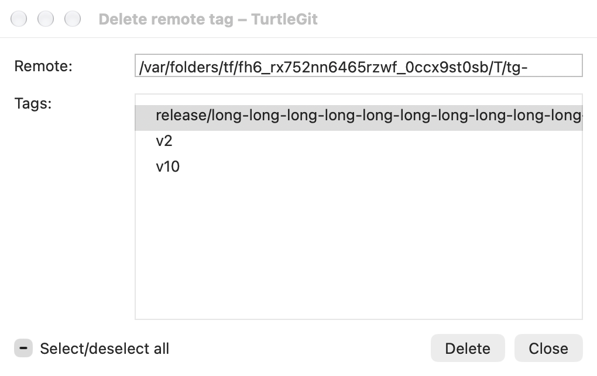
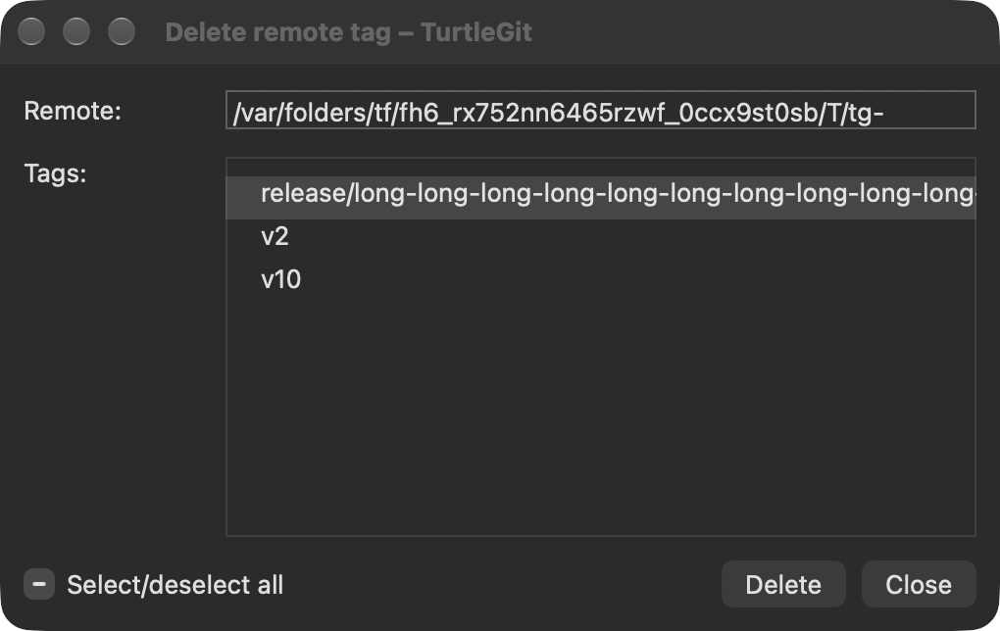

# Delete remote tag parity

Reference: pinned upstream `DeleteRemoteTagDlg.cpp/.h`, `IDD_DELETEREMOTETAG`,
`CGit::GetRemoteRefs`, `CGit::DeleteRemoteRefs`, and BrowseRefs folder dispatch.
This is a native partial port; physical and signed acceptance remain unfinished.

The native dialog has a read-only, selectable Remote field, headerless native
multi-selection tag list, Select/deselect all mixed-state checkbox, Delete and
Close. Names omit `refs/tags/`; annotated peeled `^{}` records are excluded.
Natural ordering and `SortTagsReversed` macOS preferences mirror the source's
normal/reversed tag list choice. Foundation natural ordering is not proven equal
to Windows logical ordering for every locale/name.

No selection disables Delete. Partial selection makes the checkbox mixed; manually
cycling to mixed deselects everything, as the source does. Delete captures displayed
selected names before awaiting confirmation. Source single/count question text and
Delete/Abort buttons are retained; Abort is the default. Abort preserves selection
and the catalog. Accepted deletion sends one batch Push with `:refs/tags/<name>`
refspecs. The list refreshes after success or failure, clears selection and stays
open. Local tags, branches, HEAD, index, worktree and config remain intact.

Loading and deletion use owned native progress sheets with source Loading/Deleting
remote refs and Please wait text. Active loading/deletion/confirmation blocks
selection, F5, duplicate deletion, ordinary Close and Quit. Forced dialog/browser
or progress-sheet closure cancels owned Git process groups, releases sheets and
rejects late lists/errors/confirmation results. App Store repository-scope checks
precede backend access. Remote transport scope/authentication and signed behavior
remain unverified.

Tag folders receive Delete remote tags on each configured remote with original
Delete artwork. Remote folders and descendants resolve the configured first-prefix
remote and offer Fetch from that remote plus Delete remote tags. Remote tag closure
does not refresh the reference browser, matching the source. Fetch retains its
existing owned dialog, preset, progress and browser Refresh behavior. Manage Remotes
now opens the native settings page from remote folders; full folder parity remains
incomplete. See REMOTE-SETTINGS-PARITY.md.

Browser metadata's bare-repository read now receives the same cancellation token
as its catalog request, so forced close cannot leave that subprocess unowned.
Full metadata/transport timing coverage remains unfinished.

`test-remote-tags.py` uses private local/bare repositories, hidden shipping native
menus/list/controllers, intercepted progress-sheet presentation and confirmation.
It checks selection, tri-state, Abort/Delete/Refresh, captured remote isolation,
owned progress and close/Quit gates, late Yes and recorded live helper/leader
termination in tag loading, validation and Push. Core tests cover annotated/packed
Unicode tags, normal/reversed ordering, URL input, one batch deletion, rejected
Push, invalid batches and pre-cancellation. See `qa/remote-tags-2026-10-09.json` for
final results and explicit limits. No main app, external network, installed Finder
extension or screenshot is activated by these checks.

Native configured-key loading now precedes tag catalog and accepted batch Push,
with a fresh operation-owned coordinator for the post-deletion refresh. Validation
and confirmation precede destructive transport preparation; no extra checkbox is
added. This is a macOS extension of the remote-tag workflow: pinned source
DeleteRemoteTagDlg itself does not call Pageant. See SSH-TRANSPORT-PARITY.md for
private-agent lifetime, encrypted response, cancellation and runtime limits.

## Remote-management operation ownership — October 16, 2026

Remote tag loading/deletion now owns one lifetime through confirmation, actual
network work, error acknowledgement and the post-deletion reload. Closing the
controller cancels its token and removes its presentation, while its worker count
and access lease remain until the worker actually settles. Application Quit also
checks this count when the original window no longer exists. Late successful
lists, errors and deletion answers cannot publish or launch another operation.

Deletion failure is acknowledged before reloading, matching the pinned source's
sequence. A second reload failure gets its own acknowledgement; it cannot replace
an unanswered deletion error. Native Delete/Abort and error sheets use captured,
once-only replies. Forced owner closure settles the pending sheet, and retained
or duplicate callbacks are inert. The initial error/progress overlap from the
SwiftUI alert binding is removed. Each actual query/delete still acquires and
closes its own configured SSH transport coordinator.

The connected Select Remote Ref picker accepts its editable source value once;
retained callbacks cannot select twice or start another refresh after acceptance.
Add Remote now disables its inputs while saving, displays Saving/Cancelling,
preserves the captured name/URL, and refuses duplicate save/cancel completion.
These native changes do not alter Core remote validation or Git refspecs.

One Debug build and four native case/engine pairs passed. The retained real-Git
checks were not repeated after the new fixture's stdout decoding correction.
All four receivers were reaped and independently absent. No Core suite was rerun.
[The dated evidence](qa/remote-management-owned-2026-10-16.json) records the scope,
fixture repair, native build/layout diagnostics and remaining physical/signed
acceptance.

## Source native list and accepted form — October 17, 2026

The native tag column now measures complete names and sizes its document to allow
horizontal scrolling, including names wider than the source-sized dialog. The
read-only Remote field, headerless list and Select/deselect all/Delete/Close footer
retain the source arrangement. Selection updates avoid catalog reloads and retain
the reading position. Explicit host bounds prevent automatic window resizing.

The table keeps the names actually rendered in its catalog and captures the form
lifetime for its selection callback. Select-all and Delete capture the same owner
and lifetime. Refresh and operation transitions retire those callbacks; a retained
row index cannot select a replacement catalog. Dismantled/closed list and checkbox
controls cannot revive their event route. F5 requires the owning window and no
attached sheet or modifiers. Existing destructive confirmation, error/reload and
SSH/Git process ownership are retained. All seven static controls now have partial
native mappings. Physical interaction, exact Windows sorting/geometry, signed
transport/Finder and whole-dialog acceptance remain open.

[Grouped source batch evidence](qa/reference-source-family-2026-10-17.json) records
ten distinct case/engine passes, the layout/fixture repairs and owned process
absence. Six unaffected passes precede the final layout-only build.

## Optional remote-reference engine — October 19, 2026

The [remote-reference workflow continuation](REMOTE-REFERENCE-ENGINE-PARITY.md)
connects source-selected libgit2 reference/tag reads and remote-ref deletions,
including the branch picker's source-specific HEAD choice, captured native
preferences and post-delete refill. Ordinary Push stays on its CLI source path.
Actual grouped evidence and remaining certificate-cache, public/signed/physical
and complete source acceptance are recorded with that family.
