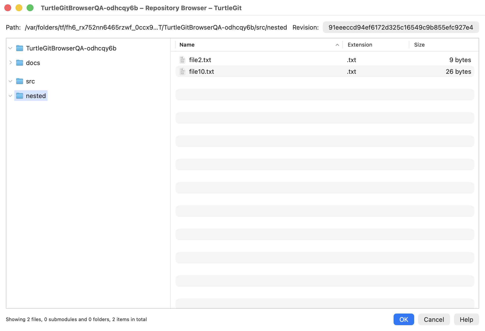
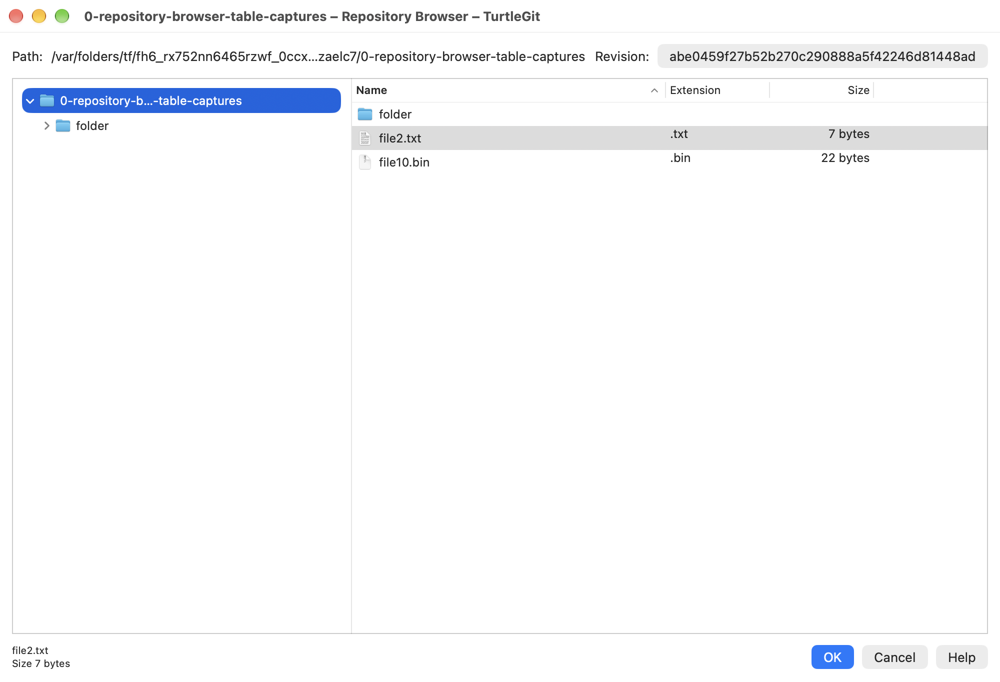
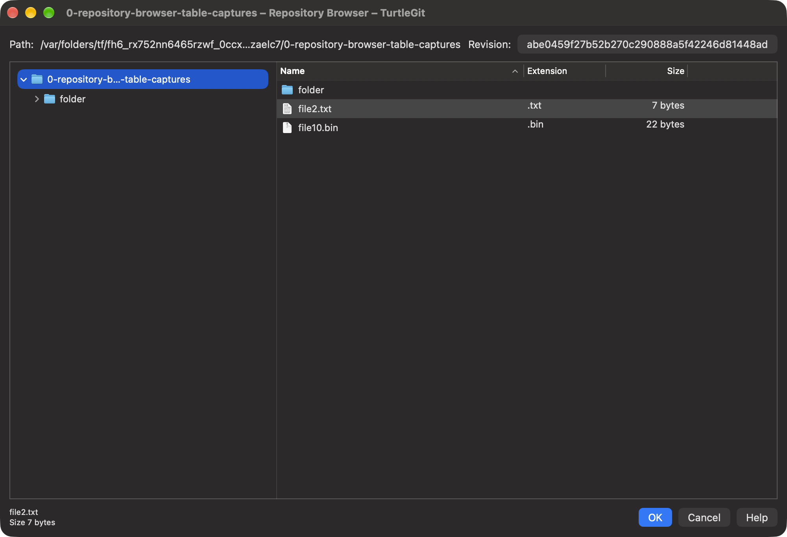

# Repository Browser parity audit

This is a partial native replacement, not complete TortoiseGit parity.
The pinned source is TortoiseGit `7338078f8ddd924b8cddee35f512f2286072136d`.
The [upstream manual](https://tortoisegit.org/docs/tortoisegit/tgit-dug-repobrowser.html)
and the source/resource controls were reviewed together.

## Source and native mapping

| Source | Pinned blob | Native replacement |
| --- | --- | --- |
| RepositoryBrowser.cpp | ced08d910b48b8c261fe7d131a409d4dc44875ac | RepositoryBrowser.swift, RepositoryBrowserWindow.swift |
| RepositoryBrowser.h | 7d315c6c04315e5251f5bceb1e6725f545bb67bf | Snapshot, entry, lazy directory and window models |
| Commands/RepositoryBrowserCommand.cpp | bba0566a3673b25916b9edfcadd8a6ecb7377710 | App/Finder action and Log-selected revision routing |
| Commands/RepositoryBrowserCommand.h | 6bc4baecacb22d418706bacea7024531ab73ee44 | RepositoryAction.repositoryBrowser |
| TortoiseProcENG.rc IDD_REPOSITORY_BROWSER | See upstream-files.csv resource pin | Read-only Path, revision button, folder tree, contents list, information, OK/Cancel/Help |

Original menurepobrowse, executable, symlink and external overlay icons remain
unchanged; exact source blobs are recorded in the icon provenance manifest.
Normal macOS file-type and folder icons replace Windows shell file-type icons.
Source notices and GPL-2.0-or-later attribution are retained.

## Implemented behavior

The native window follows the source tree-left/list-right arrangement. An AppKit
split controller provides a draggable divider and autosave identifier. The list
has Name, Extension and right-aligned Size columns. The initial 1000×650 content
size was corrected after native testing exposed hidden names at the minimum size.
The revision button opens a single-selection Log sheet; changing its revision
retains the current directory if it exists. Return in the contents table opens
one file or enters one folder; F5 refreshes without overriding an attached sheet.

Directory contents load lazily using NUL-delimited `ls-tree -l`, with exact blob
bytes fetched by object ID. A snapshot pins the peeled revision and root tree so
moving HEAD cannot change an already displayed directory. Annotated tags, bare
repositories, tree object IDs and unborn HEAD are handled. Executable, symlink
and submodule modes remain distinct. Binary files, Unicode, tabs, newlines,
colon-containing directories and pathspec-like filenames are tested. Size and
object hashes come from the tree, not working files.

Folders stay first in both sort directions. Numeric/case-insensitive names use
native comparison. The upstream extension-sort name tie compares the right name
with itself; its subsequent size/name tie order is retained explicitly. macOS
locale comparison and byte-size formatting can differ from Windows.

File menus use the original command icons: Open, Open With, alternative editor,
working-tree comparison, Show log, Blame, Save revision to, Revert to this revision, Mark for comparison,
Compare with marked file, copy names and copy hashes. Directory menus provide
navigation, Log and copying. A marked historical file retains its path and peeled
revision when the browser changes revision; comparison uses the existing native
two-pane editor. An existing scoped working-file mark can also be imported.
The upstream source copies basenames despite the manual describing full paths;
native copying preserves basenames and source CRLF records: names have a trailing
CRLF, while hashes have separators without a trailing CRLF.

Opening a submodule from a working repository resolves its initialized checkout
and browses the recorded child revision, or offers the existing Update window
when unavailable. Bare/submodule Open With produces the source-style plain text
`Subproject commit <hash>` preview. Historical previews are read-only temporary
files retained by the app; Save writes the exact selected blob bytes. Sandbox
access checks and leases protect reads and historical comparison handoffs.

## Historical drag representations

`RecursivelyAdd`/`BeginDrag` and the historical file-content/descriptors branch of
GitDataObject.cpp were audited. The pinned data-object blobs are
`3ba63178f14e6f9102f87a9a7d97080c8162282c` (cpp) and
`2d75b20c4a079a6eb3feaaea3101ef6fd661ab87` (header). Other consumers and Windows
clipboard formats remain partial, not replaced by this one browser integration.

The native contents table now provides an item provider for each draggable row;
folder-tree labels also provide pinned directory exports. The implementation uses
Apple's [table-row item providers](https://developer.apple.com/documentation/swiftui/tablerowcontent/itemprovider%28_%3A%29)
and [file representations](https://developer.apple.com/documentation/foundation/nsitemprovider/registerfilerepresentation%28for%3Avisibility%3Aopeninplace%3Aloadhandler%3A%29)
with original suggested names and file/folder content types. Generation is deferred
until a receiver requests a representation. This implements native drag data;
it does not establish Finder drag acceptance yet.

The Core exporter reads only the snapshot's pinned blobs into a private temporary
container. A selected folder retains its name and recursive relative paths, while
the displayed directory can be exported for a tree drag. Gitlinks are skipped,
matching the source's IsDirectory descriptor exclusion. Symlink blobs become
regular files containing exact target text; no target is followed. Binary bytes
and unusual names remain unchanged. Empty export selections fail instead of
promising nonexistent files. Exported executable files retain executable bits as
a macOS adaptation to the source's ordinary Windows file attributes.

Load callbacks retain the repository permission on the main actor, revalidate
Store scope and hold exports until app cleanup. The application removes its own
export containers on normal Quit, and active representation loads block Quit.
Progress cancellation is checked at file boundaries; an in-flight Git read is
not terminated. Failed/cancelled generation removes the private partial container.
Window closure can precede completion because the provider retains its own lease
and pinned snapshot. Signed transfers and cancellation/quit timing need acceptance.

Two additional Core integration tests bring RepositoryBrowserTests to nine passing
cases. They verify pinned recursive binary contents after HEAD advances, Unicode/
colon/tab/newline names, plain symlink text, skipped gitlinks, current-directory
export, exact single-file names, explicit cleanup, foreign selection rejection,
pre-cancelled export and unchanged index/working contents. The production provider
was also compiled into a native receiver check: both file and folder NSItemProvider
callbacks delivered exact pinned binary bytes while preserving HEAD/index/working
contents. This is a real Foundation transport check, not a Finder test.
Run `scripts/verify-browser-item-provider.sh`; it creates and cleans up its own
fixture without launching a GUI app. The same receiver check is wired into the
macOS workflow after Core tests; its remote execution is pending publication.
Final Debug/Store builds and bundle audits passed. See [export evidence](qa/repository-browser-export-2026-10-05.json).

## Parent and child submodule history

A single gitlink now has both source commands: Show log opens the selected path
in the superproject at the displayed parent revision; Show submodule log opens
the child repository at the displayed gitlink hash. The child checkout's current
HEAD does not override this hash. The new Core resolution API validates that the
entry belongs to the displayed snapshot, is a gitlink and resolves to the same
recorded hash. Existing child-checkout containment checks remain in effect.

The native handoff shares this resolution with Open. An unavailable Open retains
the Update/Cancel sheet; unavailable child Log shows an explanatory error and
performs no update/fetch. The source child-Log command also does not dispatch
Submodule Update automatically. Bare repositories have no child working checkout;
the native command reports selection unavailability. Reads retain the parent scope
lease, validate Store access and suppress the handoff if the parent browser closes.
The child viewer uses the inherited Git runtime and lease.

Two additional integration tests exercise pinned history after the parent gitlink
and child HEAD move, exact parent/child index and dirty-file preservation, ordinary
entry rejection, missing/unrelated child repositories and bare rejection. Combined
RepositoryBrowserTests/SubmoduleComparisonTests pass 17 cases, zero failures.
Final Debug and Store builds and complete bundle audits passed. These are targeted
checks; no new full-suite run is claimed.

Native acceptance opened Show submodule log at the recorded old gitlink and
confirmed that only the pinned child commit appeared, excluding the newer child
HEAD. Parent and child HEADs, raw index hashes and uncommitted child bytes remained
unchanged. UI observation timed out during the subsequent close; normal Cmd-Q
on the same live process succeeded, and the final process scan was empty. Further
parent-Log, unavailable-Log and Open/update native acceptance remains pending.
No new screenshot was captured. See [submodule evidence](qa/repository-browser-submodule-2026-10-05.json).

## Revert to the displayed revision

For one or multiple selected ordinary files in a working repository, Revert uses
`git checkout --end-of-options <pinned object> -- <literal path>` for each file.
It updates both the index and working file without moving HEAD. Folders, gitlinks,
bare repositories and entries from a different listing are rejected. Destination
validation rejects paths through an ancestor symlink outside the repository or
inside Git administration directories. Argument arrays and literal pathspecs
preserve unusual names. Unlike the status-dialog Revert, this historical command
does not move replaced contents to Trash; that matches RepositoryBrowser.cpp.

Files are processed in displayed selection order. A native per-file error sheet
provides Continue/Cancel, and the final result reports successes, failures and
unattempted files. The source increments its reported count even after a failed
checkout when OK is chosen; the native adaptation reports only successful Git
operations. It restores the displayed pinned object rather than re-resolving a
branch/tag that may have moved while the browser was open. These adaptations
preserve the selected historical content and avoid an inaccurate success message.

Closing/Quitting is blocked during the mutation; quit-confirmation disables
browser actions. Leases remain held through the sequence and each file revalidates
Store scope. Completion refreshes existing Working Tree/Commit/workspace views.
Earlier successful files remain restored if a later file fails or is cancelled,
matching the source's per-file sequence rather than an atomic batch.

## Verification on 2026-10-05

The original four RepositoryBrowserTests exercise tree modes and exact bytes, pinned nested
reads after HEAD moves, annotated tags/bare/tree/unborn handling, sorting and
malformed records. FinderRequestTests adds action/selection URL round-trip and
bare-repository eligibility. The focused browser/Finder/submodule run passed
19 tests; the complete Core suite passed 415 tests, zero failures. These are Core
checks, not a claim that all native dialog behavior is covered. Final window
sizing and comparison wiring were built and checked separately in the native app.

Debug and App Store configuration builds succeeded. Both bundle audits passed:
71 original icon resources, Finder extension and licenses, universal helpers;
the Store bundle additionally includes the audited universal Git 2.55.0 runtime.
This is unsigned build evidence, not App Store signing or acceptance.

Native acceptance used an owned disposable repository with two revisions and a
separate uncommitted file. Return entered src and nested directories; natural
ordering showed file2 before file10. File context commands appeared. A file was
marked at the latest revision, the Log picker selected the older revision by
keyboard, and Compare with marked file opened exact Latest/First historical
contents in the read-only two-pane editor. The mark survived revision changes.
HEAD, raw index SHA-256 and working-file SHA-256 remained unchanged afterward.
The initial pane-width problem was corrected and all columns became visible.
Executable/symlink overlays were inspected in the root view. A real native light
screenshot was saved and inspected; dark-mode acceptance remains pending.
Three additional Revert integration tests now bring RepositoryBrowserTests to
seven passing cases. They verify pinned annotated-tag restoration after the tag
moves, binary/literal names, executable and symlink modes, exact index entries,
unrelated staged preservation, folder/gitlink/foreign/bare rejection, an escaping
ancestor symlink and index-lock failure/recovery. The focused seven-test run
passed with zero failures; the earlier 415-test full suite predates this mutation.
Final Debug/Store builds and audits passed after the new command was added.

Native Revert acceptance used a separate disposable repository with different
staged/working contents. A deliberate index lock produced the expected error;
Cancel yielded zero successes with raw index and both working files unchanged.
After removing only the owned test lock, Revert reported one success and restored
exact HEAD bytes into both index and working file. HEAD, the unselected working
file and unrelated staged file remained unchanged. Continue was activated through
the default error-sheet action, yielding an accurate zero-success result. Native
multi-file error sequencing remains unverified because selected-row context-menu
automation returned ambiguous-element errors; this is not counted as a pass.
The final result screenshot attempt failed with a macOS recording-stream error;
no new Revert screenshot is claimed. The earlier light browser screenshot is kept.
See [Revert evidence](qa/repository-browser-revert-2026-10-05.json).

Every QA app was closed using normal Quit, with a final empty process scan.
See [structured evidence](qa/repository-browser-2026-10-05.json).

## Remaining parity work

- Physical multi-file Revert pointer/menu acceptance; the later lifecycle batch
  adds grouped native real Continue/Cancel and duplicate-operation checks.
- Actual Finder and other-app drops, multi-selected row drags, tree/root drag
  acceptance and file-object clipboard interoperability. Native historical item
  representations and file/folder receivers are implemented and checked.
- Broader native parent/child Log and initialized/missing child Open/update acceptance.
  Separate child Log and its pinned read-only routing are now implemented.
- Historical tree-object comparisons are implemented in the October 15 tree
  handoff batch below. Tree objects have no commit history; Log/Blame explain
  that a commit or tag is needed instead of dispatching a failing history read.
- Complete Open With, alternative editor, Save, Blame and working comparison
  acceptance from this window, plus imported Finder comparison marks.
- Complete physical column/divider/frame acceptance, full keyboard selection,
  accessibility and large repositories. False disclosure arrows for loaded leaf
  folders and refresh ancestry are addressed by the October 13 lifecycle batch.
- Native dark appearance, signed Finder invocation and Store security scopes.
- Full signed/physical cancellation acceptance; the October 13 lifecycle batch
  adds Git token propagation, process reaping and closed-window request ownership.
- Invalid UTF-8 path bytes and nonstandard tree modes need a defined native policy.

The source inventory keeps this dialog and command files partial. The complete
application, all source commands and App Store distribution remain unfinished.

## Pinned restore compatibility and CI receiver check

Browser file Revert now passes the pinned hexadecimal object directly to Git
checkout, followed by -- and the literal path. Git 2.37 rejects checkout's newer
--end-of-options syntax; the restore regression reproduced that failure before
the change. Object validation rejects option-like strings, symbolic revisions and
short hashes before mutation. Both 40-character SHA-1 and 64-character SHA-256
object IDs remain supported. The restore fixture covers moved-tag pinning, binary
bytes, symlink/executable modes, unrelated staged content, unchanged HEAD, index
locks and unsafe/foreign selections, plus a real SHA-256 repository.

The item-provider verification script also had a malformed compiler output
argument joined to a duplicated Python receiver command. It now builds the
receiver inside its owned temporary directory and runs it once with a bounded
60-second timeout. This is the script invoked by the macOS GitHub Actions workflow;
local execution does not establish hosted CI success. No GUI app/Finder instance
is launched by this receiver.

## Browser navigation and operation ownership — October 13, 2026

This batch follows RepositoryBrowser.cpp Refresh, ReadTree, the Open/Save/Revert
menu branches, per-file Continue/Cancel and Enter/F5/Select All routes. Upstream
Refresh returns to root. The native browser deliberately retains its current
folder, loaded expanded ancestors and still-present selected paths, extending its
existing folder-retention behavior. Changed revisions rebuild those ancestors
from the new pinned tree; removed folders fall back to the nearest surviving
ancestor. Known-loaded folders without child directories no longer show a false
disclosure arrow. Command-A and Command-C work in the contents table.

Root resolution, tree reads, blob Open/Save, recursive exports, per-file restore,
and submodule metadata now pass cancellation into every Git process. Refresh
cancels superseded reads; owner retirement cancels all owned requests. Request
counts retain Quit protection until the process actually settles, including after
a closed browser leaves the visible-window registry. Superseded and closed
results cannot display files, errors, completion summaries or refresh callbacks.
The data APIs retain default arguments for existing callers.

Submodule Open/Log reads are now owned by the browser model, with captured pinned
entries. Missing-child Update offers, Open With, Save and per-file failure/result
sheets are owned by the controller and ended on forced closure. Modal replies
check the owner's lifetime and revision generation before writing or handing off.
Completed files in a partially cancelled restore remain restored; cancellation
does not claim rollback. Ordinary close remains blocked during mutations/sheets.
Historical item providers can outlive the browser by design; receiver cancellation
now reaches directory traversal and each blob read as well as the export loop.

Multi-file Revert retains source ordering, one Continue/Cancel question per failed
file, duplicate-operation exclusion and a summary of restored/failed/unattempted
files. Native verification exercises real index-lock failures and subsequent
success, rather than replacing Git with a successful stub. Validation is recorded
in `qa/repository-browser-lifecycle-2026-10-13.json` after execution.

Column-choice persistence, multi-row/tree/root drag interoperability, invalid path
byte policy, tree-object Log/Blame handoffs, full visual/accessibility acceptance,
physical Finder and signed sandbox/App Store acceptance remain open. This batch
does not establish complete Repository Browser or application parity.

The Debug build and 22 focused Core tests passed. The grouped native browser
receiver passed with system and packaged Git, including four live blocked-process
phases on each engine and actual owned file/failure-sheet retirement. Both
receivers were reaped and independently checked absent. Earlier compile attempts
failed on an internal cancellation API and a shadowed error assignment (the
latter triggered a Swift compiler assertion); both were corrected before the
passing run. Physical pointer/menu acceptance and signed acceptance remain open.

The unsigned App Store build and its `--require-git` bundle audit passed. The
website build passed. This does not establish signed sandbox execution, App Store
review or a complete hosted CI run.

## Native contents table and historical multi-row drag — October 13, 2026

RepositoryBrowser.cpp supplies three columns through ColumnManager (version 6):
Name, Extension and Size. The native contents list now uses NSTableView with
multiple selection, a source-ordered file menu, original context artwork, header
sorting, right-aligned sizes and executable/symlink/gitlink badges. Right-clicking
an unselected row targets that row; clicking an already-selected row retains the
multi-selection. Double-click and the existing window Enter/Command-A/Command-C
routes operate on the same selection model.

The header saves visibility, physical order and native widths independently under
RepositoryBrowser.Columns. Name remains visible; missing/incompatible settings
restore defaults, unknown columns and invalid widths are rejected, duplicates
are normalized, and widths are bounded. Divider double-click fits content; Shift
includes the heading. Reset asks No/Yes through the owned controller sheet;
parallel/reset/refresh changes are blocked, and retired answers cannot rewrite
preferences. Native defaults are sized for macOS controls rather than Windows
DPI pixels. Full pixel/keyboard/accessibility acceptance remains separate.

Each selected ordinary row supplies a separate NSFilePromiseProvider. Folder
rows deliver their hierarchy; file rows preserve pinned bytes and modes. Providers
retain their immutable snapshot, item and security-scope lease independently of
the browser. Native promises write only to the supplied receiver URL, stage an
owned temporary sibling, refuse an existing destination and remove staging on
failure. Exported temporary trees are discarded after delivery; active deliveries
retain the application's existing Quit protection. Tree and root rows now use the same native file promises through an AppKit
folder button, including pinned directory data and delivery after owner close.
Legacy item-provider entry points remain available. Gitlink rows are not yet promised as standalone items.

The SDK delegate contract and pinned upstream multi-selection/recursive drag
implementation were reviewed. Private delegate deliveries establish historical
bytes, ownership and collision preservation, not actual Finder/other-app drag
interoperability or signed sandbox destination access. Validation and inspected
captures are recorded in `qa/repository-browser-table-2026-10-13.json`.

Twelve focused Core tests and four grouped native table/lifetime checks passed
with system and packaged Git. Both actual 2000-by-1364 captures were individually
reviewed against the pinned source screenshot: tree/list split, Path/Revision,
three-column header, size alignment, selection and footer/buttons in both themes.
Native menu conditions, original command artwork, persistence/reset and pinned
promise deliveries were checked separately. Physical drag/session and full
menu/keyboard/accessibility acceptance remain open. All owned receivers were
reaped and independently verified absent.

Debug and unsigned App Store builds passed, as did the website build. The prior
bundle/runtime audit was not repeated for this table/persistence/promise batch.
Signed destination grants and App Store acceptance remain unverified.

## Tree/list action and promise batch — October 13, 2026

Folder tree menus expose Open, Show log, Copy to clipboard and Copy hash, with
the original command artwork. Folder hashes come from pinned tree entries; the
root hash is the root tree, rather than the commit. Log/Blame handoffs retain the
upstream revision object unchanged; full tree-object history behavior remains open.

Native list menu items retain their displayed entries and comparison mark. A later
selection change cannot redirect an existing menu action. Browser refresh, navigation
(including leaving and returning), closure and busy/modal state refuse retired actions.
Direct keyboard and double-click operations continue to use the current selection.
Empty or invalid clipboard selections preserve existing pasteboard contents.

Folder/root drag gestures use an AppKit promised-file source and share deferred
pinned export, scope retention, collision refusal and cleanup with the contents list.
Delegate delivery acceptance is recorded in the batch QA record; physical drag,
Finder interoperability, signed scope delivery and complete keyboard/accessibility
acceptance remain open.

The connected action batch passed one Debug build and four grouped native cases
(table/actions and lifecycle, each with system and bundled Git). The checks cover
captured menu targets after selection changes, navigation and busy refusal, exact
clipboard records, folder/root tree hashes, and pinned root/folder delivery after
branch movement and owner close. All four owned receivers were reaped and checked
absent. Core was unchanged and was not rerun. The website build passed. See
[action-batch evidence](qa/repository-browser-actions-2026-10-13.json).

The connected historical transfer batch separates folder-button UI from the
standalone transport compiled by CI. Item-provider exports now follow provider
lifetime instead of accumulating until Quit; queued/running delivery accounting,
Progress cancellation and coordinated exclusive receiver writes are shared across
file/folder/root handoffs. See [historical transfer parity](HISTORICAL-TRANSFER-PARITY.md)
for exact ownership, the observed CI step, local results and remaining physical/
signed acceptance.

## Native folder tree — October 15, 2026

The left pane now uses NSOutlineView, replacing the nested disclosure/button
implementation. This restores standard native tree selection, arrow-key expansion
and navigation, type-to-select, Return/double-click opening and Command-C folder
name copying. The browser window's file-table shortcuts exclude the outline, so
folder Return and Copy cannot accidentally operate on the contents selection.

Folder nodes keep stable path identities while directory listings load lazily.
Expanding a folder requests its pinned listing; loaded leaves lose their disclosure
arrow. Selection updates the right pane, and list navigation/refresh restores the
matching tree row and expanded folders. The outline uses a native folder icon,
selection appearance, scrolling, path tooltips and an accessible pane label.

Right-click targets the folder row without navigating the contents pane. Its
Open, Show log, Copy to clipboard and Copy hash actions use the original command
artwork and captured pinned menu targets. Navigation, refresh and retired owners
reject old actions. Root/folder rows expose NSFilePromiseProvider through the
outline's native drag delegate, retaining the existing pinned historical export,
receiver collision refusal and permission lifetime. Actual Finder drag acceptance
and signed destination access remain separate.

The source comparison is RepositoryBrowser.cpp's RepoTree registration,
OnContextMenu_RepoTree/ShowContextMenu, ReadTree/FillListCtrlForTreeNode, refresh
and historical drag behavior at the pinned commit. AppKit supplies macOS tree
keyboard/selection behavior in place of Windows common controls. Full physical
keyboard/VoiceOver and visual parity acceptance are not inferred from delegate tests.

The Debug build and four grouped browser table/lifecycle checks passed on system
and bundled Git. After a sheet-state correction, the affected table/capture cases
passed again on bundled Git. The fixture needed an explicit synchronous sheet
completion signature; production code did not change for that fixture correction.
Core behavior is unchanged and was not rerun. All six owned receivers were reaped.
See qa/repository-browser-folder-tree-2026-10-15.json for exact scope and limits.

Both captures were inspected against the pinned upstream RepoBrowser.png. They
show the native folder tree alongside the source-style path/revision, contents
columns and footer layout. These private fixtures contain representative folders
and files, not a claim of full physical or accessibility acceptance.

## Standalone tree comparison handoffs — October 15, 2026

Repository Browser accepts commits, annotated tags and standalone trees. The
comparison family now accepts the same snapshot objects: selected historical
files against working bytes, marked historical paths against other historical
or working paths, imported external working files, full revision comparisons,
selected raw patch export, and historical Save As reads. Annotated tags peel to
their underlying commit or tree. Blob objects and invalid revisions are rejected.
A standalone tree stays pinned to its object ID even when references move; the
code never substitutes a commit containing similar content.

Changed Files displays a tree's short hash and **Tree**, with a tooltip explaining
that it has no commit metadata. It leaves author/date fields empty and does not
claim a newer commit date. Common-ancestor mode keeps a direct comparison when
one side is a tree. Forward/reverse diffs and working bytes use the existing Git
diff pipeline, literal paths, raw patch data and cancellation tokens.

The pinned source's `eCmd_CompareWC`, `eCmd_ViewLog` and `eCmd_Blame` handlers pass
the browser revision to their downstream helpers. Git trees themselves have no
parent commits or attribution. Browser Log/Blame and Changed Files history actions
therefore explain that the user must choose a commit or tag; they do not launch
an invalid tree-as-commit request or invent history. A tag pointing to a tree has
the same limitation. Commit-backed history routes retain their existing behavior.

Grouped Core/native evidence is recorded in
[tree comparison QA](qa/browser-tree-comparisons-2026-10-15.json). The native
receiver exercises browser working/marked callbacks, downstream blob reads,
Changed Files metadata/history guards and owned window cleanup. Assigning light
and dark appearances is a host check, not visual screenshot certification.
Signed Finder invocation, physical drag/drop, complete accessibility and full
source-dialog visual parity remain separate acceptance work.

## Exact historical Unicode path identities — October 16, 2026

Git can store precomposed and decomposed names as distinct UTF-8 paths. Swift
String equality treats canonical equivalents as equal, so it cannot key browser
selection, directory caches, expansion state or outline nodes. The browser now
uses byte-keyed path maps/sets and opaque byte-derived entry IDs. Entry equality,
folder matching and captured directory checks use the same exact identity. Names
and copied path text keep the original Unicode spelling. Root/folder refresh
retains both aliases and their separate pinned listings.

Historical blob reads and single-item exports keep the selected object ID and
bytes. Raw tree path resolution and checkout disable Git's macOS argument
precomposition for that command only. Recursive export creates each directory
exclusively: if the destination volume aliases two directory names, export fails
and removes its private partial container instead of merging their children.
Existing exclusive file writes continue to refuse file collisions.

Working-folder comparisons, submodule resolution and Revert check the Git index's
raw path prefixes. A different tracked path with the same canonical Unicode
spelling refuses the action before reading a potentially different working item
or changing the index/work tree. Exact ordinary paths still work. This policy
covers tracked aliases; complete untracked/ignored filesystem collision handling,
case-only aliases and raw invalid-UTF8 paths remain separate work. Working
comparison preflight is cancellable, owns its scope/request and refuses callbacks
after navigation or retirement.

This is a macOS path-identity correction rather than a new source menu. The pinned
RepositoryBrowser.cpp/GitDataObject workflows pass exact tree entries to historical
actions; native Unicode equivalence must not redirect those entries. Complete
Finder/file-object clipboard, physical accessibility, very large trees, signed
scope and App Store acceptance remain unverified.

[Path identity evidence](qa/repository-browser-paths-2026-10-16.json) records the
15 passing Core tests, native cases on both Git engines, initial fixture API/argv
failures and focused repairs, actual receiver cleanup and hosted CI gate progress.
