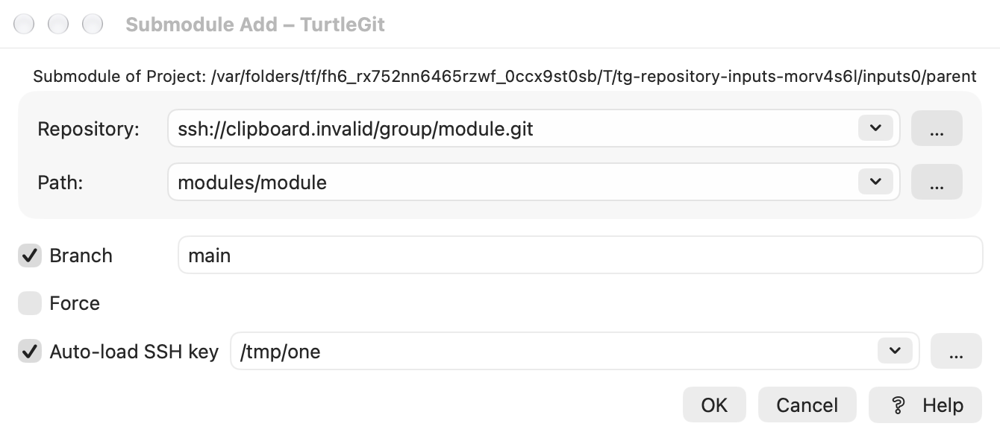
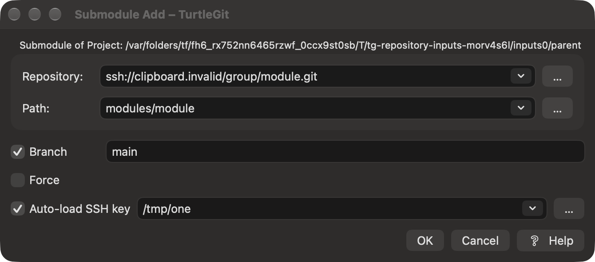

# Clone and Submodule Add input defaults

Source pin: `7338078f8ddd924b8cddee35f512f2286072136d`,
`CloneDlg/SubmoduleAddDlg::OnInitDialog`, `AppUtils::GetClipboardLink`,
`SubmoduleAddDlg::OnRepoEndEdit/OnPathBrowse`, `PathUtils::GetFileNameFromPath`
and shared `HistoryCombo`.

The application captures clipboard text when opening a new Clone or Submodule
Add dialog. The common link probe recognizes its existing supported URL/path
forms or the literal `git clone ` prefix, trims the result and strips one matching
quote pair longer than two units. Invalid clipboard text falls back to the first
saved history entry. Explicit Clone source arguments take precedence. Prefill
only supplies text; it grants no folder/key access and executes no command.
Models accept explicit clipboard text, so private receivers do not read the system
clipboard. Reusing an existing Add window retains its current draft.

Source parser quirks remain: case-sensitive prefix/scheme recognition, first-line
and NUL boundaries and its literal-space truncation are not replaced with a shell
parser. A copied command containing destination/flags can therefore require user
editing. POSIX absolute paths and file URLs retain the existing macOS additions.

Submodule Add now uses bounded, exact-spelling native history controls for source,
path and the shared Clone key list. Shift-Delete persists only the selected item,
selects the nearest survivor and cannot change a retired/submitted/busy draft.
Accepted submissions save the captured choices using the shared 25-load/26-save
rules; key grants remain independent of remembered text. Cancel does not add the
current draft, while explicit prior history deletion remains saved.

Repository end-edit and Path Browse share the source filename rule: slash and
backslash delimit components, only lowercase terminal `.git` is removed, and
spaces, uppercase `.GIT`, scp colons and trailing empty components are retained.
End-edit prefixes the invoking folder; Browse appends to its selected contained
folder. The existing Core path validation still refuses traversal/outside-tree
or invalid destination forms. Choosing a source folder retains its narrow lease.

Submodule Add pickers capture the initiating draft and a unique request identity.
Changed drafts, superseded callbacks and closed owners cannot publish a selected
folder/key or clear another picker's state. The active picker retains ordinary
Close/Quit guards. Forced close dismisses its owned panel and fences duplicate
replies and later attempts to reopen it. Controls inherit their supplied preference
domain through the native root, rather than global default app storage.

[Grouped evidence](qa/repository-inputs-2026-10-17.json) records sixteen passing
focused Core checks, the final Debug build and six distinct native case/engine
combinations: new input controls, retained Clone completion and SSH coordinator
workflows on system and bundled Git. Two native declaration/initialization repairs
and a missing receiver argument are recorded. Core was not repeated for native
repairs. One affected system-Git capture repeated with an enabled fixture callback;
its final light/dark images were individually reviewed and published. All eight
owned receivers, including the argument trap, were reaped and independently
absent; no private agent from this family remained.

Physical input/popup/VoiceOver/layout, real remote
SSH/git-svn, minimum macOS, signed Finder/sandbox and full application/App Store
acceptance remain open.

Actual passive compositor captures show the complete source-ordered form with its
Branch field visible and an enabled submission callback. They retain the user's
current focus; the native title and controls therefore use inactive appearance.
The source resource uses PuTTY where macOS supplies the OpenSSH key row. The
long project caption and all option/field/footer controls fit in both reviewed
frames. This is scoped visual evidence, not complete dialog certification.

