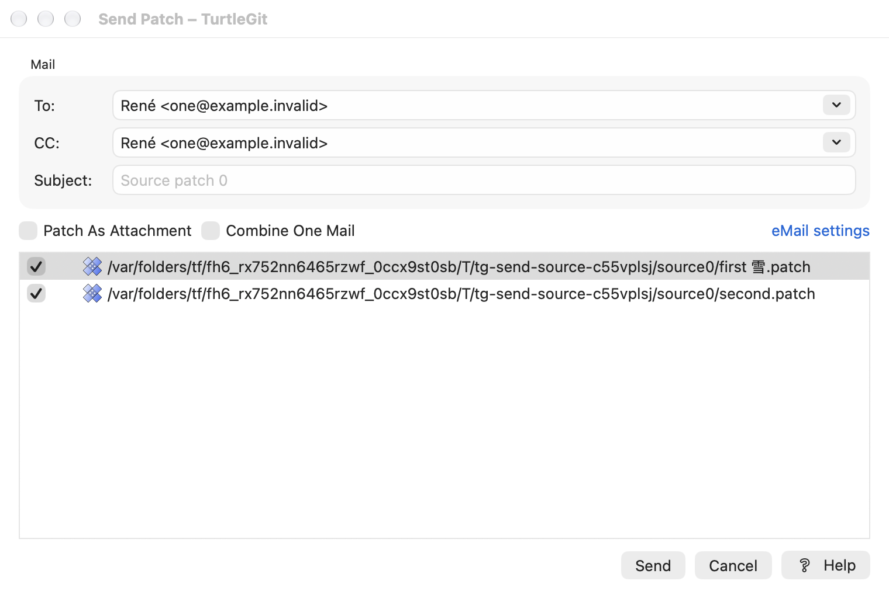
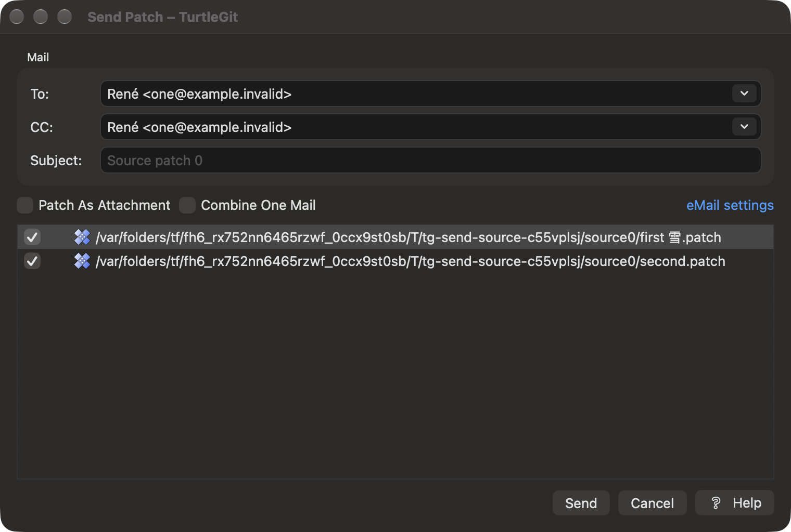
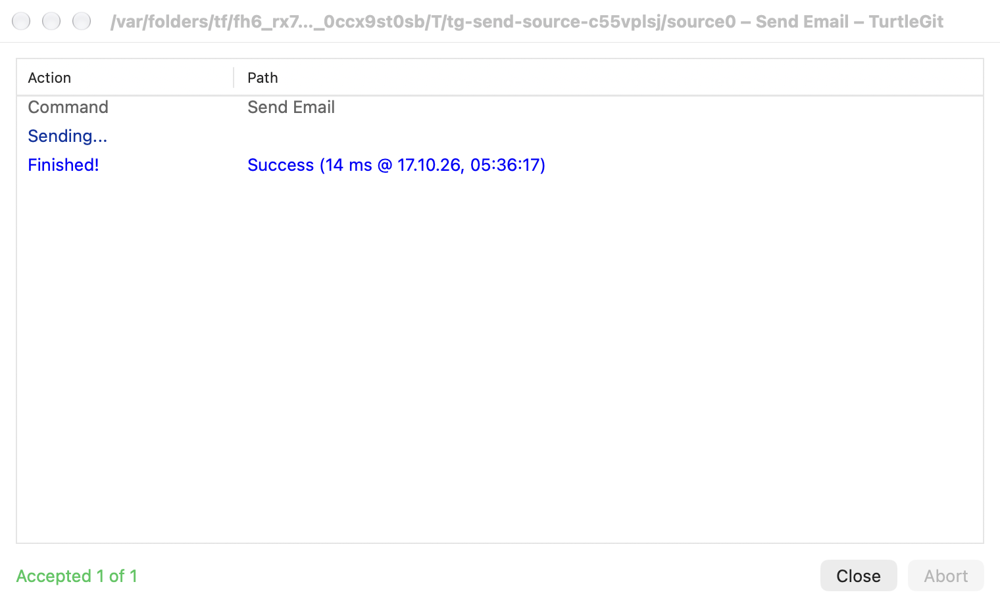
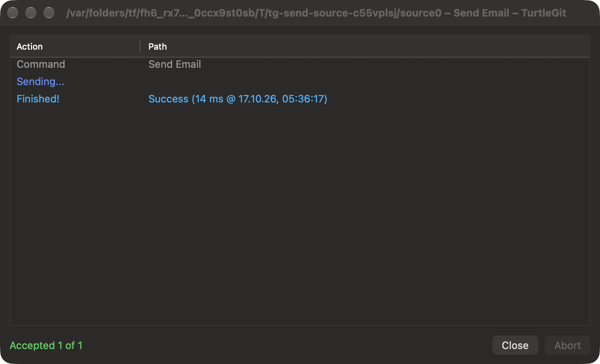

# Send Mail and patch delivery

TurtleGit implements native Send Mail options, patch selection and progress windows.
The source baseline is TortoiseGit
`7338078f8ddd924b8cddee35f512f2286072136d`. This family has substantial implemented
behavior and automated coverage; it is not certified as a complete port.

## Using Send Mail

Send Mail is available for selected files through Finder routing, generated Format
Patch output, Import Patch's selected-file menu and Request Pull output. Files can
be outside a repository. The application retains selected-file grants and uses an
owned global sender context when no repository provides Git's user identity.

The native dialog retains To/CC history and semicolon-delimited completion. Its
Mail group contains To, CC and Subject. **Patch As Attachment** and **Combine One
Mail** control message preparation. Checked files determine the ordered submission;
highlighted rows determine preview/context-menu targets independently. Original
TortoiseGit menu artwork and native checked-list controls are used.

For separate patch messages, the subject comes from the selected patch. Combined
mail uses the entered subject. Request Pull's ordinary document mode keeps its
custom subject/body rather than requiring a serialized patch header. The eMail
settings link opens the separately owned Email settings host.

View Patch opens a native viewer. Review/Apply use owned native review/import
windows and a target-repository chooser when necessary. Preparation, preview,
selection changes and close are guarded while their child operation owns the UI.
Closing Send Mail does not close independently retained Email settings or prepared
review/import windows.

## Delivery modes

- **Configured SMTP:** captured server, UInt32 port, encryption and authentication
  settings. Recipient, sender and MIME validation precede credential lookup. One
  atomic login/password pair is captured only when authentication is enabled.
- **Direct SMTP:** recipient domains and MX hosts drive delivery without configured
  credentials/server settings. Accepted recipient/domain prefixes and uncertain
  delivery are retained when later delivery fails.
- **Mail client:** Apple Mail automation prepares visible drafts with captured sender,
  display-name recipients, subject/body and separately retained attachments. The
  user sends the draft in Mail. Preparing a draft is not SMTP acceptance.

Configured/direct SMTP retries use the source three-attempt limit and two-second
wait where retry is safe. An uncertain accepted message is not automatically retried.
Cancellation interrupts transport/retry boundaries and retains prior acceptance.
A cancelled credential read takes precedence over a missing-secret result and never
reaches submission, even when it returns after cancellation.

The progress window shows source-style Command/Sending/Notice/Error/Finished rows,
original colors/icons, accepted counts, upload percentage, elapsed/date footer and
bounded output. Close while running requests Abort; optional confirmation's No
leaves work active, and Yes cancels owned work. Quit guards active operations and
credential edits. Captured delivery settings and prepared bytes are not altered by
later preference/file edits. Action-log and auto-close settings apply to completion.

## Source mapping and evidence

| Upstream | Native adaptation |
| --- | --- |
| SerialPatch.cpp/.h | MailPatch.swift: bounded reads, headers/folded subjects, original bytes |
| SendMailPatch.cpp/.h | PatchMailPreparation.swift: separate/combined, inline/attachment preparation |
| SendMail.cpp/.h | SendPatchSMTPDelivery/SendPatchMailClientDelivery: immutable capture, routing, cancellation |
| Utils/HwSMTP.cpp/.h | PatchMailMIME.swift/PatchMailSMTP.swift/TurtleGitSMTP: MIME and SDK SMTP transport |
| SendMailDlg.cpp/.h / IDD_SENDMAIL | SendPatchWindow.swift/SendPatchList.swift: native options, selection, context commands |
| SendMailCommand.cpp / AppUtils::SendPatchMail | RepositoryModel, Format/Import/Request Pull caller routes |
| Settings/SettingSMTP.cpp | Native Email settings with immediate Store/Clear and separate Apply/Cancel options |

Current sources and dated `docs/qa/*mail*`, `*send-patch*` and `*smtp*` records are the
authoritative evidence for their stated scope. The grouped LFS/mail receiver uses
private repositories/preferences, injected credentials/transports and a private
loopback SMTP server; owned windows, processes, attachment folders and helper
processes are cleaned up. It does not send public mail or touch user Keychain data.

The October 13 cancellation fixture explicitly holds credential capture until the
operation is cancelled and then releases it. Four cases cover present/missing
credentials and token/task cancellation, each asserting that the transport was not
called. This replaces a 40 ms/150 ms scheduling assumption that failed in hosted CI.
A local pass does not establish that the entire hosted workflow is green.

## Remaining acceptance

Physical keyboard/VoiceOver and complete upstream layout/menu parity are still
unverified. Real Keychain credential UI, Apple Mail draft behavior/account selection,
live SMTP/TLS/public MX interoperability, signed sandbox/TCC permissions and App
Store acceptance remain open. The Windows MAPI lifecycle is replaced by draft
preparation; complete usability equivalence still needs assessment on macOS.
Outside-repository target selection also needs signed/physical acceptance.

[Historical implementation checkpoints](history/SEND-PATCH-PARITY-CHECKPOINTS.md)
retain earlier evidence and limitations; their obsolete pending statements do not
describe the current implementation. [Finder/LFS routing](FINDER-LFS-MAIL-PARITY.md)
records the associated shell integration scope.

The October 13 Debug build and focused grouped LFS/Send Mail receiver passed. The
four held-capture cases each verified zero transport calls after cancellation.
Owned compiler, receiver and loopback server PIDs were independently checked absent.
Core/AppStore suites were not repeated for this native delivery-boundary change.
[Validation record](qa/send-mail-cancellation-2026-10-13.json) lists the actual scope
and the still-unverified full hosted CI result.

## Email Settings credential editor — October 17, 2026

The [Email Settings family](EMAIL-SETTINGS-PARITY.md) now maps all source Email
controls, conditional client availability and the owned native Password editor.
Immediate Store/Clear remain independent of Apply/Cancel. Secure-control limits,
focus/default buttons and request/Quit/retirement guards complete this connected
native workflow; real Keychain/Apple Mail and signed acceptance remain open.

## Source Send form, native input and target ownership — October 17, 2026

The native Mail group retains To, CC and Subject above Attachment/Combine/eMail
settings, the checked patch list and Send/Cancel/Help. Options and progress hosts
use explicit source-sized content bounds. Combine changes synchronously commit
editing and switch between the saved combined draft and highlighted patch subject;
retained Subject edits cannot cross a Combine transition. Custom document subjects
keep their existing editable behavior. Recipient/attachment/Send/settings and list
callbacks capture their form/catalog lifetime. Viewer/child, preparation and
retired owners reject older edits and actions.

Native address controls ignore disabled, dismantled and closed-owner delegates.
History/value updates preserve UTF-8 spelling, and accepted history removal uses
exact spelling to match `RegHistory::AddEntry`'s `wcscmp`, retaining canonically
equivalent entries. Shared To/CC completion and CC-before-To history order remain.
The native checked list retires its event route and captures row identity plus
its epoch for checkboxes and context entries. Busy/child/catalog changes cannot
revive a retained action. The supplied preferences now govern its context icons.

Preview, viewer and prepared-message loads retain their aggregate Quit ownership
until their actual workers finish, even after forced option-window closure.
Target repository choosers consume one reply and own a cancellation token through
root discovery and bare-repository checking; forced closure cancels those Git
processes and suppresses late child presentation. The scope lease and worker count
remain until that read drains. SMTP/MIME/Core delivery code is unchanged.
Physical input/completion/popup behavior, large files/catalogs, external Mail/SMTP,
signed permissions/Finder and complete source parity remain open.

Native minimum width/height constraints enforce the source floor for the Auto
Layout hosts; `contentMinSize` alone is ignored in this configuration, as documented
in the local AppKit SDK. [Grouped source evidence](qa/send-source-family-2026-10-17.json)
records all four final-build case/engine passes, the minimum-layout diagnosis,
eleven receiver and five loopback-server PIDs independently absent, and explicit
physical/signed/public-delivery limits. CI retains the existing full Send delivery
phase and adds the new source cases without repeating that phase.

## Direct command entry and original path-list admission — October 18, 2026

The `sendmail` primary command now feeds the existing `IDD_SENDMAIL` adaptation
with its original ordered list, including duplicate occurrences. Finder keeps its
selection deduplication. As in `SendMailDlg::OnInitDialog`, every original entry
is listed: missing files and directories can be unchecked instead of rejecting
the whole batch. Only checked files are read/prepared on acceptance. A directory
entry supplies its own sender-discovery location; a file or missing path uses its
parent. This corrects the older all-regular-files preparation gate.

Preparation captures its owner, preferences and grants, cancels on owner close or
retirement, and fences late replies while keeping real work accounted for. Scoped
linked/common/object metadata gets separate grants retained with the sender's
primary working-folder permission. The composer/progress retain that repository,
access and settings explicitly; no-repository inputs use an owned private global
identity context. The current workspace stays unchanged. Request Pull shares the
existing mail workflow while its new entry preserves its own draft and presets.

[Mail entry evidence](qa/mail-commands-2026-10-18.json) records the actual Core,
native command/lifecycle and private loopback delivery checks, attempts and scope.
It includes a mixed original list whose unchecked unusable entries do not block
the valid checked patch. Physical pickers/Finder/VoiceOver, actual scope issuance,
public services and current signed App Store acceptance remain open.
