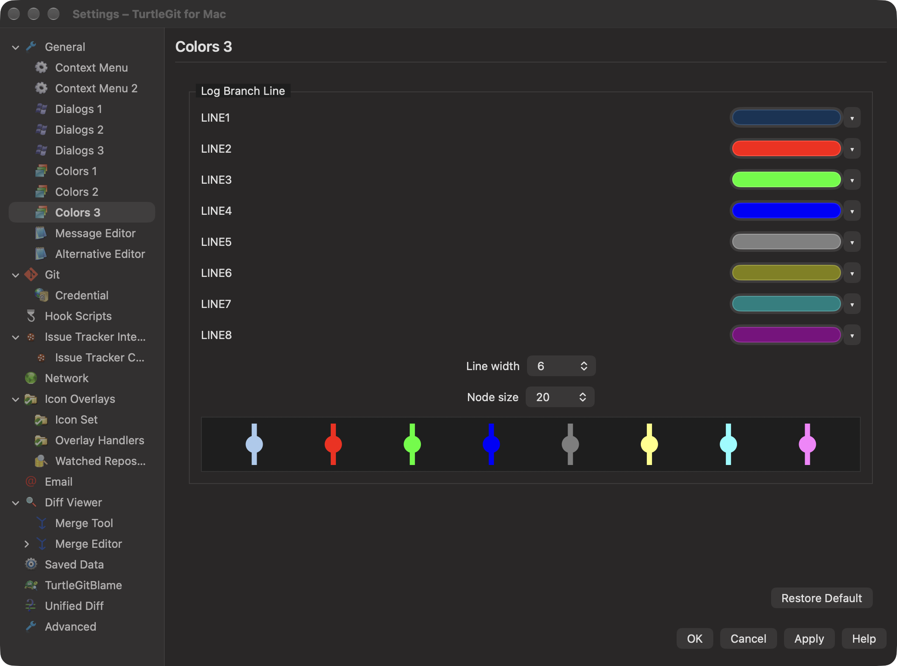
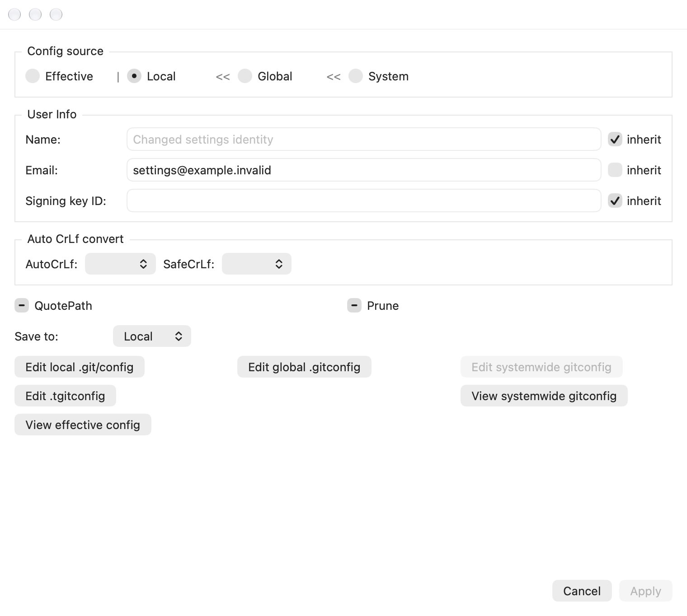

# Settings source appearance and configuration pages

Pinned reference: `7338078f8ddd924b8cddee35f512f2286072136d`,
`SettingsColors.cpp`, `SettingsColors2.cpp`, `SettingsColors3.cpp`,
`SettingGitConfig.cpp`, `SetDialogs3.cpp` and `GitSettings.h`.

This batch preserves the earlier Settings OK/Cancel owner and Remote list fixes;
see `SETTINGS-SHEET-PARITY.md` and `REMOTE-SETTINGS-PARITY.md`. It does not add a
second Remote configuration writer or replace its existing list/selection rules.

Appearance now belongs to the property sheet transaction from construction. A
command which opens directly on Colors 1 can preview Dark theme and Apply/OK it
without first visiting General. General uses that same participant when embedded;
standalone General retains its original participant. Visiting a cached page does
not replace the property's appearance registration. Cancel restores the committed
choice, and forced retirement removes the preview before deferred draft disposal.

The pinned Colors 1 theme button updates the live property sheet immediately.
The native adaptation previews Follow System/Light/Dark through bounded,
owner-identified application appearance overrides without saving preferences.
Multiple preview owners retain independent receipts; retiring one cannot remove
another's preview. Apply commits through AppAppearance, and Cancel/closure returns
to the latest committed application choice. Retired native theme controls reject
retained actions. This does not claim physical multi-window or system-theme event
acceptance beyond the recorded checks.

Git, Dialogs 3 and Colors 1/2/3 use compact thin group frames instead of rounded
cards. Their scoped radio controls share the source hierarchy order and separators;
Git omits Project as upstream does, while Dialogs 3 retains it. Actual model source
selection, inherited fields, destination warnings, scoped saves and config editors
remain in place. Dialogs 3 aligns the overlay's inheritance control with its path
and Browse control. The earlier property-sheet scroll viewport and footer remain.

Color pages now show draft status-text/reference-label samples. Colors 3 draws all
eight lane colors with the actual draft line width and node size. These previews
use the same palette/theme conversion as Log, including high contrast, and never
write temporary preference values. Restore Default and Cancel update the preview
through the existing draft. The extra examples are a native usability adaptation,
not additional upstream configuration controls.

Line width and node size use explicit native combo boxes with the source ranges
1–10 and 1–30. They retain the original owning window, reject retired controls
and update the existing draft rather than saving a temporary preference.

`qa/primary-settings-appearance-native-2026-10-21.swift` is the grouped receiver
fixture for direct-page theme preview/Apply/Cancel, cached General identity,
retired controls, real color/dimension inputs and scoped Git/project inheritance.
It uses private preferences/repositories and closes its owned windows. Optional
captures use `TURTLEGIT_PRIMARY_PARITY_CAPTURES` and remain offscreen. The
[grouped checkpoint record](qa/primary-dialog-controls-2026-10-21.json) reports
actual attempts and results.
Complete dialog parity, physical keyboard/VoiceOver, all locales, external config
races and signed/App Store behavior remain open.
