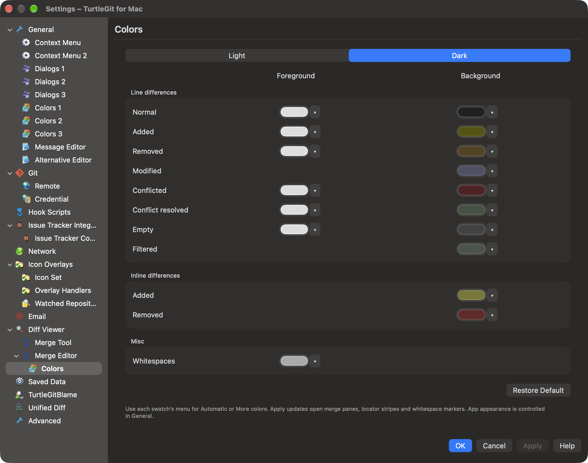
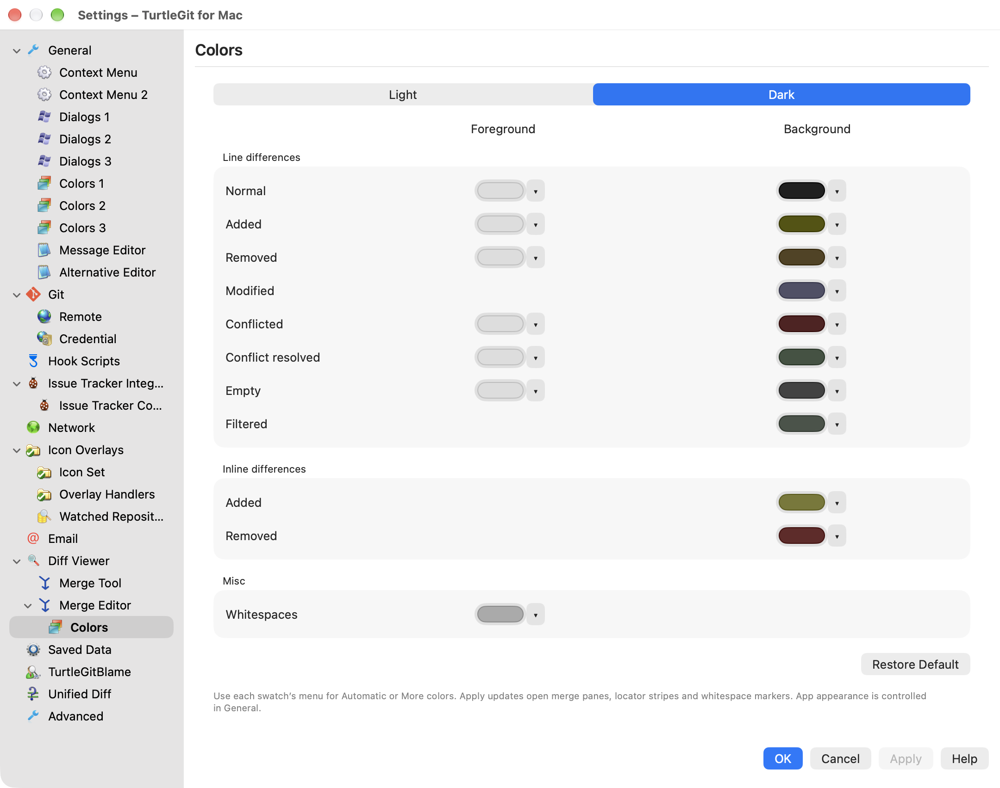
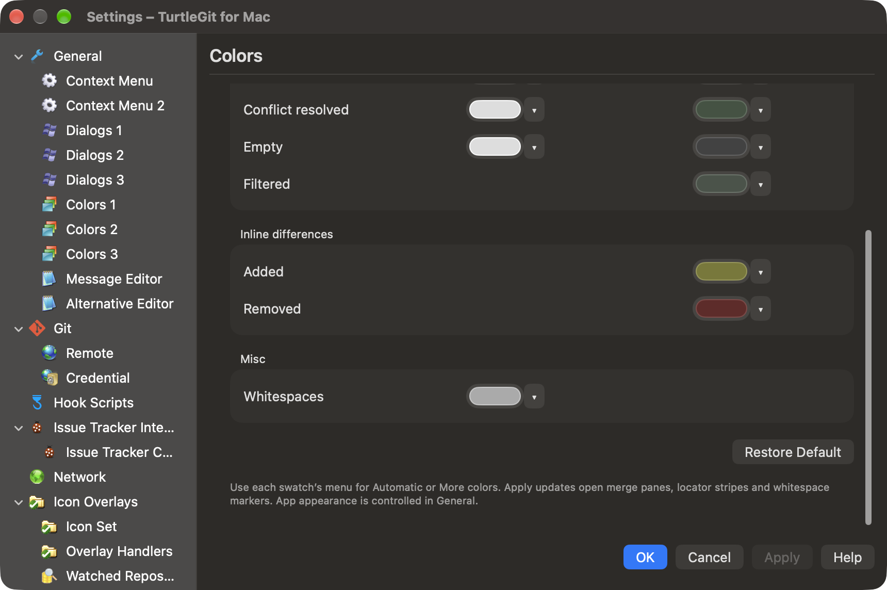
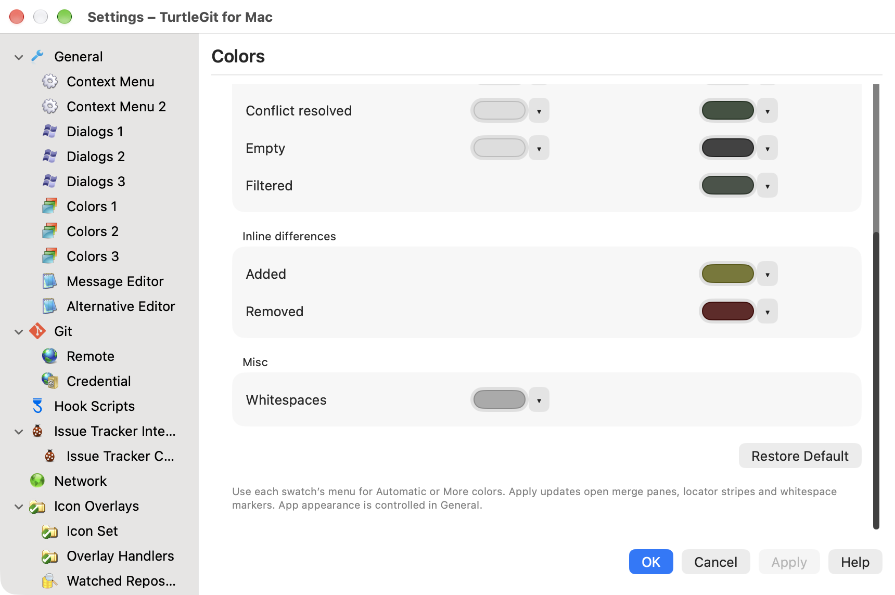
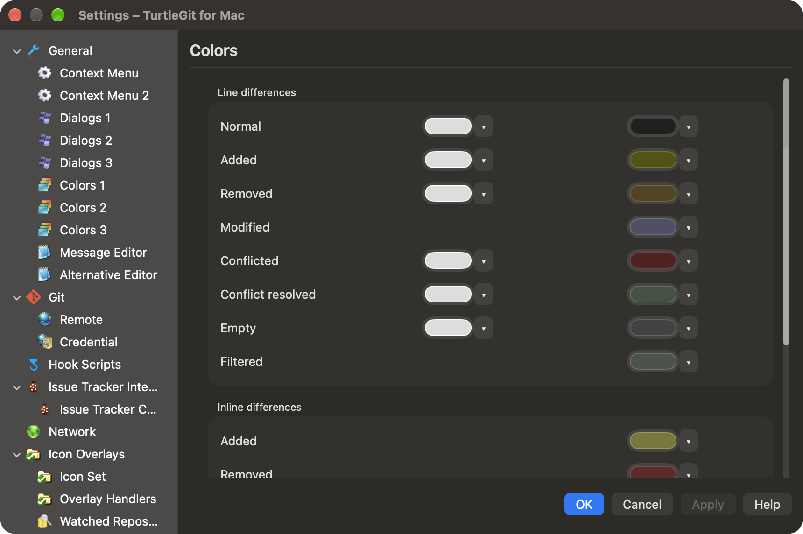
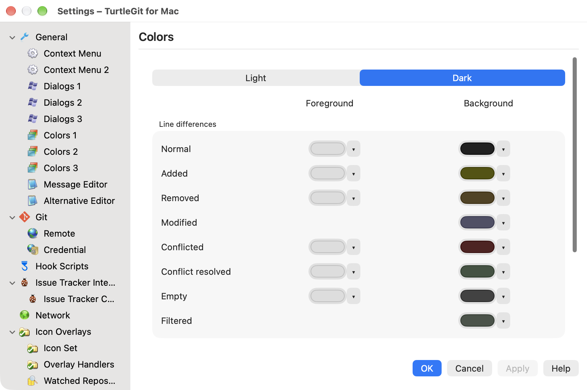

# Native Settings tree — implementation in progress

Reference: pinned `Settings.cpp::AddPropPages`,
`7338078f8ddd924b8cddee35f512f2286072136d`.

The Settings scene now uses a native AppKit outline/sidebar and content pane,
replacing the crowded global toolbar tab row. General owns Dialogs 1, Dialogs 2, Dialogs 3, Colors 1–3, Message Editor and
Alternative Editor. Git owns Remote when a repository is open. Email, Merge
Editor, Saved Data, Blame, Unified Diff and Advanced remain available. This is a
projection of implemented pages, not the complete upstream page catalogue.
Message Editor and Merge Editor retain macOS-specific grouping. Dialogs 1/2
now follow the source separation for implemented controls; Dialogs 3 has the
scoped project fields described below. Colors 1/2/3 now have separate source
pages as described below; tools and helper-app settings still need full mapping.

Rows use original upstream General, Dialogs, Git Config, Git Remote, Saved Data
and TortoiseUDiff artwork, plus the existing editor/mail/merge/blame assets. The
six added files are copied byte-for-byte from the pinned source with SHA-256
provenance in the asset manifest (128 assets). Sidebar icons are page icons and
remain independent of the context-menu icon preference.

Hosting controllers are retained per visited page. Revisiting a page uses that
controller, rather than recreating all its native/SwiftUI controls. Merge, Blame,
Alternative Editor and Unified Diff Appearance now initialize their drafts only
on first appearance. Git retains its source and draft when revisited in the same
repository; leaving still cancels owned reads and questions. Source changes or a
new repository reload the Git page. The hierarchy hint is presented once per
page instance unless its saved suppression flag is set.

Remote embeds the existing native form with Add/Save, Rename, Remove, tags,
three-state Prune, Push Default, key-file selectors and owned prompts. It captures
the repository/grant that created it; changing repositories cancels that model
and recreates the conditional page. Fetch uses the existing native workflow, and
remote changes refresh repository history/workspace state. Active remote tasks
now fence application termination even after their window disappears.

The Settings window delegates close decisions through a proxy that retains the
original SwiftUI window delegate and forwards its other events. Normal close and
page selection are guarded during Remote operations, child sheets and Git saves.
Forced closure ends outstanding sheets and invalidates owned Remote reads/work.
The proxy is removed when the host is dismantled. Sidebar navigation uses native
outline keyboard behavior, single selection, disclosure triangles and accessible
page labels; geometry and actual focus need verification.

## Shared property-sheet draft handling

The host now owns OK, Cancel and Apply for its implemented pages. Visited pages
register draft participants; Apply saves modified participants in page order and
stops at the first validation or save failure, selecting that page. Successful
earlier saves remain saved if a later page fails, matching sequential property
sheet behavior. OK closes only after successful Apply. Cancel discards pending
preference drafts; immediate actions such as clearing saved data, Remote Add/Save,
Rename/Remove and credential actions retain their existing source semantics.

Dialogs and Commit now keep preference drafts instead of saving each click.
Font, history limit, status/log colors, viewer appearance, Email, Advanced,
Alternative Editor, Merge and Blame participate in the same flow. Unified Diff
keeps both subpage drafts alive when switching Viewer/Appearance. Git and Remote
await their asynchronous save results. A native input shield prevents editing the
content while Apply is running, while owned confirmation sheets remain usable.
Application termination is guarded until active saves finish. Repository changes
remove the captured Remote participant before creating its replacement.

Standalone settings windows retain their own existing buttons and save behavior.

## Remaining section work and acceptance

- Remaining settings pages and exact source hierarchy, captions, grouping and
  helper application boundaries. Existing pages remain partial.
- Source page sizes/resizing, sidebar width, all light/dark content and original
  icon raster appearance; physical keyboard, focus and VoiceOver acceptance.
- Remote Fetch ownership, forced repository replacement/close, cached draft
  retention and signed sandbox grants across the complete Settings host.

The combined Debug build passes at this continuation, and three focused real-Git
configuration tests pass (1.193 seconds). The check compiled the accumulated
History and Settings changes; it did not exercise their complete native workflows.
No app or native receiver was launched, no full suite or App Store build was run,
and visual, focus, asynchronous sheet and sandbox acceptance remain open.
See `docs/qa/settings-history-batch-2026-10-11.json`. No complete application/dialog
certification is implied and inventory counts are unchanged.

## Dialogs source-layout continuation (uncompiled and untested)

After the recorded shared-Apply validation, the next implementation section
separates Dialogs 1 from Dialogs 2. Dialogs 1 contains log limits/font, dates,
reference presentation, avatars, revision counters and Describe. It now includes
source AsteriskLogPrefix (default true), AbbreviateRenamings (default false), and
all five Describe preferences. Describe runs against the captured selected commit
with annotated-tags/all-tags/all-refs strategy, abbreviated size, long format and
first-parent choices. Missing describe names are omitted as upstream does. Late
results are fenced by the detail selection generation/cancellation. The message
pane follows the source hash/Describe/subject/body/Notes/Tag Info order, removing
CR and applying optional section asterisks.

Abbreviated rename paths share only directory prefixes/suffixes, with source
`{old => new}` formatting. Display/clipboard path cells use the preference; actual
Git paths and operations remain unchanged.

Dialogs 2 has source Misc and Commit groups. Progress auto-close, cancellation
confirmation, execution timings, Trash, unchanged-reference filtering and tag
sorting appear with completion, history-limit, selection/missing and comment-strip
controls. Message-editor-specific formatting and completion extras remain on
Message Editor and cannot write stale source Dialogs 2 preferences when applied.
The shared `MaxHistoryItems` key now drives Commit and Merge histories, with a
fallback/migration for the earlier Commit-only key.

Remaining implementation in this section: persistent log cache; Sync startup
position behavior; operation notification sounds; FETCH_HEAD choices and .mailmap
preference coverage; Dialogs 3 scoped project preferences and source physical
layout/keyboard/visual acceptance. No disabled or inert toggles are used to stand
in for these missing behaviors. Inventory remains unchanged. This continuation
has received source/diff review only; the earlier build/tests do not cover it.

## Dialogs 2 behavior continuation (uncompiled and untested)

The remaining source Misc controls are now implemented alongside the earlier
controls. `UseMailmap` defaults true and selects canonical author/committer
formatting in history reads; Log, Sync projections and version-picker history
honor their preference store. Reference Browser skips its mailmap lookup when
disabled, and full Log clipboard details use the same choice. Raw amend-author
identity reads explicitly remain raw; a display mapping does not rewrite an
original author's identity.

`BranchesIncludeFetchHead` defaults true. Version catalogs opt in to a
`FETCH_HEAD` entry only when the file contains exactly one for-merge line naming
an existing commit. Switch, Merge, Export, Reset, revision comparison and Format
Patch catalogs use the choice. The normal reference catalog remains real refs
unless a caller explicitly opts in. Switch treats a selected FETCH_HEAD as a
detached commit (or a new branch at that commit), rather than passing its pseudo
name as an existing local branch. Operation validation remains available for a
captured FETCH_HEAD even if the display preference is later disabled.

`SortTagsReversed` additionally governs Switch/Merge/Export tag lists. Sync
startup positioning follows the source sequence of 30-point offsets, cycling
through five positions and clamping to the selected screen's visible frame.

`NoSounds` now gates native terminal error/notification sounds for shared progress
models and Sync operations. Normal application startup enables these sounds;
headless receivers remain silent unless explicitly enabled. Recording deduplicates
outcomes across completion/close and resets between retries. Mid-operation warning
alias fidelity and audible/physical acceptance still require review.

Dialogs 2 Apply validates the source 1–100 timeout/history ranges. Changes above
have received source/diff review only. The grouped build/core QA record predates
this continuation. Persistent Log cache, Dialogs 3 and full native/visual/sandbox
acceptance remain open. No dialog certification or inventory count has changed.

## Persistent cache and Dialogs 3 backend continuation

Dialogs 1 now exposes Enable Log Cache with persistent changed-file records;
see LOG-CACHE-PARITY.md for its scope and unverified acceptance. The previous
paragraphs' pending-cache statement describes the earlier checkpoint.

Dialogs 3 backend models are implemented for `tgit.projectlanguage`,
`tgit.logminsize`, `tgit.logwidthmarker`, `tgit.warnnosignedoffby` and `tgit.icon`.
Reads support Effective/Local/Project/Global/System. Effective honors the shared
system/global → .tgitconfig includes → local/worktree/command hierarchy. A missing
project file gives inherited values; bare repositories read HEAD:.tgitconfig
through an owned temporary file. Effective fields use read-only default values.

Writes allow Local/Project/Global and reject System/Effective, Local/Project
without a repository, and Project in a bare repository. Field order matches
SetDialogs3; inherited fields unset their key. NUL values are rejected before
writes. Errors stop the sequence and report that earlier fields may already have
been saved. Local/global remain normal Git configuration files; Project writes
.tgitconfig and may require an ordinary commit to share with collaborators.

The native Dialogs 3 page now implements the five source fields in the source
Commit/Dialogs groups, Effective/Local/Project/Global/System selectors, inherited
fields and Local/Project/Global save destinations. Shared Apply saves in source
field order; Cancel restores drafts. Cross-destination confirmation, hierarchical
configuration hint/suppression and sandbox folder authorization use owned sheets.
Read/chooser callbacks are fenced on page departure and closure. Repository-bound
Git/Dialogs 3 drafts are removed when the settings repository changes. Shared
Apply detects participant replacement before saving queued pages.

Commit now enforces the configured minimum message length (UTF-16 units, as in
the Windows source). Commit, Merge and Rebase use native NSTextView project
language/disable settings and the configured character margin. Windows locale
IDs map through CoreFoundation; orthography is document-specific. Commit's
project icon uses the native window document icon, with security-scoped icon
bookmarks and fallback to the repository icon. This is a macOS adaptation of the
source taskbar overlay, not Finder status badges or a Dock overlay. Other dialog
window project icons still need integration.

These additions and the preceding Dialogs/Log cache changes remain **uncompiled
and untested**. This checkpoint deliberately adds implementation before another
combined section check. Native source-layout comparison, spelling support,
keyboard/focus, scope changes, sheets, signed sandbox permissions, save failures,
light/dark rendering and full displayed acceptance remain open. Earlier passing
QA records do not cover these additions. Inventory counts remain unchanged.

## Colors 1–3 native page continuation (uncompiled and untested)

The source's three pages are now separate native Settings children with original
lookandfeel.ico artwork (new provenance entry; 129 assets). General no longer
mixes status and Log settings into tabs. Colors 1 uses source-ordered status/action
rows, Note node/Unknown ref-types and the Revision Graph current/local color
checkbox. Its Dark theme control shares a draft with General's macOS
System/Light/Dark selector, so cached pages cannot overwrite each other's theme.
Colors 2 has the four Log Graphic reference roles and separate Filter match row.
Colors 3 has eight branch lanes and source ranges/defaults for line width
(1–10 / 2) and node size (1–30 / 10). Default color actions and page-wide Restore
Default update drafts. Colors 1 restore retains the theme choice, as in source.

Shared Apply/Cancel owns persistence. Each page saves only its own color roles;
Colors 1/2 never overwrite graph dimensions or the other page's colors. The
existing Modified → PropertyChanged alias is retained. Status/Log redraw
notifications now also repaint open Revision Graph/overview surfaces without
rerunning Git. Colors continue to use the existing source-derived dark conversion.
Native ColorPicker replaces the Windows color popup and its Custom option.

This continuation has not been compiled, tested or launched. Earlier passing
color tests/QA do not certify these new pages. Shared draft retention/Apply/Cancel,
role isolation, dimensions, source layout, native color panel ownership and
light/dark/keyboard accessibility remain in the grouped section validation scope.
General's source language/update/Git executable controls and helper pages still
need their own mapping; this does not certify the General dialog. Inventory
counts remain unchanged.

## Diff tool continuation (uncompiled and untested)

Diff Viewer now hosts two-file diff program selection and Advanced associations,
plus the existing unified patch viewer. Merge Editor is a child of Diff Viewer,
as in the source hierarchy. Unified Diff has its own appearance page. Source
external Merge configuration remains pending. The former combined Unified Diff
Viewer/Appearance draft statement describes the previous checkpoint. See
[Diff tools](DIFF-TOOLS-PARITY.md) for routing, placeholders, owned Browse sheets,
permissions, remaining source boundaries and grouped acceptance scope.

## Merge tool and grouped validation checkpoint

Merge Tool now supplies external program and association drafts, Block while
merging and the main conflict dispatch. Merge Editor remains the built-in
editor-preferences page. App-bundle launch exit codes are unavailable; source
Trust exit-code behavior is still open and cannot be enabled for these programs.
The preceding pending external-Merge statements describe earlier checkpoints.

The Swift package builds and four new DiffToolPreferencesTests pass: source
selection/Shift precedence (including image/default boundaries), safe argument
substitution/fallback, persistence/unique normalized association keys, and exact
stage extraction without index or working-file mutation. This does not validate
all accumulated Dialogs/Colors/Log-cache behavior. Native layout and runtime
acceptance, real tool receiving-app behavior, signed sandbox execution and the
remaining source modes stay open. No app instances were launched in this check.
The Xcode Debug build also passes (exit 0). See
`docs/qa/settings-dialogs-tools-batch-2026-10-11.json` for exact source hashes,
commands, limited coverage and remaining acceptance.

## General Git-engine continuation (uncompiled and untested)

General now hosts installed-language/appearance and native Git runtime controls.
Desktop builds can choose system or custom Git and Extra PATH, check the draft
version and view effective environment variables. AppStore builds keep the
bundled engine. See [General settings](GENERAL-SETTINGS-PARITY.md) for behavior,
remaining upstream application controls and combined validation scope. The
previous grouped Debug build/four tests do not cover this continuation.

Context Menu continuation (2026-10-11): General now includes Context Menu and
Context Menu 2, sharing one retained draft and transaction participant. Both
source catalogs/controls are present, with unavailable command routes disabled.
Placement, Shift-only visibility, Hide-unversioned and path exclusion preferences
are consumed by the actual Finder builder. See CONTEXT-MENU-SETTINGS-PARITY.md;
physical navigation/focus/keyboard/signed acceptance remains open.

## Dialogs/Colors/Saved Data connected continuation (2026-10-13)

Dialogs 1/2, Colors 1/2/3 and Saved Data now receive the owning Settings preference
store. Log's nested history-limit and message-font participants use that same store;
Apply/Cancel stays coordinated when a draft page is cached and another page is
selected. Source Dialogs 2 checkboxes use native controls with retained source keys,
defaults and 1–100 validation. Graph line/node ranges remain 1–10 and 1–30. The source
Gravatar URL presets now use an editable native combo and accept custom URLs.
Short-date settings stay editable as in the source resource.

Saved Data restores the repository-log cache and authentication rows, in source
order. The cache clear removes only the native cache's regular hash-named JSON
records, preserving other files/directories/symlink targets and repository data.
Authentication opens the owned selective SSH Keychain dialog; generic HTTP helpers
and Windows credentials have separate native boundaries and are not claimed cleared.
Settings navigation/dismissal respects active authentication operations. Transient
cleanup generations refuse retained answers after page departure/owner closure;
owner retirement does not discard an unapplied draft simply because its page is
cached. The native Settings family fixture covers the sidebar, cached drafts,
private-domain Apply/Cancel, nested font, URL presets and owned cleanup.

The Debug build passed, seven Saved Data Core cases passed, and the native family
passed with system and bundled Git; both receivers were reaped. Native acceptance
uses the actual Settings sidebar and cached Log/Dialogs 2 drafts, native URL/font
controls, private color models, Saved Data cache model and an owned authentication
child with an injected store. It does not prove every rendered Saved Data/color
picker control. At that checkpoint the Dialogs 2 source footer remained unmapped; the tool-page
continuation below ports it.
Broad visual/accessibility/physical and signed acceptance stays open. Native
mappings record source/native implementation references, not completed parity.
See [grouped evidence](qa/settings-family-2026-10-13.json).

## Connected tool-page continuation (implementation 2026-10-13)

The owning Settings preference store now reaches Diff/Merge tools, Merge Editor
and colors, Blame options/presentation, Unified Diff appearance/viewer, Alternative
Editor and Advanced settings. Diff's nested patch viewer shares the parent's
store, as do the standalone combined Unified Diff subpages when supplied a store.
Cached Apply/Cancel remains handled by the existing Settings transaction.

Alternative Editor Browse uses the same owned native app chooser as Diff/Merge
and the patch viewer; page departure cancels its panel and ignores a retained
callback. Chooser cleanup uses the panel's actual sheet parent when its view's
window probe has already detached. Alternative Editor and patch viewer standalone
Cancel act on their owning window. The missing Dialogs 2 source footer is now
present; the Blame navigation title uses TurtleGit branding.

This continuation changes preference/child ownership rather than claiming all
remaining upstream controls or external-app exit-code behavior. Windows executable
commands, trust-exit-code semantics, generic authentication and signed sandbox
launch retain their documented platform boundaries. The Debug build passed and one grouped native run passed both Settings-family and
tool-association receivers with system/bundled Git. All four receivers were reaped.
Acceptance includes actual cached Blame/Unified Diff/Alternative Editor drafts,
Diff's nested patch viewer, protected global preference keys, Advanced numeric
model Apply/Cancel, and real chooser cancellation after its window probe detaches.
Existing associations/table/parent validation and failed-save assertions passed.
No Core code changed, so the Core suite was not repeated. Full rendered Merge
Editor/color/Advanced page and physical/signed acceptance remains open.
See [grouped evidence](qa/tool-settings-family-2026-10-13.json).

## Integration-page ownership continuation (implementation 2026-10-13)

General Git-engine and update drafts, Message Editor, global Hooks, Network,
retained Email and Finder overlay/context-menu models now receive the Settings
owner preference store. The SMTP credential store is an explicit owner dependency,
allowing private acceptance fixtures without production secret access. AppAppearance
can likewise be created in the same preference domain. General validated Apply
and SSH environment preview use that domain; temporary engine-inspection stores
remain isolated. Credential, Issue Tracker and project-dialog destinations remain
Git-config/file scoped, preserving their repository/effective/local/global behavior.

The native acceptance family is expanded for cached General/Message Editor/Email
Apply, validated engine persistence and global Hook snapshots, with private SMTP
and Git-global stores. Network/Credential/Issue Tracker existing scope and lifecycle
fixtures form the same validation group. No Core persistence APIs changed.
The Debug build passed and the six-case native family passed with both Git engines
(12 receivers), including existing configuration-scope, secret-store and publication
fixtures. Two focused receivers also passed a genuine context replacement during
suspended Apply with no stale writes. All receivers were reaped. No Core code changed,
so Core checks were not repeated.

Acceptance found a cached-page race: reappearance regenerated a participant token
while Apply was queued, refusing an unchanged repository context. The generic
participant view now owns a stable token; shared Finder models and cached
Network/Credential pages use their model's stable token. New/manual context
registrations still receive new tokens and reject the old snapshot. An initial
fixture compilation typo was corrected without launching receivers; two failed
diagnostic receivers were reaped before the actual transaction repair.

Full scope/control/layout and signed credential/Finder publication equivalence
remains open. See [integration-family evidence](qa/integration-settings-family-2026-10-13.json).

The October 15 executable-tool family adds CLI Diff/Merge defaults and associations
and implements trusted merge exit status. The native source Trust control becomes
usable for executable tools, and disabling blocking clears Trust as upstream does.
App bundles retain their success question. See
[tool parity and grouped evidence](DIFF-TOOLS-PARITY.md#executable-tool-family-and-trusted-merge-status--october-15-2026).
Physical Browse, complete keyboard/VoiceOver and signed sandbox launches remain open.

The [hierarchical settings lifecycle batch](CONFIGURATION-LIFECYCLE-PARITY.md)
adds shared read/Quit ownership, Dialogs 3 save ownership, captured confirmation
context and owning hierarchy-hint preferences. Its
[grouped checkpoint](qa/configuration-lifecycle-2026-10-15.json) records native
checks and the remaining physical/signed scope.

## Current visual follow-up — October 16, 2026

The [color family captures](qa/settings-color-choices-2026-10-16.json) expose two
existing layout gaps: the tree lookup only flattens one child level, so nested
Merge Colors uses its raw identifier as the heading and can be missed by failed-
page selection; long sidebar captions are clipped at the captured screen width.
Merge Colors also requires scrolling to its lower controls at that height. These
remain explicit navigation/layout work; the successful color-control workflow
does not certify them.

## Nested navigation and constrained-screen layout — October 16, 2026

The page catalogue now traverses descendants recursively. Initial selection,
repository-tree rebuild, heading/breadcrumb tooltip and failed-Apply routing can
resolve Merge Editor's nested Colors page. Revealing a failed page expands its
ancestor chain and scrolls its selected row into view. Unrelated expansion and
collapse choices survive a repository-context rebuild. Cached page owners and
Settings registration tokens retain their existing semantics.

Sidebar rows now use bounded native table cells with trailing ellipsis, full
caption tooltips and the original icons/accessibility captions. The divider has
room to widen the sidebar; a narrow sidebar preserves full hover text. Native
page headings and property-sheet actions remain outside a scrollable page
viewport. The viewport retains the normal 600- or 730-point wide, 640-point high page layout when a
smaller window needs horizontal/vertical scrolling; existing page-local scroll
views remain usable. Returning to a cached page restores its outer scroll
position. The app-owned Settings window permits 860×540-point content, instead
of demanding a size larger than some screens. No page controls are removed to
fit the smaller frame.

Retired navigation refuses new page/context/help dispatch and cannot recreate
cached children after closure. This continuation supersedes the descendant/raw
heading gap above; broader physical resize, assistive-technology navigation and
all page-specific minimum-size acceptance remain open.

The six color-related pages use a 600-point native minimum width; other pages
retain 730 points. The initial sidebar divider is positioned after real layout,
so a zero-size controller does not accidentally expand it to its maximum width.

The controller begins with a real 1040×740-point frame: AppKit adopts the current
controller view size when assigning a window content controller. This keeps the
normal initial size independent of the smaller resize constraints and avoids a
heading/footer-only initial window.

The [navigation/layout batch evidence](qa/settings-navigation-layout-2026-10-16.json) records the initial-size repair, fixture failures, final four-case pass and visual scope. Older color-gallery frames predate the new navigation layout.

The normal-size Merge Colors frames below show the corrected nested heading and
all color channels plus Restore Default. The smaller frames show different scroll
positions while the heading and OK/Cancel/Apply/Help stay visible. Inner page
scrolling retains its own position between appearance switches. These captures
do not certify every Settings page or VoiceOver behavior.

## Native footer containment after hosted failure — October 16, 2026

Hosted macOS run `38852442307` at `78bcdd06` passed its app/Finder build,
full Git integration suite and earlier native phases, then failed step 102,
Native Settings navigation and constrained layout: **Footer button clipped at
small size: OK**. The same original assertion passed locally before this change;
the exact hosted geometry has not been reproduced on this macOS version.

The native property-sheet stack previously had no outer insets. It now reserves
12 points around the right pane and 8 vertical points inside the footer, centers
its controls and accounts for those insets in its width constraints. AppKit lays
out alignment rects separately from a control's full frame; the reserved space
keeps native button frames away from the sheet edges. The scrolling page keeps
its existing minimum document size and cached origin. No footer control is removed.

The original full-frame containment assertion remains, with frame diagnostics
and an additional four-point outer-space assertion for OK/Cancel/Apply/Help.
The affected Debug build and one isolated native layout case passed. No Core,
color-family or full application suite was repeated for this native layout change.
The six reviewed captures above were refreshed from this run in both themes;
they show normal size and different small-window scroll positions, with existing
page-local scrolling retained across appearance changes. Older capture assets and
QA records remain available as historical evidence.

See [the hosted failure and local repair record](qa/settings-footer-ci-2026-10-16.json).
A new hosted pass, other macOS versions, full physical/VoiceOver and signed
acceptance remain unverified. This does not certify every Settings page.

## Source command pages and context ownership — October 18, 2026

`settings /page:<pageName>` now maps the pinned `Settings.cpp` source tree names
into the existing native page IDs, with case-sensitive Git-in-repository / General
outside defaults. Windows-only Win11 and repository-only unavailable pages fall
back as source selection does. The native administrator credential equivalent is
the regular Credential page. Explicit Remote entry suppresses the post-save Fetch
question and carries the owning preferences into the embedded Remote model.

Global Settings uses a bounded marker lookup before requiring Git. Repository
entry authorizes source/metadata and uses captured workspace adoption/rollback.
A changed context respects the existing Settings transaction guard. Idle source
page jumps reuse the same window/cache and preserve modified page participants;
active operations/children refuse navigation. Main-window closure cancels its
preparation and adoption; transferred owners stay retained for actual drain.
The common handoff now observes its supplied owner rather than a later workspace
window. [Utility evidence](qa/utility-commands-2026-10-18.json) records actual checks
and remaining physical/signed/complete-layout acceptance.

## Ordinary workspace changes and Blame entry — October 23, 2026

Pinned `SettingsCommand.cpp` constructs the property sheet with its captured
repository path. The Mac workspace and modeless Settings coexist, so ordinary
Open Repository, Open Recent and Close Repository must enforce the same context
ownership already used by specialized command handoffs. A changed resolved root
now consults the existing Settings transaction before adoption. Same-root reloads,
including a selected subfolder resolving to that root, retain the current pages.
Discovery and selected-revision validation finish before publication; a refused
or failed opening restores the original workspace and monitoring without
replacing Settings drafts. A refusal uses the existing native Settings message,
not a second Git error.

Immediate Settings reopening also retains the requested initial page while the
previous owner's asynchronous page cleanup drains. Page construction must retry
for the current owner and context rather than leave an empty property sheet;
closing or replacing that owner cancels the deferred request.

Both Blame Settings routes select the Blame page, as the pinned Blame process's
`/page:blame` command does. The shared action rejects retired, busy, Quit-owned or
child-blocked Blame owners. This is command/page fidelity rather than a complete
Blame or Settings certification.

[The connected batch record](qa/repository-settings-commit-handoff-2026-10-23.json)
distinguishes grouped native checks from physical acceptance. Two attempted
shipping-GUI launches did not isolate the ordinary preference domain; they were
closed without opening a repository or applying Settings. That attempt is not
evidence of successful isolated physical acceptance. Existing preference data
was preserved rather than deleted. Full physical keyboard/VoiceOver, signed
entry points, minimum-version/Intel and hosted integration remain open.
