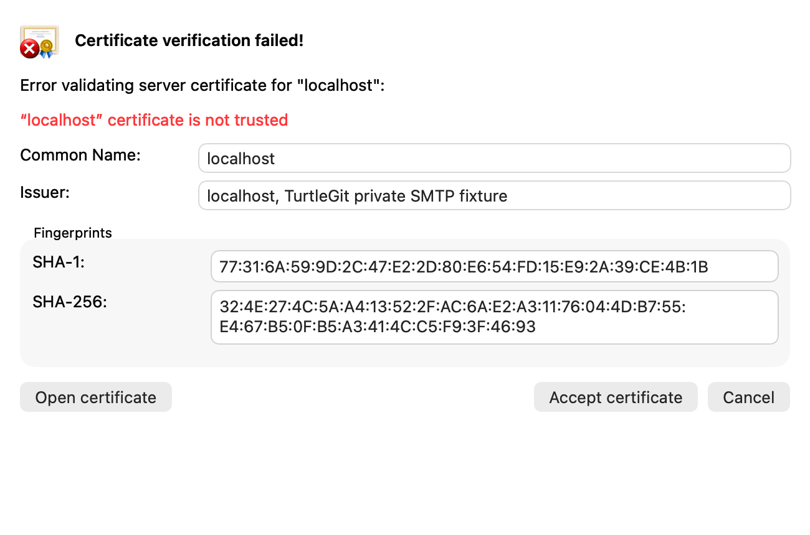
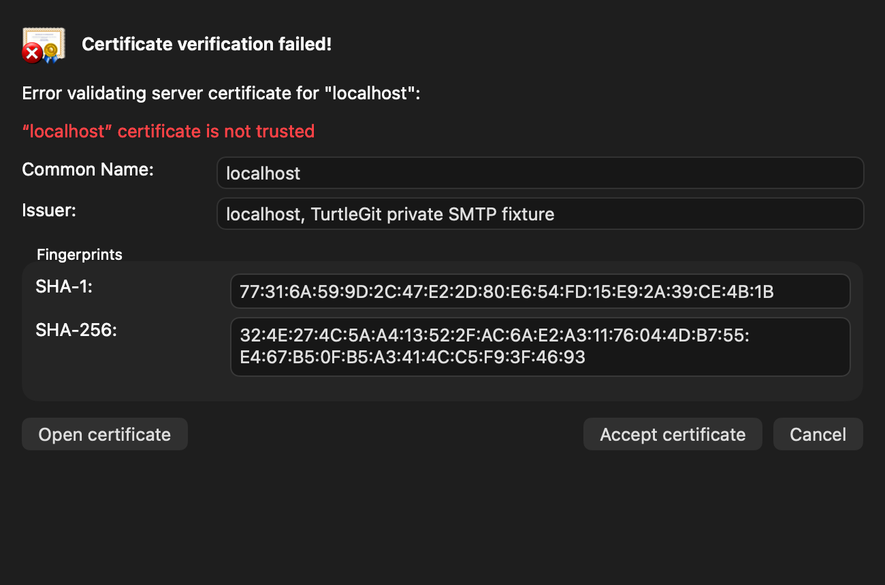

# SMTP certificate review parity

Baseline: TortoiseGit `7338078f8ddd924b8cddee35f512f2286072136d`.
This is a connected partial native replacement for the SMTP caller of
`IDD_CERTCHECK`; it does not certify the entire certificate/authentication family.

## Source and behavior

`src/Utils/HwSMTP.cpp:833–848` obtains the actual peer certificate and invokes
`CAppUtils::Git2CertificateCheck` before authentication/upload.
`src/TortoiseProc/AppUtils.cpp:3715–3755` validates the peer, presents errors and
retains an accepted certificate in process memory. `CheckCertificateDlg.cpp`
sets default Cancel and opens the Windows certificate viewer.
`src/Resources/TortoiseProcENG.rc` supplies `IDD_CERTCHECK`.

| Source control/operation | Native replacement |
| --- | --- |
| IDC_ERRORDESC / IDC_ERROR | Actual configured hostname and Security validation diagnostic |
| IDC_COMMONNAME / IDC_ISSUER | Selectable subject summary and issuer fields |
| IDC_SHA1 / IDC_SHA256 | Selectable colon-separated fingerprints of the actual DER leaf |
| IDC_OPENCERT | Owned read-only SecurityInterface inspector, Text, Copy and DER/PEM export |
| IDOK | Accept certificate for the suspended connection; exact workflow-owned exception |
| IDCANCEL / default button | Reject before AUTH/DATA; Escape rejects |
| IDI_CERTCHECK | Pinned source certificate-check artwork |

`Sources/TurtleGitCore/SMTPCertificateTransport.swift` uses public Network and
Security frameworks. TLS 1.2/1.3 certificate review belongs to the actual
`NWConnection`. STARTTLS consumes greeting/EHLO/220 with a public protocol framer
and inserts TLS on that same connection before readiness. It does not probe and
reconnect or disable verification globally. System trust uses the configured
hostname; explicit private CA files remain supported. Implicit trust-network
fetches are disabled so the owned connection does not initiate unrelated AIA/OCSP
requests. The callback supplies the leaf certificate, not a complete chain.

Temporary exceptions are bounded and tied to exact hostname UTF-8, port and DER,
owned by one Send Mail workflow. This narrows upstream's process-global last-leaf
exception. A valid trust evaluation needs no prompt. Legacy callers without a
review callback retain the existing SDK curl backend. Configured/direct native
Send Mail both supply the review callback; the public Core API remains compatible
with older callers. A declined certificate is not retried automatically. Existing
source-ordered retry limits and uncertain-delivery handling remain in force.

## Native ownership

`SMTPCertificateReviewWindow.swift` adapts the source field/button layout to
AppKit and adds a separate owned read-only inspector. It never edits system trust.
`SendPatchWindow.swift` binds each review to the active submission and cancellation
token, retaining progress ownership until the actual connection/review drain.
The inspector waits for actual Save-panel detachment and an accepted write before
resolving its parent. Forced close, duplicate/late callbacks and Quit cannot
approve a stale submission. Human decision time pauses the transport's local
timeout, while actual connection failure and cancellation still reject the review.
`ApplicationDelegate.swift` guards pending submissions and sheet releases at Quit.

The user-facing behavior is described in [SMTP certificate review](SMTP-CERTIFICATE-REVIEW.md).
The existing [SVN implementation](SVN-AUTHENTICATION-PARITY.md) remains a separate
caller of the same source dialog. The [optional libgit2 Clone/Fetch/Sync backend](LIBGIT2-TRANSPORT-PARITY.md) now
connects actual HTTPS certificate callbacks to its native helper. The default Git
CLI route retains Git's own TLS failure/credential behavior; the SMTP transport
and its callback are separate.

## Evidence and limits

The batch validation record is [SMTP certificate QA](qa/smtp-certificate-2026-10-19.json).
It must be read for actual attempts and outcomes. Private loopback TLS/auth servers
exercise the real native transport without public mail, real credentials or user
Keychain changes. Focused native checks do not establish a full hosted CI pass,
signed sandbox/save grants, public SMTP/MX compatibility, physical keyboard or
VoiceOver acceptance, complete chain inspection, or parity of every dialog.

## Native review captures

These actual offscreen AppKit content captures use a private loopback certificate.
The requested appearance is settled before capture, and native drawing is rendered
on its resolved window background. They are not desktop/compositor captures and
do not certify physical keyboard, window chrome or every inspector disclosure.

