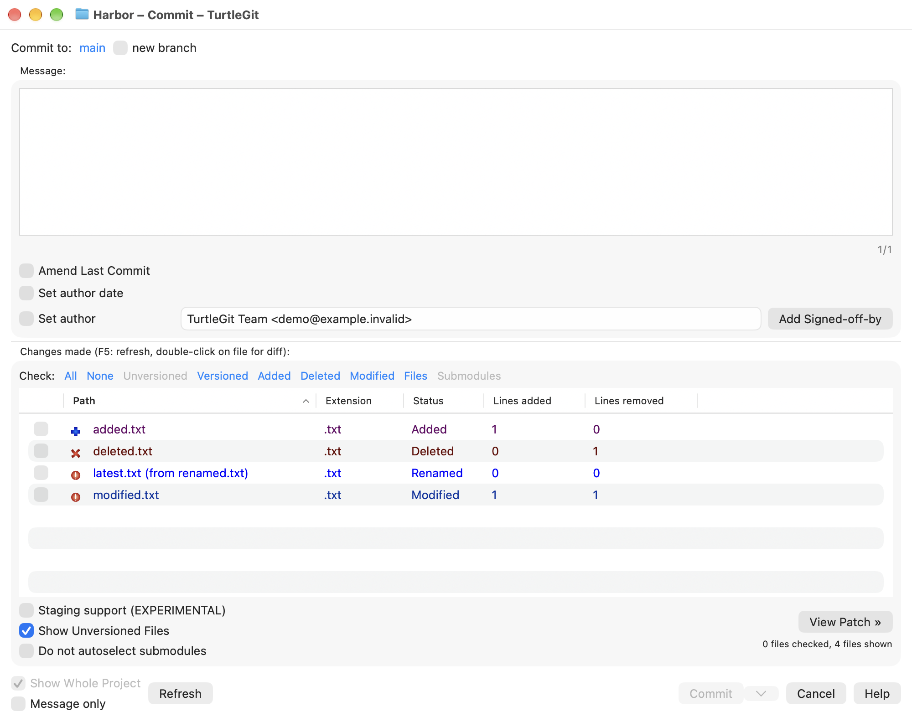
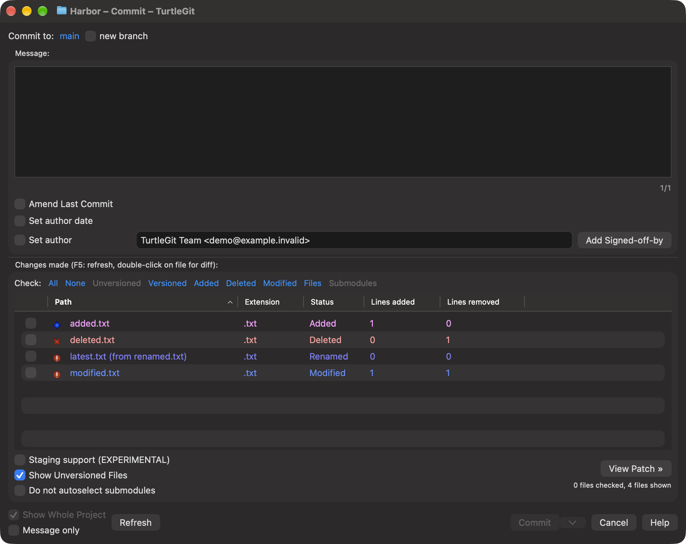
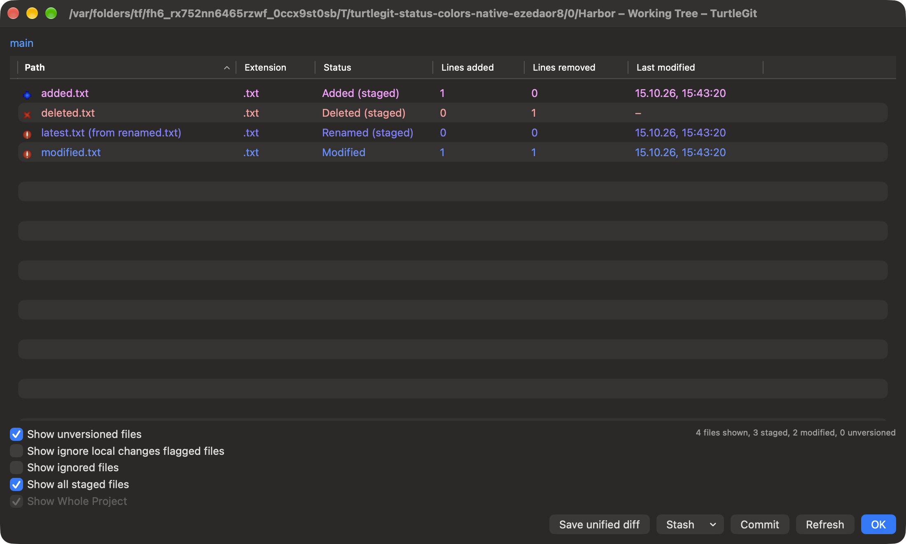
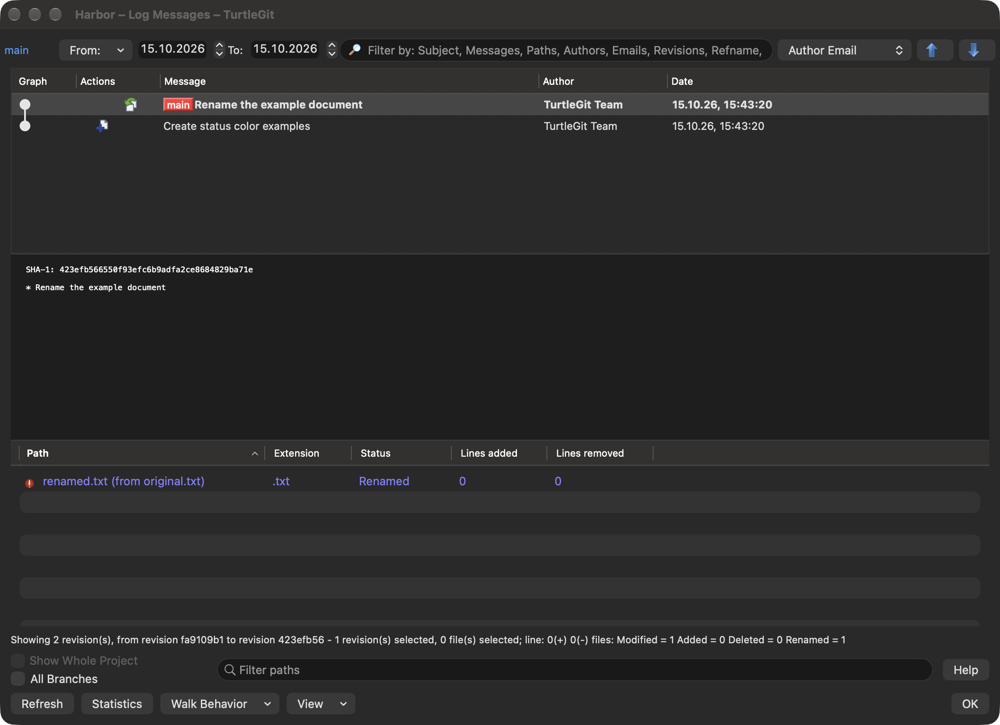

# Native status text in light and dark mode

Source baseline: TortoiseGit `7338078f8ddd924b8cddee35f512f2286072136d`,
`Colors.cpp`, `Theme.cpp::GetThemeColor` and
`GitStatusListCtrl.cpp::OnNMCustomdraw`.

TurtleGit retains the source RGB defaults, role precedence, packed preference
values and HSL dark conversion. The source conversion inverts lightness, so
saturated blue at 50 percent lightness stays blue. That source result had poor
contrast against the macOS dark table in the current Log rename capture.

Status text now has a separate native presentation step. Light appearance keeps
source RGB exactly. In dark appearance, text already readable against native
plain/alternating table and window backgrounds stays unchanged; other text mixes
toward white only as far as needed for a 4.5 contrast target. Increase Contrast
uses a target of 7. Hue and the distinctions between modified, added, deleted,
renamed and conflict text remain visible. These numerical targets do not certify
all rendered states or accessibility.

This adaptation does not overwrite saved colors, change the color-well values,
or replace the source palette used by Log graph lanes/reference badges. Source
RGB/HSL methods remain independently available for the original palette oracle.
The Colors page explains the native text adaptation. Selected text retains native
semantic primary; unrelated/gray and normal/untracked text retain their existing
semantic roles.

The shared status/entry/file renderer covers Commit, Working Tree, historical
Log files and other callers such as Rebase conflict files and operation status
text. Send Patch sending/error labels use it too. Working Tree now consistently
uses its model's color store for all file columns, and Commit line-count columns
use the owning Commit store rather than global defaults. Apply notifications
update existing owners; Cancel and Default preserve the existing draft workflow.

## Verification and remaining work

The grouped native runner links current Debug objects and retains the independent
pinned C++ RGB/HSL oracle and earlier preference/settings checks. The added real
repository fixture covers Commit/Working Tree/Log roles, private stores and live
Apply/Cancel/Default, source light RGB, actual native dark backgrounds and both
contrast targets. Optional compositor captures require actual adjusted rename
color pixels in all three dialogs, including after a custom Apply. Raw captures
are saved unchanged; pixel conversion is analysis only.

The Debug build, 29-input source oracle/retained settings receiver and both
native text engine cases passed after the recorded fixture/background repairs.
See [batch evidence](qa/status-text-2026-10-15.json). Physical gestures, active/
inactive selection, every customized palette/window/theme/scale, actual system
Increase Contrast toggling, signed/minimum-OS and complete application acceptance
remain open. The adaptation is deliberately documented as macOS rendering rather
than a claim that upstream uses the same contrast step.

The reviewed default captures show unchanged source light RGB and the adjusted
dark status text. The same open dialogs also produced distinct custom-color
Apply pixels. These demonstrate the tested rename/default/custom states without
certifying every role or selected-row appearance.

