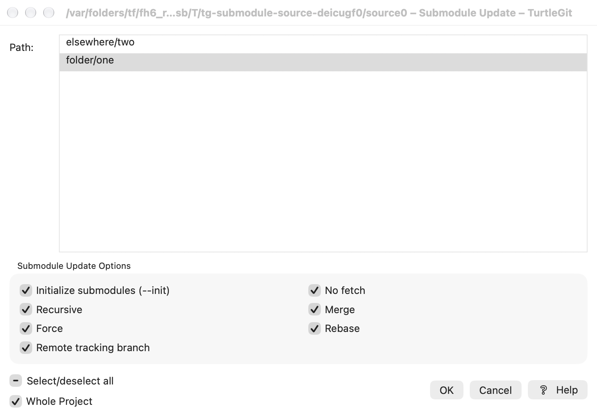
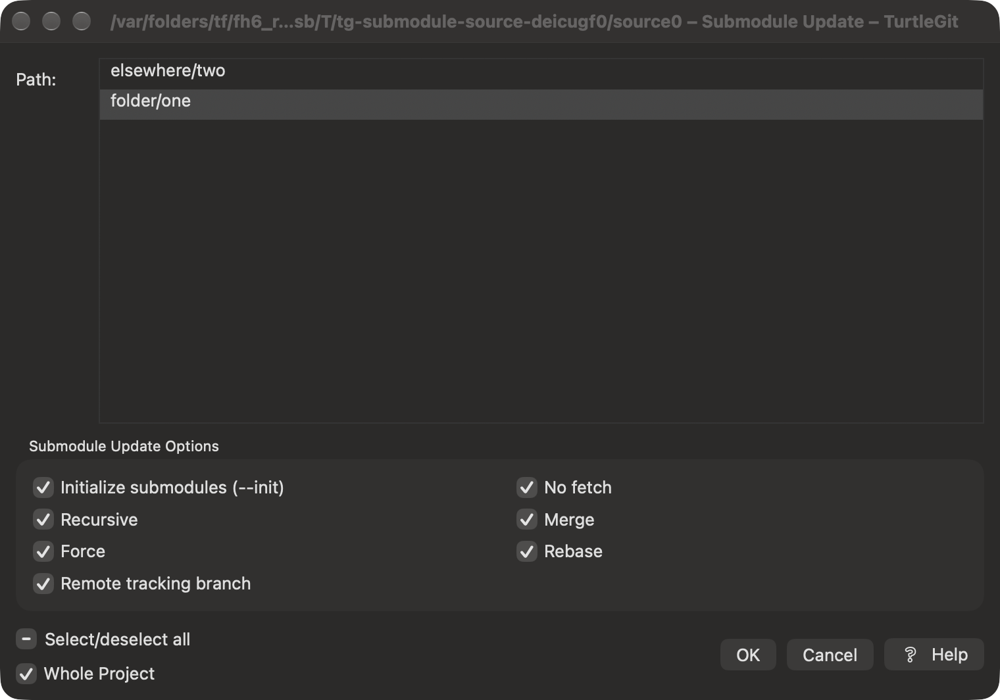

# Submodule Update parity

The connected [Submodule command-entry family](COMMAND-LINE.md#submodule-add-update-and-sync-entry)
adds source `subadd`/`subupdate`/`subsync` routes, superproject base discovery,
directory filtering/selection, preserved reviews, owning preferences and existing
Git progress consumers. [Dated evidence](qa/submodule-commands-2026-10-18.json)
separates scoped checks from physical, signed and complete dialog acceptance.

The references are pinned to `7338078f8ddd924b8cddee35f512f2286072136d`:
[SubmoduleUpdateDlg.cpp](https://github.com/TortoiseGit/TortoiseGit/blob/7338078f8ddd924b8cddee35f512f2286072136d/src/TortoiseProc/SubmoduleUpdateDlg.cpp)
and `.h`, `IDD_SUBMODULE_UPDATE`, and the Update branch of
[SubmoduleCommand.cpp](https://github.com/TortoiseGit/TortoiseGit/blob/7338078f8ddd924b8cddee35f512f2286072136d/src/TortoiseProc/Commands/SubmoduleCommand.cpp).
All three source blobs were verified against the file inventory. The
[official Submodules manual](https://tortoisegit.org/docs/tortoisegit/tgit-dug-submodules.html)
was also reviewed. This Update checkpoint does not establish Add or Sync parity; current separate
ports are documented in SUBMODULE-ADD-PARITY.md and SUBMODULE-SYNC-PARITY.md.

## Native options and selection

The window follows the resource arrangement: selected paths above two columns of
options, followed by Select/deselect all, Whole Project and OK/Cancel/Help.
Initialize submodules starts enabled; Recursive, Force, No fetch, Merge, Rebase
and Remote tracking branch start disabled. All seven options are retained per
repository after acceptance. The selection is a native AppKit multiple-selection list, not per-file
checkboxes. Its ordinary clicks toggle individual rows without modifier keys,
matching the resource's LBS_MULTIPLESEL style. Arrow navigation moves the focused
row independently; Space toggles it. Full-width columns and horizontal scrolling
retain long paths, and literal newline characters receive readable display
markers while selection/acceptance retain the original strings. Native system
colors and a focus outline support light/dark appearance; physical visual and
VoiceOver acceptance remain pending. The native three-state all control clears a mixed
selection, and selects all from the empty state. OK is disabled without selected
paths. Whole Project expands a scoped folder request; an unscoped request disables
that redundant toggle. F5 refresh preserves the current selection.

Window frame and repository scope/selection/options are saved using native
preferences. Path selections use a string array, preserving literal pipes and
newlines rather than using a separator-delimited registry string. Original
Update artwork is used by the app and Finder action. Selecting an initialized
indexed submodule root routes Update to its superproject; files within it retain
their containing repository.

## Git execution

Available paths combine index gitlinks and `.gitmodules` entries, with exact
component-based scope matching and natural sorting. Config names and values are
queried separately using NUL delimiters, without following config includes.
Selections are revalidated before Git runs. Missing/duplicate selections,
escaping configured paths and checkout symlinks/non-directory objects are
rejected before checkout. `.gitmodules` must be a regular file.

Flags follow the upstream order, including both independently chosen Merge and
Rebase flags. Git receives the reviewed paths explicitly after `--`; selecting
all within a folder cannot inadvertently update another folder's modules. Git
controls initialization, checkout, Force, fetching, remote tracking, merging,
rebasing and recursion. Updates preserve the superproject HEAD and staged
entries; remote tracking can leave the checkout ahead of its indexed gitlink.
App Store mutations require the repository's active security-scope lease.

The options window now captures the reviewed paths and all seven options, saves
those preferences and closes before a separate native progress window runs Git,
matching the source handoff. Each submission executes once; the Core revalidates
paths with the owned cancellation token before checkout. Explicit path arguments
remain a deliberate native scope guard, even when all visible rows are selected.

Progress streams live UTF-8/CR output through the existing bounded Git output
parser. Ordinary Git errors retain the bounded transcript and exit status; no
success handoff is published. Cancellation reaches both metadata validation and
Git's owned process group. The source ConfirmKillProcess Yes/No question has Yes
as its default; No retains the operation, and duplicate/late replies cannot cancel
completed work or dispatch twice. Forced close cancels and fences output/results.
Quit is denied while execution or a cancellation question remains active. Idle
progress and options freeze during another window's Quit confirmation. The
repository access lease remains alive until execution ends.

Successful Update checks the current worktree's administrative directory for
`BISECT_START` and offers source-order Good, Bad, Skip and Reset with original
icons. The first action has a button with a dropdown for all four; Close remains the default;
selection dispatches the existing native Bisect route once. No-options auto-close
keeps a successful result with post-actions open; no-errors follows the shared
source policy. Action-log writes use the existing application-installed store.
Private preference injection and cancellation fence options discovery on close.

Complete upstream progress geometry/taskbar and broader controls, large command-list splitting, real transfer/authentication, displayed and
signed acceptance remain partial. Cancellation retains earlier checkout/config
effects; it does not promise rollback.

The submodule progress log now has the source Copy / separator / Copy all
information to clipboard menu with original copy icons, respecting application
menu-icon preferences. Copy All preserves selection and viewport without a
temporary select-all. Live output follows the tail and retains a valid selection;
shortened/truncated text clamps ranges. The pane uses native dynamic text/background
colors and the configured log font. Both progress windows expose parsed percentage
and current work, a progress bar, separate Close/Abort and a native Escape route;
Close remains the Return default, including when Update offers bisect actions.
[Progress control verification](qa/submodule-progress-controls-2026-10-09.json)
records hidden native evidence; physical display/keyboard acceptance remains pending.

Completion now replaces the phase label with Success, the Git exit-code result or
User cancelled and finishes the progress bar. The visible/action-log footer uses
source completion wording and, by default, elapsed milliseconds plus a localized
short date/time. The native dialog settings expose Show Git execution timings and
timestamp; disabling it keeps the completion line without timing. Elapsed time
uses the monotonic process clock. UseSystemLocaleForDates selects native
localized short date/time or the source fixed yyyy-MM-dd HH:mm:ss local format. Native validation/launch failures without a Git
status use Operation failed; forced close still fences late output.

At completion the output styles only exact line-start fatal/error/warning prefixes:
bold red errors and yellow warnings with source light/dark RGB values. StyleGitOutput
(default true) gates those prefixes independently of links and terminal color.
The existing upstream URLFinder port supplies URL/email links; clicks use native
URL handling, while hidden QA injects a private receiver. Success footers use source
blue/cyan unless native increased contrast requests system text color; failures
are red. Stream output stays plain until completion, matching the source callback.
[Styling verification](qa/submodule-progress-styling-2026-10-09.json) distinguishes
attributed-text/color-component checks from unverified displayed appearance.

## Verification

The current progress checkpoint is recorded in
[Update progress verification](qa/submodule-update-progress-2026-10-09.json).
The counts and screenshots below describe the earlier options implementation,
including its former in-options result panel; they are historical evidence, not
current separate-progress screenshots.

Six real-Git tests cover scoped literal Unicode/comma/newline paths, Init enabled
and disabled, selected initialization with another checkout retained, Force and
dirty-checkout rejection, Remote/No fetch branch behavior, distinct Merge/Rebase
histories, recursive nested initialization, unchanged superproject HEAD/index,
invalid/stale selections and escaping config. A disposable executable wrapper
allows only the local file protocol for these test fixtures without changing
user Git configuration. The focused Update/selection/icon suite passed all ten
tests. The full Swift suite passed 232 tests with zero failures. The existing unique-icon assertion was updated to recognize that Update
and Fetch share the original Update artwork.

Native QA checked Whole Project expansion, native keyboard selection, mixed/all/
none state and disabled OK, returning to scoped selection, Cancel without
mutation, selective Init/No fetch execution, saved options on reopen and F5.
Only the selected module became initialized; its checkout matched the base;
the other module, parent HEAD and indexed entries remained unchanged. The real
captures are `site/assets/submodule-update.png`, `submodule-update-result.png`
and `submodule-update-dark.png`. They were visually inspected and copied
unchanged. The dark capture was repeated after refresh finished so that it
shows idle enabled controls. Each sequential scenario closed its test process
and verified absence before another instance opened; no instances remained.
A stale row observation used the same process and native keyboard navigation.
An observation timeout after Cancel was followed by normal Quit, not a restart.

Unsigned Debug and App Store builds passed with the embedded Finder extension,
licenses, all 59 artwork resources and the pinned universal Git runtime audit.
Signed Finder activation, sandbox/network authentication, native Force/Merge/
Rebase/error/busy-Quit variants, resize and multi-display frame restoration,
ordinary-file request scope normalization, full list context commands and
comparison-window integration remain pending. Separate Add and Sync ports have
their own partial verification records; they do not complete Update parity. Inventory entries remain partial and this is not App Store approval.

The shared visible output state now enforces the cumulative byte limit across
streamed batches, rather than allowing a last full batch past the cap. A cut
does not leave an incomplete valid UTF-8 scalar. The source truncation marker
and final completion line remain visible; raw Git recovery output is unchanged.

## Selection interaction audit

The [selection receiver record](qa/submodule-update-selection-2026-10-10.json)
checks actual unordered AppKit mouse/key events, mixed/all/empty state, long-path
width and viewport resizing, disabled input, busy/submitted callback fencing,
and literal single submission. It launches no main app window and uses a private
preference domain. These are backend/control checks, not displayed UI acceptance.

[Microsoft's list-box style definition](https://learn.microsoft.com/en-us/windows/win32/controls/list-box-styles)
documents per-click toggling for LBS_MULTIPLESEL. The pinned Update command and
dialog contain no LaunchPAgent call or key-autoload checkbox; the command inherits
the current agent. No extra SSH control was added. Inherited-agent compatibility
in signed submodule initialization/recursive transports remains unverified.

## Connected source forms and metadata ownership — October 17, 2026

The native window retains the source path list, two option columns and footer.
Whole Project now synchronously persists its scope, updates the scoped title and
owns a fresh catalog read before another form action can execute. Bindings,
selection callbacks and acceptance capture the form lifetime; callbacks from
before refresh or Quit confirmation cannot revive after those transitions.
The native path table retires its event route when dismantled or its window closes.

Cancel and the close button now remain available during the read-only metadata
load. Closing cancels the owned process; its worker retains access and the active
read count until it drains, suppressing late paths and diagnostics. A failed
refresh displays an inline diagnostic with Retry and prevents acceptance of the
previous catalog. Retry clears that diagnostic and keeps the current reviewed
selection where paths survive. Explicit hosting size retains the source layout.

Grouped verification covers these forms with Add inputs, actual AppKit selection
and Update progress; the underlying Git operations are unchanged in this batch.
Physical keyboard/VoiceOver, signed installation/Finder and complete source parity
remain open. Canonically equivalent Unicode paths in Swift string sets also
remain a known limitation requiring a separate byte-identity path review.

[Grouped batch evidence](qa/submodule-source-family-2026-10-17.json) records the
build, eight case/engine passes, fixture repairs and owned-process absence.

## Exact submodule path identities — October 17, 2026

Index and .gitmodules discovery now deduplicate exact UTF-8 identities, rather than
Swift's canonical String equality. Scope filtering, requested-path validation,
selection, focus restoration, saved selections and accepted submissions preserve
distinct Unicode spellings. Localized row sorting has an exact-byte tie breaker.
Ambiguous row tooltips and accessibility labels include UTF-8 bytes so the two
names can be distinguished without changing the source list layout.

Add, Update and Sync disable Git-for-macOS argv precomposition for their individual
commands; persistent repository preferences stay unchanged. Add's contained absolute
path extraction and Sync's configured scope checks use exact prefixes. Existing
working-file models still expose String sets through the older submodulePaths API;
their wider identity migration remains open. Filesystems may themselves alias both
spellings or refuse simultaneous checkouts; the app preserves the reviewed Git
names and reports Git's result instead of silently substituting a sibling.

Add/Update use real hosting-view minimum constraints rather than relying solely
on contentMinSize. The grouped checkpoint passed: 58 Core tests and ten distinct native case/engine
pairs cumulatively. The first compile failed on overloaded initializer references;
explicit closures repaired it before any Core case ran. The first native group
passed eight pairs, then caught an actual progress regression: adding the Git
option prefix bypassed the bounded-error classifier. The classifier now recognizes
that exact prefix. Only the affected identity/capture and progress cases were
repeated, passing four pairs; Core was not repeated for the native-only repair.
Four final raw Add/Update light/dark captures were reviewed and all 13 receivers
were independently absent. See [exact evidence](qa/submodule-path-identities-2026-10-17.json).
Physical keyboard/VoiceOver, filesystem-specific checkout limits, real SSH servers and
signed Finder/App Store acceptance remain open.
