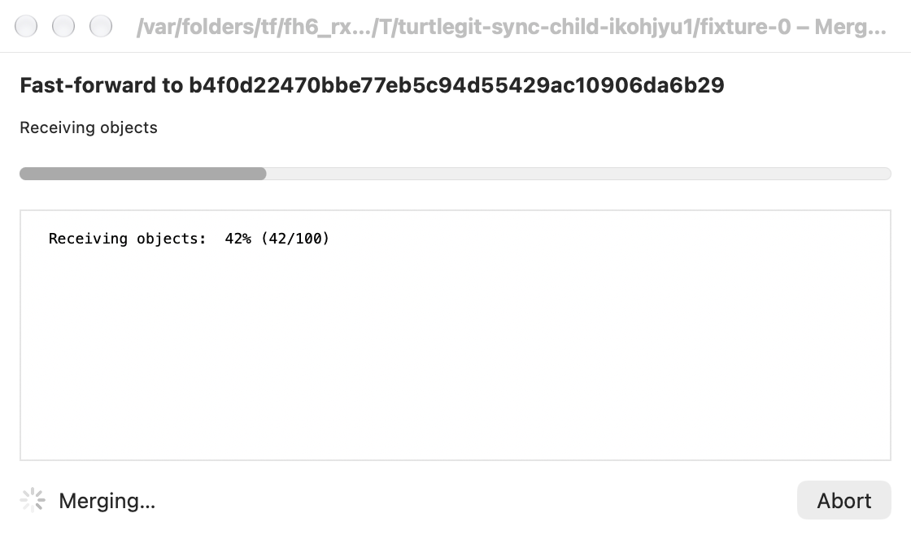
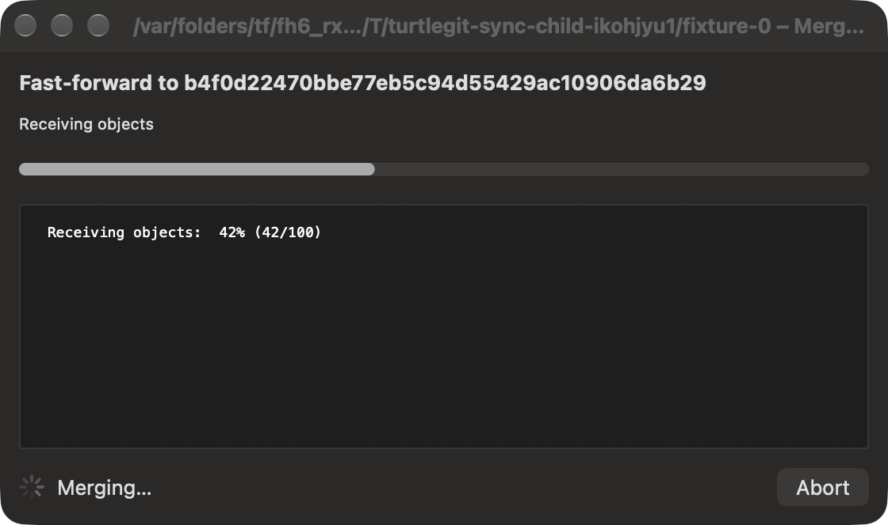
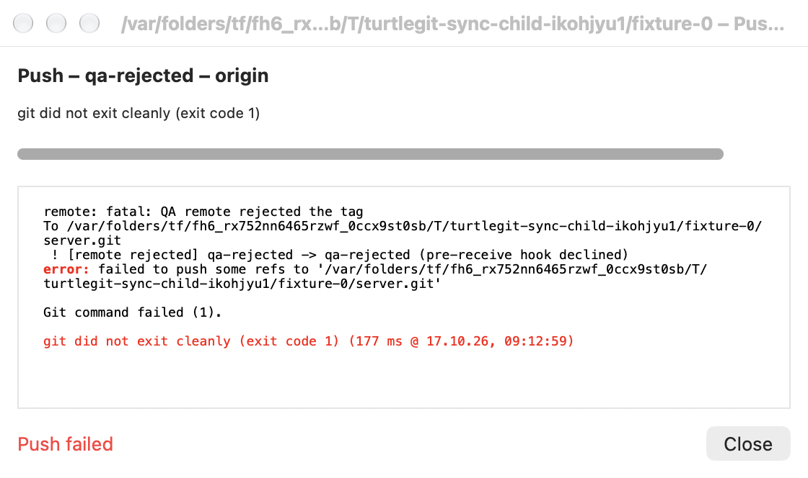
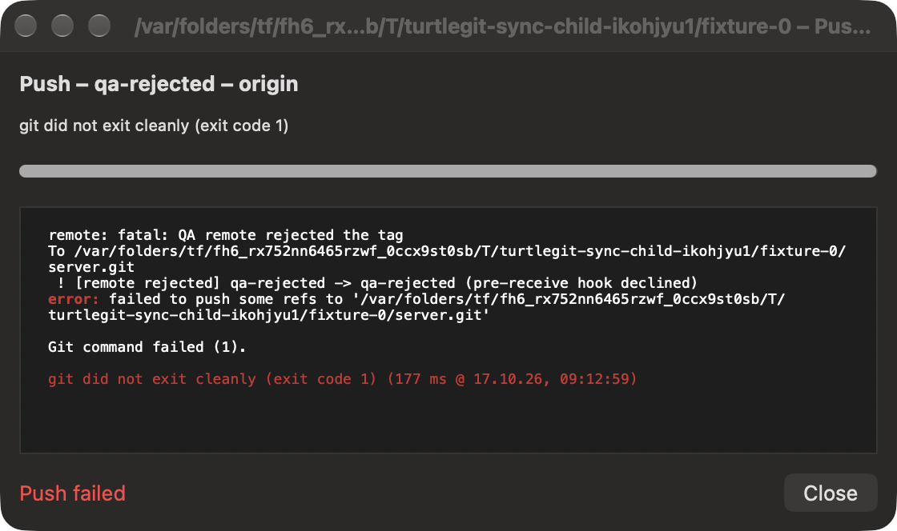
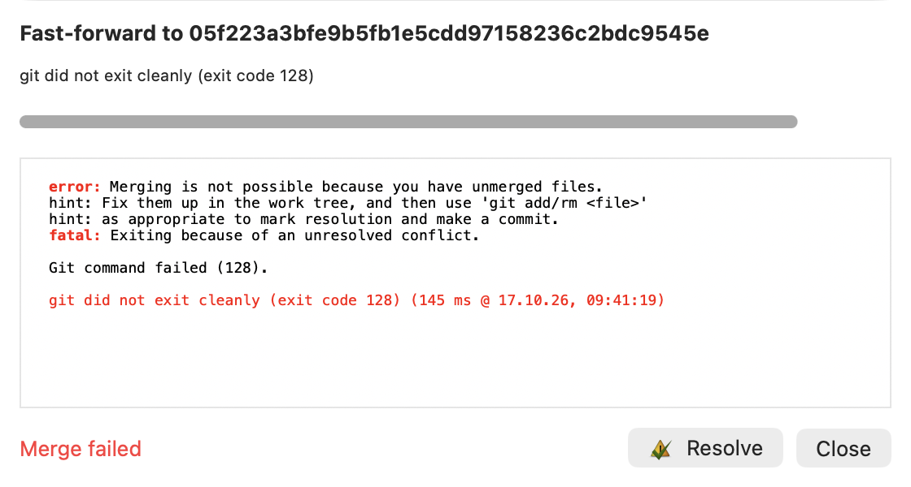
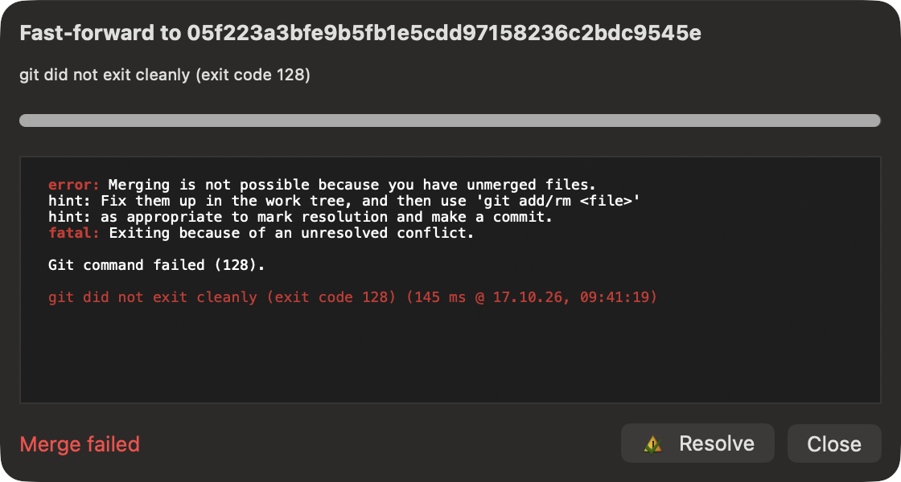
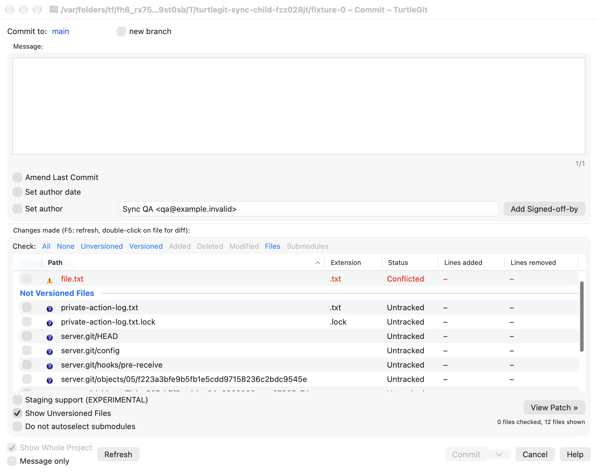
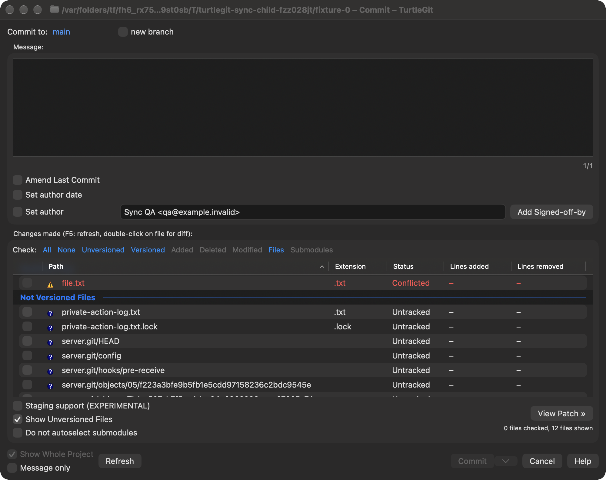
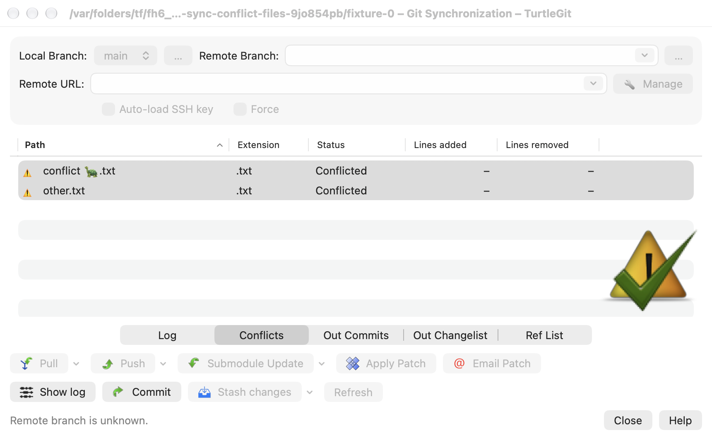
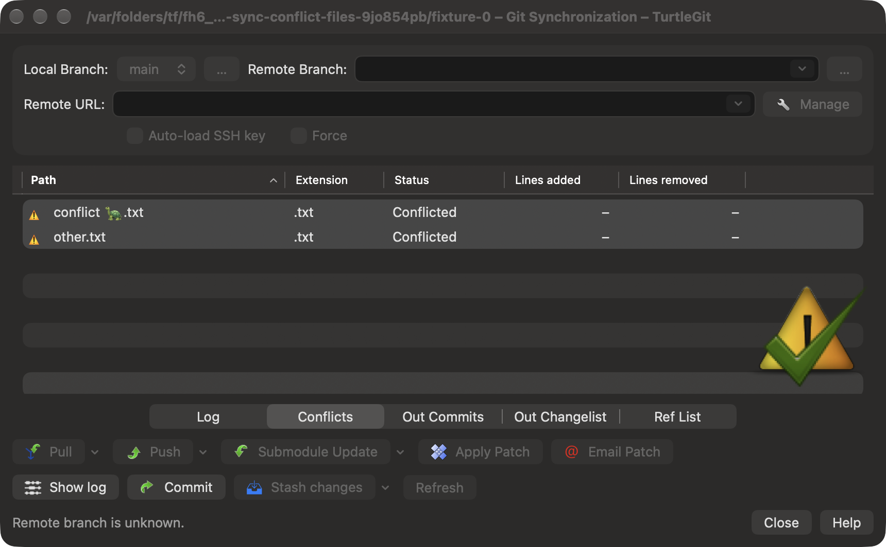

# Git Synchronization parity

The [literal reference identity family](SYNC-LITERAL-REFERENCE-PARITY.md) connects
selected branch bytes to outgoing comparisons, tracking configuration, checkout
and transport when macOS Git filename precomposition is enabled. Its acceptance
scope is recorded separately from full dialog parity.

The [incoming/outgoing commit-list family](SYNC-COMMIT-LIST-PARITY.md) connects
conditional SVN columns, source parsing, independent saved layouts, confirmed
content-fit reset and configured font metrics. Native menus retain their selected
results and source side, while root feedback and metadata workers drain through
closure. Shift comparisons receive the owning preferences. The Debug app and
four native case/engine checks pass after a fixture-only source correction;
[actual evidence](qa/sync-history-controls-2026-10-21.json) retains that failure,
configured-font captures and remaining installed/physical/signed/source gates.

The [reference and tag result family](SYNC-REFERENCE-RESULTS-PARITY.md) now uses
fixed source columns, native fonts, eight-character hashes, source sorting and
header widths, window-local filters and captured menus. Log selects the clicked
revision; Shift comparison and first-hop Log/Compare/RefLog preferences survive
routing. Tag deletion retains its snapshot and remote through owned confirmation
and retirement. The Debug build and six native case/engine checks pass; four
light/dark captures were reviewed. [Evidence](qa/sync-reference-results-2026-10-21.json)
keeps physical, signed, authenticated transport and complete source gates open.

The [incoming and outgoing file-list family](SYNC-FILE-LIST-PARITY.md) replaces
both Changelists with native source-restricted comparison/clipboard tables,
independent saved columns, sorting and owned reset. Exact historical paths,
native activation and stale action guards have a grouped checkpoint with both Git
engines. This remains a partial review of `IDD_SYNC`; physical, signed and complete
dialog acceptance remain open.

The connected [Synchronization/SVN entry family](COMMAND-LINE.md#synchronization-and-svn-entry)
adds all five source command routes, Sync sequence placement, owning preferences
and preserved SVN questions/options across competing requests. Existing native
forms, original icons and backend workflows remain the consumers.
[Batch evidence](qa/sync-svn-commands-2026-10-18.json) separates focused execution
from public transport, physical, signed and complete dialog acceptance.

Baseline: `7338078f8ddd924b8cddee35f512f2286072136d`, `SyncDlg.cpp`
(`FetchOutList`, `ShowInCommits`), its inline `AddDiffFileList` in `SyncDlg.h`,
and `Git.cpp::IsFastForward/GetCommitDiffList`, plus `BranchCombox.h`.
A partial native window now exposes the outgoing projection. This is not a
completed Synchronization dialog.

## Comparison backend

`GitRepository.synchronizationOutgoing` returns a pinned, read-only projection of
the local and remote-tracking revisions. Equal revisions produce Up to date with
no outgoing comparison. A missing remote branch produces the source unknown
branch state. The source's slash/backslash URL heuristic is retained: a typed URL
or path is unknown without contacting the server, even with Force enabled.

For a fast-forward push, the outgoing Log range is remote..local and the file
comparison is remote to local. Divergence without Force produces the blocked
state. Force keeps the remote..local Log range but compares files from the merge
base to local. The full history is requested, bypassing Log's ordinary 200-row
limit. File comparisons enable the source default 50-percent copy detection and
retain original paths. Existing other comparison callers keep their defaults.

An unusual pinned-source behavior is preserved: no merge base leaves a zero
CGitHash; GetCommitDiffList interprets zero as the working-copy revision. Forced
unrelated histories therefore keep outgoing commits and use working tree to local
for their file comparison. A forced behind branch can have zero outgoing commits
while still enabling Email Patch, just as the source does.

`synchronizationIncoming` compares the captured pre-operation revision with the
actual completed revision (HEAD after Pull, fetched upstream after Fetch), returning
that pinned comparison and old..new history. Equal revisions return empty lists.
Resolving hashes uses stdout independently of diagnostic output. Input NULs and
pre-cancelled operations are rejected; the token is forwarded through Git reads.
The snapshots do not authorize transport operations.

## Transport backend

`SynchronizationTransportOptions` and its immutable plan cover Pull, Fetch,
Fetch & Rebase, Fetch All, Remote Update, Prune, Push, Push Tags and Push Notes.
Pull, Fetch, Fetch All, Remote Update and Prune are wired to the native window.
Fetch & Rebase owns its source choices and separate progress. Push, Push tags
and Push notes now have native split actions and owned Shift Push options;
project pre/post-push hooks remain pending.

The source CLI rules are preserved: matching pull tracking omits an explicit
branch; configured Pull rebase performs Fetch and defers the native rebase
handoff. Branch-specific rebase overrides the global setting, including Git's
numeric and valueless boolean forms. `merges` requests preserved merges.
Existing tracking refs give Fetch a `branch:remotes/remote/branch` refspec;
missing refs and typed URLs use the selected branch alone. Fetch All omits the
branch for the selected remote. Remote Update uses `git remote update`; Prune
uses the selected remote. Git still applies its configured remote-update groups.

Push Tags includes both `--tags` and the selected branch refspec. Push Notes
uses `git notes get-ref` and ignores the destination-branch field. FETCH_HEAD
prefill uses exactly one for-merge line, preserving the source's FixBranchName
rule. An empty resulting source with a destination is a deletion refspec; the
executor requires separate explicit deletion authorization. NULs in fields or
metadata-derived arguments are rejected.

Pull requires explicit authorization before a planned branch switch. Git 2.39
rejects the pinned upstream's newer checkout `--end-of-options` syntax, so the
macOS adapter uses `switch --no-guess -- branch` for local branches and
`switch --detach -- revision` otherwise. Source old-HEAD metadata remains in the
original plan. Execution checks the repository identity and the Pull HEAD/branch
before work and again after asynchronous authentication. Cancellation reaches
metadata reads, checkout, authentication and transport; output uses the shared
stdout/stderr stream protocol. Fetch-for-Rebase pins the completed target hash;
if that read fails, a separate error retains the successful transport result.

Pull preflight predicts the selected branch's attachment, and detached targets skip
the native Fetch-for-Rebase interception. Pull resolves FETCH_HEAD as a normal
revision; Push alone uses the source unique-for-merge FixBranchName rule. After an
approved checkout and asynchronous key preparation, execution uses the actual
current branch's rebase setting and current pull configuration. This preserves
post-checkout hook and key-preparation configuration changes. The original plan
keeps its pre-checkout old HEAD for incoming results. `rebaseMode` and
`executedArguments` on the result report the command actually executed; owners
must use that mode for their native handoff rather than the earlier prediction.

The backend also exposes `synchronizationPullCheckout` and a continuation overload
of `synchronize`. The checkout step returns its own streamed command result and
an opaque checkpoint containing the original plan and the actual post-hook
HEAD/branch fingerprint. A native owner can present separate checkout progress,
then ask tracking questions and capture reference metadata before starting
transport. Continuation rejects a different repository actor or changed
HEAD/attachment and never repeats checkout, including when a hook selected
another branch. The existing combined executor remains available. The native
Pull owner now uses this checkpoint across its separate checkout progress and
tracking prompt.

Three additional Core tests exercise continuation after a branch-changing hook
with a different original baseline, streaming checkout output, no transport
before continuation, rejection of unapproved/cancelled checkout and foreign or
stale continuation, a no-switch Pull, and checkout blocked by uncommitted work.
The blocked checkout preserves the worktree, index and prior FETCH_HEAD and
returns no continuation checkpoint.

The native owner still needs Push project hooks, full conflict/reference menus,
the remaining source controls and complete post-action menus.
Native revision-expression prefill, metadata snapshot ordering after key loading
and broader repository modes also require further source parity work. No signed
or authenticated network acceptance claim follows from the local command tests.

## Native outgoing window

The TurtleGit menu opens a retained per-repository Git Synchronization window.
Local Branch, editable Remote Branch and Remote URL, Force, Outgoing Commits and
Outgoing Changes follow the source group order. Branch defaults use pull tracking
configuration independently of pushRemote/pushDefault/pushbranch. Selecting a
local branch reloads its tracking defaults. A detached HEAD still exposes the
local branch catalog so the user can select a branch. The local selector and
remote choices retain byte-distinct Unicode names rather than normalizing them.

The outgoing native table draws the existing colored graph before hash/message/
author/date columns. The changed-files tab shows Path, Extension, Status, Added
and Deleted, using original status artwork and appearance-aware status colors,
with original-icon comparison and unified-diff actions against the
pinned snapshot. Show Log and Commit use the captured repository and access
lease. Refresh replaces the outgoing snapshot and clears obsolete selection.

Each reload cancels its predecessor and checks identity before publishing. Close
invalidates owned reads; active comparison children and dirty editors guard
ordinary close. App Store reads require the retained repository grant. Quit
confirmation fences controls and comparison requests. Physical interaction,
complete source columns/context menus and displayed theme acceptance are pending.

## Native Fetch transport

The Fetch split control exposes Fetch, Fetch All, Remote Update and Cleanup stale
remote branches with original icons. The Command Log tab retains streamed output
in the shared selectable native text view, including its Copy/Copy All icon menu
and completion styling. Percentage/work text uses the shared Git output parser.
The Auto-load SSH key control captures a private transport coordinator per
operation; its passphrase sheet belongs to the synchronization window.

Controls and ordinary close are fenced while transport runs. Cancel honors
ConfirmKillProcess and uses a one-shot request identity; a reply after completion
or forced owner closure cannot cancel another request. Closing the owner cancels
its token, suppresses later publication and closes owned confirmation UI.
Completion refreshes the outgoing projection and the repository's other views,
including after cancellation or failure because Git may already have updated
references. Fetch does not populate incoming HEAD tabs. These four actions do not
run Pull/Push tracking questions or Push project hooks.

The Pull split control remembers its implemented selection per repository, using
the source entry indexes. Shift options routing, Compare Tags and
the other split controls remain to be ported. This does not establish complete
native Synchronization parity or authenticated network/physical/signed acceptance.

## Native Pull workflow

Pull captures the repository, selected fields, cancellation token and original
HEAD before any question. A selected branch change asks Switch/Abort and opens
separate owned checkout progress. Successful checkout closes that progress
automatically; failure retains selectable output until Close and prevents
transport. Cancellation honors ConfirmKillProcess. Forced owner closure cancels
checkout, dismisses its owned alert/progress and suppresses later publication.

For a typed non-URL remote and nonempty branch, a missing tracking branch asks
Yes/No/Cancel. Do not show again persists AskSetTrackedBranch=false even on
Cancel, as upstream does. Yes writes local remote/merge configuration for the
selected branch; No proceeds without writing it. Tracking is read after checkout.
The guarded checkpoint resumes transport without switching again.

Ordinary successful Pull fills pinned Incoming Commits with its graph and Incoming
Changes from original HEAD to completed HEAD. Equal hashes select Ref changes and
show an empty incoming log as Up to date. Failed transport checks conflicts using
a fresh cancellable read, selecting Conflicts or Command Log. Conflict rows route
Resolve to the captured repository. Incoming comparisons have an independent
owner and inherit close, dirty-document and Quit guards.

Configured Pull rebase executes Fetch, then uses the actual returned mode and
pinned target to open the existing Rebase controller as a sheet, with auto-start
and preserve-merges as appropriate. Its repository factory configures existing
conflict, commit-selection and completion actions. Incoming HEAD is read after
the child closes. An existing Rebase window is not reused for this operation, and
a modeless activation cannot replace an owned sheet's dismissal callback. Forced
parent closure detaches a busy Rebase to its retained repository owner, or closes
an idle child. Full physical child-dialog acceptance remains pending.

## Native Fetch & Rebase

The Pull split control exposes source entry 2, Fetch & Rebase, and remembers it
per repository. Successful transport pins the fetched target. The source
unchanged-remote check compares that target with the pre-fetch remote hash,
independently of current HEAD. No shows incoming results against the fetched
target without changing HEAD. Yes continues to the fast-forward check. The
shared prompt uses the source response values and suppression preference keys.

A fast-forward offers Merge/Rebase/Abort with Rebase as the default. Merge opens
separate owned progress for `git merge --ff-only -- PINNED_TARGET`. Its Core
state captures actual HEAD and branch attachment, and validates the same actor,
HEAD and branch before executing. Planning is read-only; later remote-ref movement
does not change the target. Equal HEAD/target remains a valid fast-forward.
Failure retains progress output until Close. Incoming HEAD and reference results
are read after the progress closes, including failed merge. Abort preserves
successful Fetch/reference results and does not fill incoming tabs.

Rebase opens the owned child without auto-start or preserve-merges. Divergence
opens it directly, without the standalone Fetch dialog's extra up-to-date prompt.
Incoming HEAD is read after dismissal. Configured Pull continues to request
auto-start and its actual preserve-merges setting. Checkout and Merge share the
same bounded selectable progress output, cancellation and force-close handling.
Full Merge post-actions and physical prompt/button acceptance remain pending.

## Reference-change results

The reference backend captures all refs into maps keyed by exact UTF-8 identity,
including symbolic remote aliases and annotated tags. Annotated tags retain the
source `^{}` friendly name and immediate tag target; nested tags are not silently
peeled through every tag layer. Git's [`object` header atom](https://git-scm.com/docs/git-for-each-ref)
provides that target without a separate process for every tag.

Comparison keeps full old/new hashes and first-line commit messages. New, deleted,
forward and rewind counts, divergent newer/older/equal committer times, unchanged
and unknown non-commit states follow `GitRefCompareList`. Backend metadata is
cached per object. Native results use the seven source columns, original reference
type tiles, header sorting and a persisted Hide unchanged refs header checkbox.
Row menus contain original icons for old/new Log, Compare and Reflog. Log/Compare
use captured hashes rather than resolving moving names.

The owner captures refs before transport, then reads results with a fresh token
so a cancelled Git command can still report changes it already made. Forced close
cancels the currently owned metadata read and suppresses later publication.
Non-integrating completion selects Ref changes after success, failure or ordinary
cancellation, as the source CLI flow does; Command Log remains available. Empty
filtered results show No differences found. Result-read failure retains the
successful/failed transport output separately.
Native factory handlers retain the repository and access lease.

Windows logical-sort policy, complete configured short-hash/column settings,
bisect short-name terms, Shift alternate Compare, actual downstream receiver
acceptance, large-repository performance, invalid UTF-8 refs, external writers,
physical input and signed/network acceptance remain to be checked. This is a
partial reference-result port rather than complete Synchronization parity.

## Verification scope

Five real-Git tests cover equal/ahead/missing/URL states, incoming and unchanged
results, pinned snapshots after a tracking reference moves, divergence/Force,
merge-base file scope, the unrelated working-copy fallback, copy identity,
205 outgoing commits, cancellation and invalid inputs. Staged/unstaged contents,
raw index and refs are preserved by the covered comparison cases. A sixth test
covers pull tracking versus push overrides, source ref-name stripping, missing
tracking configuration, detached HEAD, cancellation and byte-distinct packed refs.

The existing 15 revision-comparison regressions run alongside the new tests to
check the shared options change. Their fixtures use system Git; the five new tests
explicitly select the requested Git executable. No full-suite, transport, physical-input or signed-runtime acceptance claim
follows from them. The separate native verification covers only the outgoing
window controls/table/snapshot lifecycle; see the
[native QA record](qa/synchronization-window-2026-10-11.json).

Ten additional transport tests, alongside the six comparison/branch tests, pass
with system Git 2.50.1, Git 2.39.5 and packaged Git 2.55.0. They execute against
private local bare repositories and cover refspecs, force, tags/notes, checkout
authorization, FETCH_HEAD deletion refusal, asynchronous authentication cancellation
and pinned Rebase targets. Both unsigned build configurations and their bundle
audits pass. This does not verify native transport controls, real network
authentication, the full test suite or signed distribution; see the
[transport QA record](qa/synchronization-transport-2026-10-11.json).

The extended native receiver verifies the four Fetch actions against private local
servers using system and packaged Git, selectable command output, unchanged HEAD
and raw index, failed Fetch, pruning scope, cancellation choices, completed-request
late replies and forced-owner closure. Cancellation uses a controlled executable
shim; confirmation decisions are injected. SSH/network authentication and physical
input remain untested. See the
[native Fetch QA record](qa/synchronization-native-fetch-2026-10-11.json).

Two reference tests pass on system Git 2.50.1, Git 2.39.5 and packaged Git
2.55.0. The extended native receiver passes on system and packaged Git, including
all seven columns, actual icon menu dispatch to captured callbacks, Hide unchanged
persistence, failed/cancelled result selection and chained-operation ownership.
Both unsigned builds and bundle audits pass. Full-suite, downstream child windows,
rendered pixels, real network and signed acceptance remain unverified; see the
[reference-result QA record](qa/synchronization-reference-2026-10-11.json).

Five additional Pull preflight tests cover approved checkout hooks changing
configuration/attachment, asynchronous key-preparation configuration changes,
detached FETCH_HEAD/qualified refs and empty rebase branch validation after
checkout. All 23 synchronization tests pass on each of the three Git versions.
The existing native receiver passes against rebuilt Core on system and packaged
Git; both unsigned builds and bundle audits pass. This is backend preparation
for the pending native Pull workflow; see the
[Pull preflight QA record](qa/synchronization-pull-preflight-2026-10-11.json).

The separate-checkout checkpoint adds three tests. All 26 synchronization tests
pass on system Git 2.50.1, Git 2.39.5 and packaged Git 2.55.0. The existing native
receiver passes against rebuilt Core on system and packaged Git, and both
unsigned builds and bundle audits pass. The checkout API was backend-only at that checkpoint; the native Pull workflow
described above was added later. See the
[separate checkout QA record](qa/synchronization-checkout-2026-10-11.json).

The extended native Pull receiver passes on system Git 2.50.1 and packaged Git
2.55.0. It exercises actual separate checkout progress, the original incoming
baseline and graph/files tables, tracking Yes/No/Cancel suppression, branch Abort,
conflicts, failed-checkout Close and forced running-checkout cleanup with late
duplicate cancellation replies. The preserve-merges handoff is tested with an
injected completion callback; actual production Rebase child/replay acceptance
remains pending. Both unsigned configurations and bundle audits pass. Core source
is unchanged from the separate-checkout record; the full suite was not rerun.
Hidden bitmap captures omitted SwiftUI labels and were rejected for publication.
See the [native Pull QA record](qa/synchronization-pull-native-2026-10-11.json).

Fetch & Rebase adds two Core tests; all 28 synchronization tests pass on system
Git 2.50.1, Git 2.39.5 and packaged Git 2.55.0. The extended native receiver passes
on system and packaged Git, including actual separate Merge progress, unchanged
No/suppression with ahead HEAD, Abort, real owned Rebase controller fast-forward
and divergent replay, stale Merge refusal and pinned incoming results. Prompt
answers and Start/Close actions are injected; the child is opened in the callback
with the actual controller, not through the production RepositoryModel factory.
The temporary receiver embeds its framework rpath for the sequence-editor role.
System Git also completes a private two-commit replay using the actual Debug app
sequence editor without DYLD overrides. Both unsigned builds and bundle audits
pass. Full-suite, physical/rendered, full factory/completion and signed acceptance
remain unverified. See the
[Fetch & Rebase QA record](qa/synchronization-fetch-rebase-2026-10-11.json).

## Remaining full port

- Complete progress-phase arrangement and full history autocomplete/interaction acceptance.
  Tabs below the result grid, shared Force/SSH row and status/Close/Help footer
  now follow the source layout; full column and interaction parity remain partial.
  Owned branch choosers and Manage are implemented; physical acceptance is pending.
- Complete incoming/conflict/reference/outgoing column interactions, sorting and
  context menus. Actions, reference labels, conditional Bug-ID and shared dates
  now have focused native evidence; full visual/interaction parity remains partial.
- Project hooks, full completion actions, Shift alternative Compare behavior,
  authenticated/encrypted-key network acceptance and remaining transport variants.
- Physical keyboard/pointer/VoiceOver and production app/Finder workflow acceptance,
  including retained results, child ownership and cross-launch saved state.
- Configured similarity thresholds beyond the pinned default, libgit2 route
  equivalence, external writers and signed sandbox grants.
- Bare-repository app entry (currently disabled), signed Finder/App Store/distribution
  acceptance and complete application parity.

## Shift options routing

The Pull split control now samples Shift for the main button and menu commands.
Shift+Pull and Shift+Fetch open the full existing native options dialogs as owned
sheets. Other split entries remember their selection and return without starting
work, matching `CSyncDlg::OnBnClickedButtonPull` at the pinned source revision.
`synchronizationOptionsPlan` skips direct-transport rebase validation and returns
no executable command. Both synchronize overloads reject an options-only plan.
Pull first performs the existing approved branch checkout and tracking question.
The owner captures the original HEAD and references, prepares configured keys,
and waits for the options dialog to close before refreshing results. Full Pull
uses its own defaults. Full Fetch receives a named remote only; a typed URL in
Synchronization does not override the full Fetch defaults.

The options dialog owns its own progress, configuration and post-actions through
the existing application Fetch interaction configuration. After dismissal,
Synchronization reads reference changes and conflicts, then compares the
original HEAD against current HEAD when no conflicts exist, including Shift+Fetch
and a cancelled options dialog. Conflict results use the source resolve hint and
its `MergeConflictsNeedsCommit` suppression preference for both direct and
options-based Pull. Closing the owner forcibly invalidates and closes
the options dialog and its progress; late continuation results cannot update the
closed Synchronization model. Authenticated server, rendered/physical interactions
and signed sandbox acceptance remain pending. Because macOS uses private SSH
agents per operation, options transport also prepares its own configured agent;
this does not inherit a shared Pageant process as Windows does.

At checkpoint `5b472dd`, full-options Rebase closed Fetch before a modeless
Rebase callback, allowing incoming results to refresh too early. Synchronization
now installs an awaited owned-Rebase callback. It suspends the Fetch progress
and options sheets without invalidating their pending completion, opens Rebase
through the existing owned factory, then finishes the Fetch/options workflow
when Rebase dismisses. Original HEAD and the fetched target are retained.
Automatic Pull forwards auto-start and Preserve Merges; manual Fetch does not
auto-start. An opening failure closes suspended windows and propagates the
handoff error to Synchronization while preserving fetched reference changes.
The outgoing refresh retains that error; a normal manual Refresh clears it.

The standalone Fetch route retains its existing deferred callback when no owned
callback is installed. Full application factory/post-action acceptance, including
Push/Mail completion chains and the upstream TortoiseGit-specific stale-lock
marker prompt, remains pending. The marker prompt checks `tgitrebase.active`;
it must not be replaced by a generic Git active-Rebase test.

Verification at code checkpoint `5b472dd`: 29 synchronization tests passed on
system Git 2.50.1, Git 2.39.5 and packaged Git 2.55.0. The hidden native receiver
passed on system and packaged Git, including real options/progress and forced
running-Fetch cleanup. Debug and App Store unsigned builds, both bundle audits,
pin validation and site generation passed. The full suite was not rerun.
The [dated Shift options record](qa/synchronization-shift-options-2026-10-11.json)
retains exact source/log hashes and the earlier full-options Rebase completion gap.

Verification at code checkpoint `84d55b5`: the expanded native receiver passed
on system and packaged Git, including automatic Preserve Merges, real divergent
manual replay, cancellation, retained opening error/manual Refresh, suspended
window cleanup on failure/force-close and duplicate late dismissals. Both unsigned
builds and bundle audits, source pin validation and site generation passed.
Core/test source hashes are unchanged from the preceding 29-test-per-engine
checkpoint; Core tests and the full suite were not rerun in this GUI phase.
See the [owned Rebase record](qa/synchronization-owned-rebase-2026-10-11.json)
for exact source/log hashes and remaining acceptance work.

## Compare Tags backend

`synchronizationTags` implements the pinned `CGitTagCompareList::Fill` data
model using Git CLI remote advertisement rather than Windows libgit2. Rows
include raw annotated objects and `^{}` target entries,
with Same/Differ/Only local/Only remote states. Local nested annotation targets
remain one-level `git_tag_target` equivalents; remote advertisements retain
Git's recursive peeled target. Thus an equal nested tag object can have a
Different friendly row, as in the source. Commit messages are looked up only
in the local object database; absent remote objects, tags and non-commit objects
have empty messages. Comparing does not fetch objects or alter refs/index/config.
Default `remoteTags` consumers still omit peeled advertisement rows.

The immutable snapshot owns its repository actor and selected remote.
`synchronizeTag` normalizes a friendly row to the tag and implements non-force
Fetch, force Push, confirmed local deletion and confirmed remote deletion.
Local deletion uses an expected-object update-ref guard; actions that depend on
local tag state reject stale changes before and after asynchronous key loading.
Remote Push retains source force behavior; no server lease is added. Ref commands
disable macOS argument precomposition to preserve exact UTF-8 names.

At the backend checkpoint, the native Compare Tags entry, six-column table,
sort/hide state, icon menus, owned progress and result refresh remained pending. Backend
results are not a certification of native control parity. Broader symbolic tags,
short-name ambiguity, SHA-256 repositories, remote authentication, hook/race and
signed/rendered/physical acceptance also remain to be audited.

Verification at code checkpoint `daf20c0`: 34 focused tests passed on
system Git 2.50.1, Git 2.39.5 and packaged Git 2.55.0. Three new tests exercise
real tag advertisement and mutations, nested objects, read preservation,
confirmation, exact Unicode names, stale snapshots and cancellation. Existing
native Synchronization regressions passed six groups on system and packaged
Git with the rebuilt framework. Debug and App Store unsigned builds, both bundle
audits, pin validation and site generation passed. The full suite was not rerun;
there is no Compare Tags UI acceptance in this backend phase. See the
[backend verification record](qa/synchronization-tags-backend-2026-10-11.json)
for exact source/log hashes and remaining work.

## Native Compare Tags integration

The source Pull split entry at index 6 now opens a dedicated Compare Tags tab.
Its selection is remembered; Shift remembers the entry without starting work,
as for the other source entries above index 1. Loading owns a cancellable native
sheet, with repository-access checks and a captured remote. The tab has Tag,
Status, Local hash, Local message, Remote hash and Remote message columns.
Hashes display the pinned source's eight-character length with full-hash tooltips.
Names/messages use macOS natural ordering by default; header clicks select a
column/direction, and SortTagsReversed starts with descending tag names.
Windows Explorer's NoStrCmpLogical policy maps to a local preference. Exact-name
row identity is retained even when the platform collation treats names equally.

The header's Hide unchanged state initializes from TagCompareHideEqual and
stays in the window, matching the source header handler, which does not write
that registry value. Row menus offer local/remote Log, Compare revisions,
Fetch, Push, Delete local tag and Delete tag on remote according to source side
presence/difference rules. They use original artwork, including Commit for the
source tag Push icon, and honor the application context-icon setting. Native
Log and Compare route full selected hashes; displayed-prefix ambiguity is not
introduced into commands. Log selects the requested revision through the
production RepositoryModel callback.

Both deletion paths require a Yes/No answer for the normalized underlying tag
and captured remote. Fetch and Push own a separate output/progress sheet. Its
Close button completes the command handoff in manual mode; successful commands
with no post-actions also honor AutoCloseGitProgress modes 1 and 2. The table refills after dismissal,
including a failed/cancelled Fetch or Push. Failed remote deletion returns
without refill, as in source. Local deletion and its refill have no progress
window. Remote deletion and its refill use one compact native progress sheet.
Successful deletions refill. Repository log/status
views are notified after a command returns, since failure can still have changed
refs. Root force-close cancels the active operation, closes owned progress/key
prompts and fences late publication. Editing branch/remote controls returns to
the outgoing view and discards the old tag snapshot; Refresh in tag mode loads
tags again.

This remains partial parity. Physical/accessibility and rendered light/dark
acceptance, authenticated remotes, command-line close-on-end overrides and
cancellation/finish races, Shift alternative Compare routing, prefix-collision
behavior, Windows-versus-Mac
collation edge cases and wider symbolic/SHA-256/hook/external-writer scenarios
are still pending. No new screenshots or dialog certification are claimed.

Verification at code checkpoint `6408cc5`: seven hidden native check
groups passed on system Git 2.50.1 and packaged Git 2.55.0. The added tag group
exercises actual menu actions, real tag transport/deletion, source sort/hide
behavior, failed-command refill, preserved HEAD/index/config and forced parent
cleanup during loading/writing. Debug and App Store unsigned builds, both bundle
audits, inventory pin validation and site generation passed. Core/test hashes
match the backend record; Core tests and the full suite were not rerun in this
GUI phase. See the [native verification record](qa/synchronization-tags-native-2026-10-11.json)
for scope, source/log hashes, corrected fixture attempts and remaining work.

## Compare Tags source progress presentation

The first native checkpoint used the common output sheet for every mutation.
The source handlers distinguish them: Delete local tag calls DeleteRef and Fill
without a progress dialog; Delete tag on remote holds its compact system dialog
through DeleteRemoteRefs and Fill; Fetch/Push use CProgressDlg. The native port
now keeps these same phases. Compact sheets have no output pane or progress bar,
are not resizable, and do not reuse the saved regular ProgressDlg geometry.

Local deletion executes the guarded backend directly after confirmation. Its
remote advertisement refill uses the captured SSH factory without introducing
a command/loading sheet. Remote deletion performs its write and refill inside
one owned compact sheet, reusing the operation's SSH coordinator. Command failure
skips refill and preserves the previous snapshot. Successful deletion followed
by a failed refill clears the table and reports the read error. Loading and
remote-deletion errors close compact progress before presenting an owned native
error alert; force-closing the owner ends that alert and fences late completion.

Tag Fetch/Push now capture AutoCloseGitProgress when the output controller is
created. Manual mode retains output for Close; no-options and no-errors modes
close successful commands because these source tag handlers have no post-actions.
Failed commands retain output in every mode. A pending cancellation confirmation
still delays automatic close until answered. Existing checkout/merge automatic
close behavior is retained. The tag menu now uses the source caption Compare
with previous revision, and deletion confirmations use the source quoted-tag
question with the captured remote shown for remote deletion.

Rendered appearance, physical keyboard/mouse/accessibility, authentication,
command-line close-on-end overrides, cancellation/finish races, Shift alternative
Compare routing and wider object/ref/configuration cases remain pending.

At code checkpoint `e1b1f97`, all seven hidden native Synchronization groups
passed separately on system Git 2.50.1 and packaged Git 2.55.0. The extended tag
fixture checks inline local deletion, one compact remote deletion/refill,
rejected deletion preserving the old rows and reporting an error, manual and
automatic output closing, loading error handoff, and force-closing the actual
owned native error alert. Its rejection hook is explicitly pinned in the remote
receive command because the system local receiver read the client hook
configuration before entering the server. The temporary receive configuration
is removed before the unchanged-client-config assertion.

The first full invocation passed all system groups but then supplied a missing
Debug-bundle Git path; the corrected separate packaged invocation passed. Core
and test hashes still match the earlier backend record; no full suite was rerun.
See [progress presentation verification](qa/synchronization-tags-presentation-2026-10-11.json).

The unsigned Debug and App Store configurations built successfully; both bundle
audits, pinned-inventory checks and the website build passed. Post-run process
inspection found no test receiver/app/compiler processes. These checks verify
packaging, including the Finder extension and upstream icons, but do not establish
signed Finder registration, sandbox activation or App Store acceptance.

## Native Push split actions

The source Push button has three entries: Push, Push tags and Push notes. The
native footer now exposes those same choices with original icons and restores
source selection indexes 0/1/2. Normal actions capture local branch, remote URL,
destination and Force, stream into Command Log, read changed refs and refresh
outgoing results without checking out a branch or creating an incoming history.
Push tags retains the source combination of all tags plus the selected branch
refspec. Push notes uses Git's configured notes ref and ignores the destination.

Ordinary named-remote Push asks the existing Yes/No/Cancel tracking question
when the selected local branch has no tracked branch. Empty destination falls
back to the selected local branch. Yes writes remote/merge, No keeps Git config,
Cancel prevents transport; suppression is shared with Pull. Tags, notes and typed
URLs do not ask. Normal selection is persisted after accepted preflight. Remote
removal additionally requires an owned Yes/No confirmation before authorizing the
backend deletion; the pinned Windows Sync handler does not show this extra
question. Native project pre/post-push hooks now use the shared hook session; see the October 14 transport-hook checkpoint below.

Shift+Push opens the full native Push options as an owned sheet with the source
local-branch preset; it does not preflight the Sync remote or overwrite the saved
split selection. Its own progress remains owned until Close, then Sync refreshes
refs/outgoing results. Production refresh and post-action routing reuse the same
configuration as standalone Push. Shift on Push tags/notes changes the displayed
selection but runs no command and writes no selection preference. Closing the
root invalidates and closes options/progress and cancels owned processes.

Full project hooks, authenticated network operations, physical/rendered/VoiceOver
acceptance, signed sandbox/Finder handoffs and complete Synchronization parity
remain pending. Hidden native checks are evidence for their exercised workflows,
not certification of the whole dialog.

Push verification uses its own preference suite, so a preceding Pull test's
tracking-suppression choice cannot affect the expected Push question. The fixture
also cancels an injected pending Shift options handoff before opening the real
owned sheet again; cancellation state resets on completion/new invocation. Root
invalidation clears transport/cancellation flags while cancelling the token and
closing all owned children.

The updated root window was captured and visually inspected in light/dark at
1050×660 and minimum 860×500 content sizes. The initial hidden-view cache omitted
SwiftUI layers; those images were discarded. Final captures use Core Graphics
on one actual native preview window, including window chrome, which closes after
all four captures. Duplicate split-control arrows were removed using the native
Menu arrow. Labels/actions fit at minimum size; later table columns require
horizontal scrolling. The two default-size captures are published on the site.
These captures establish this default root layout only, not menu/prompt/progress
rendering, keyboard/VoiceOver or complete source visual parity. Upstream's
[Sync manual](https://tortoisegit.org/docs/tortoisegit/tgit-dug-sync.html) and pinned
`doc/images/en/GitSync.png` were consulted; the missing controls and graph/actions/
refs/metadata column differences remain explicit backlog items. Shift source
resolution for FETCH_HEAD and broader special refs also needs further review.

At code checkpoint `e11f595`, the final full native run passed eight groups on
both system Git 2.50.1 and packaged Git 2.55.0. Only cosmetic split-menu labels
changed after that workflow run; fresh Debug build and final root captures
verified their rendering. Both unsigned configurations, bundle audits, pin checks
and website build pass. Core hashes match the prior backend record, without a
new Core/full-suite run. See [Push verification and limits](qa/synchronization-push-native-2026-10-11.json).

## Submodule split follow-up (October 11, 2026)

The native Synchronization footer now has Submodule Update, Submodule Init and
Submodule Sync, using the existing original Update/Add/Sync artwork. The pinned
`CSyncDlg::OnBnClickedButtonSubmodule` handler is the reference: normal Update
runs `git submodule update --init --recursive`, with `--force` only when checked;
Init runs `git submodule init`; Sync runs `git submodule sync --recursive`.
These commands ignore the dialog's remote/branch fields, retain Git's configured
update mode and leave Command Log selected without refilling Sync's result tabs.
The normal selected action is saved per repository.

Shift Update and Shift Init route to the existing standalone full Update dialog;
Shift Sync routes to standalone Sync. The production callbacks capture the
repository and access lease. As in the upstream separate-process launch, these
routes do not put Sync into a busy state or save its split selection. Standalone
Sync retains its own source non-recursive command; it is distinct from this
button's recursive normal action.

New real nested-repository Core checks cover Init without checkout, recursive
pinned child checkout and URL synchronization, dirty-work refusal/Force,
configured `update=none`, bare/unsafe metadata refusal and pre-cancellation.
The native fixture also exercises completion, saved selection, Shift routes and
forced-owner process cleanup. At code checkpoint `6d02bce`, the four new Core tests pass on system Git; the
38 focused Synchronization tests pass on Git 2.39.5 and packaged Git 2.55.0.
The focused native Submodule group passes on both system and packaged engines.
Both unsigned builds, bundle audits, inventory and website checks pass. Full
nine-group native regression, actual standalone Shift child lifetimes and new
button layout captures remain pending. The published root screenshots retain
the earlier Push checkpoint. See [verification and limits](qa/synchronization-submodule-native-2026-10-11.json).
This addition does not certify the whole dialog.

## Submodule lifecycle and layout follow-up (October 11, 2026)

The full Synchronization native receiver now passes nine groups on both system
Git 2.50.1 and packaged Git 2.55.0. In addition to the earlier direct-command
checks, Shift Init opens an actual standalone Update options controller with
saved settings, which survives closing Synchronization. Submitting it opens
actual standalone Update progress and completes successfully. A running
standalone Sync likewise survives its parent closing; closing its own window
reaps the Git process and prevents a late completion callback. These are real
controllers with fixture-injected callbacks/private preferences. The production
RepositoryModel routing is compiled and inspected, but its complete workspace
callbacks are not driven end-to-end by this receiver.

After that workflow run, the only application change was presentation of the
history graph column: it starts compact and expands to fit rendered lane widths.
Fresh Debug compilation and real native captures cover that change. The capture
fixture now includes a branch and merge, displaying colored lanes. All four
captures (light/dark, default/minimum size) were inspected; actions fit and the
graph is visible. The default-size captures replace the site images. Later
metadata columns still require horizontal scrolling at smaller widths.

The source screenshot still has action/ref/bug columns, two action rows and
other controls absent from this partial port. Displayed split menus, physical
keyboard/VoiceOver interaction and signed sandbox/Finder acceptance remain
pending. The Core and test hashes match the preceding Submodule checkpoint;
no new Core/full-suite run is claimed for this lifecycle/presentation follow-up.

At code checkpoint `18a07c1`, both unsigned builds, bundle audits, inventory
and website checks pass. See [lifecycle and layout verification](qa/synchronization-submodule-lifecycle-2026-10-11.json).

## Stash split follow-up (October 11, 2026)

The native footer now uses two action rows, with Stash changes/Pop/Apply beside
Show log and Commit, following the pinned SyncDlg arrangement. Normal commands
are `git stash save`, `git stash pop` and `git stash apply`. They ignore remote
and Force fields and do not use the full Save dialog's optional message,
untracked/all or follow-up settings. Whole-project Save retains Git's internal
magic pathspec semantics so tracked work is actually cleaned; untracked files
remain. Apply retains the stash. Pop drops it only after successful application;
neither requests index restoration.

The commands leave outgoing/reference results unchanged and hide incoming
results. Failed Pop/Apply checks actual unmerged entries and selects Conflicts
only when they exist; otherwise Command Log remains selected. Conflict-check
errors retain the original command output and append the inspection error.
Shift Save routes to the existing standalone Save dialog for the captured
repository/access lease. Shift Pop/Apply do nothing. Source does not save a
Stash split index, so reopening starts with Save.

Three real-repository Core tests pass on system Git 2.50.1, Git 2.39.5 and
packaged Git 2.55.0. The focused native Stash receiver passes on system and
packaged engines, including conflict-tab selection, Shift routes/no-ops,
closed-owner fencing and forced process reaping. Actual Shift Save child
lifetimes and the full ten-group native regression remain pending. No full-suite
claim is made. Four root captures were inspected: original colored icons,
compact merge graph and both footer rows fit in both themes/default and minimum
sizes. The default captures replace the site images; menus/progress/conflicts
are not certified by these root captures. Full source controls/columns,
workspace callbacks, physical/VoiceOver and signed acceptance remain pending.

At code checkpoint `1afffb2`, both unsigned builds, bundle audits, inventory
and website checks pass. See [Stash verification and limits](qa/synchronization-stash-native-2026-10-11.json).

## Stash standalone lifetime follow-up (October 11, 2026)

The standalone Stash Save options window now owns cancellation and closure of
its progress sheet when forcibly closed. Previously, invalidating options did
not cancel its active progress model or close the attached sheet. Progress now
refuses late results/completion actions after invalidation, and the options
model refuses late completion/confirmation callbacks. Ordinary completion and
its selected post-action still finish before releasing the options window.
Closing Synchronization leaves the separately launched Save window alive.

The options controller accepts private preferences for verification and passes
them into its progress model and untracked-warning suppression. Production
callers retain their standard preferences. Hidden options also keep their
progress sheet hidden. The expanded receiver opens actual Shift Save options,
closes Sync, submits a captured message, exercises a completion action, and
force-closes a separately blocked options/progress pair to check process reaping,
sheet detachment and absence of late replies. It also injects command/status
failures to check that conflict-inspection errors preserve original command
output and leave Command Log selected. Production workspace callbacks and
physical/signed acceptance remain separate.

At code checkpoint `e57e137`, all ten Synchronization groups and the existing
Stash Save model checks pass on both system and packaged engines. Both unsigned
builds, bundle audits, inventory and website checks pass. The backend's before/
after `refs/stash` reads still need cancellation-token propagation and separate
process-reaping checks; this phase checks the blocked main stash command only.
See [verification and limits](qa/synchronization-stash-lifecycle-2026-10-11.json).

## Stash reference-read cancellation follow-up (October 11, 2026)

Stash Save now passes its cancellation token into both before/after
`refs/stash` inspections and checks cancellation after each optional read.
An absent stash still permits Save, while cancellation is no longer swallowed
by `try?` or reported as successful completion. Cancellation before the write
preserves the working file/index and stash reference. Cancellation during final
inspection preserves any stash already created; it does not undo that write.

A controlled wrapper stalls each reference-read phase around a real Git save.
Core checks verify process reaping, preserved HEAD, untouched pre-save work and
retained post-save stash content. Native checks force-close options during the
first read and ordinarily cancel progress during the second. Closed options
suppress late replies; ordinary post-save cancellation shows Cancelled, offers
no completion actions and closes cleanly while retaining the created stash.
This addresses the reference-read gap recorded by the preceding lifecycle
checkpoint. Broader UI/physical/signed acceptance remains separate.

Focused checks passed on system Git 2.50.1, Git 2.39.5 and packaged Git
2.55.0; native Stash checks passed on system and packaged Git. Both unsigned
builds and bundle audits passed. See [verification scope and limits](qa/stash-reference-cancellation-2026-10-11.json).

## Manage Remote settings (October 11, 2026)

The source `OnBnClickedButtonManage` opens Settings on its Remote page modally,
then calls `Refresh` after dismissal. The native Manage button now sits beside
Remote URL and opens the existing native Remote settings page as an owned sheet,
using the captured repository, access lease and private/default preferences.
It reuses configured Fetch interactions for the settings page's Fetch offer.
The settings page blocks Sync transport/reload and normal parent closure.
Dismissal reloads the remote/branch catalog and outgoing projection while
retaining typed local/remote branch, URL and Force values. Forced parent closure
invalidates both models, cancels settings reads and closes the owned sheet.

The native page is currently a standalone Remote settings sheet rather than
the upstream full Settings tree. The complete Settings tree, physical button/keyboard
acceptance and signed sandbox acceptance remain pending.

Focused all-source Manage checks and the eleven-group native regression passed
with system and packaged Git. Debug and universal unsigned AppStore builds,
bundle audits, inventory and site checks passed. Updated native light/dark
screenshots are published; both sizes were inspected against the source. See
[verification methods and limits](qa/synchronization-manage-native-2026-10-11.json).

## Selected remote fallback after Manage (October 11, 2026)

Source Refresh captures the combo selection index and text before rebuilding
history/remotes. If the index was nonnegative and that text is no longer a named
remote, it chooses the first rebuilt entry. Typed text survives. Native Sync now
tracks user selection versus typing through the shared combo delegate, and uses
that distinction on Manage dismissal and ordinary Refresh. Local/remote branch
text and Force remain unchanged. Refresh reloads the URL history before choosing
a fallback; a history URL selected from the menu follows the same source rule.
Programmatic combo redraw does not turn typed text into a user selection.

The focused native regression removes a selected remote through the actual owned
settings sheet, verifies fallback, then verifies that typed text with the same
name survives dismissal. It also exercises history reload and selected URL
fallback through Refresh. Physical input and the full Settings tree are separate
remaining requirements.

Focused native checks passed with system and packaged Git, along with unsigned
Debug/universal AppStore builds, bundle audits, inventory and site checks. See
[verification scope and limits](qa/synchronization-selection-native-2026-10-11.json).

## Local and remote branch browse buttons (October 11, 2026)

Sync now has both ellipsis buttons in the source positions after their branch
fields. The inherited BranchCombox handlers use a local-head-only reference
picker for Local Branch and a remote-reference-only picker for Remote Branch.
Local acceptance strips refs/heads/ and reloads the selected branch's tracking
remote/branch. Remote acceptance strips refs/remotes/, splits at the first slash,
sets the remote and remaining branch text, adds the branch to the in-memory
history, and reloads outgoing results. Force remains unchanged. Cancel returns
without altering the fields or reloading Sync.

Each picker is the existing native Browse References dialog, presented as an
owned sheet with captured repository access and preferences. The production
workspace configures its reference actions through the shared browser adapter.
While it is open, duplicate pickers, Manage and parent transport/normal closure
are blocked. Forced parent closure invalidates Sync, abandons picker completion,
ends its sheet and cancels the browser's reader. The complete picker menus,
physical input/accessibility and signed scope remain separate acceptance work.

Twenty Core reference-browser tests passed on system Git; the namespace/tracking
check also passed on packaged Git. Focused native branch-picker checks passed
with both engines. Unsigned Debug/universal AppStore builds, bundle audits,
inventory and site checks passed. All four native root captures were inspected
against the source; updated full-size captures are published. See
[verification scope and remaining work](qa/synchronization-branch-picker-native-2026-10-11.json).

## Apply Patch caller audit and prerequisite (October 11, 2026)

Sync OnBnClickedButtonApply captures HEAD, opens CImportPatchDlg and only
inspects incoming/outgoing results after IDOK. ImportPatchDlg's OK handler
clears m_PathList; its worker applies checked files using the selected options.
The normal completed return therefore must not import the same patches again.
The native importer now distinguishes final OK from Cancel and cancels owned
Git work on forced closure. The native Sync button now opens the captured importer as an owned sheet.
Only final OK refreshes incoming results, without importing files a second time.
The file comparison uses HEAD captured immediately before opening the dialog;
the incoming log uses the previous Pull/Fetch baseline when available. Without
a prior transport, the native log uses the immediate pre-import HEAD.

The source-position Apply Patch button retains the upstream patch artwork.
Cancel preserves Sync results; a skipped/no-change session shows the source
“No commits get from patch” result and hides the Incoming Changes tab. Changed
HEAD refreshes outgoing results while preserving Force. Parent/duplicate-command
guards, sheet dismissal and forced parent cleanup have focused native verification
with both system and packaged Git. A missing HEAD reports an error before opening
the importer. The full 13-group Sync native regression passed on each engine (26 groups).
The standalone Import Patch regression also passed all 24 groups per engine
(48 groups). Actual light/dark captures at normal and minimum sizes were
inspected against the pinned GitSync image; Apply Patch fits in both sizes.
The refreshed normal captures are on the website. Debug and unsigned universal
App Store builds, both bundle audits, inventory-pin and site checks passed.
Physical input and signed acceptance remain unverified. See [Import Patch lifetime work](IMPORT-PATCH-PARITY.md) and the
[checkpoint evidence](qa/synchronization-apply-native-2026-10-11.json).

## Email Patch caller audit and export prerequisite (October 11, 2026)

SyncDlg::OnBnClickedButtonEmail reads the current local branch, trims remote URL
and remote branch, then runs `format-patch -o <repository> --end-of-options
<remote>/<branch>..<local>`. It does not open Format Patch options or use their
saved no-prefix/output-directory preferences. FixBranchName handles FETCH_HEAD
by selecting the sole for-merge record. CAppUtils::SendPatchMail opens Send Mail
options and then mail progress; an empty export shows a no-patches message.

FetchOutList disables Email Patch for unknown URL/branch, equal hashes, and
divergence without Force. Fast-forward/Force enables it even when an unequal
but behind local branch yields no outgoing patches. The Core projection already
exposes that gate through canEmailPatch.

The new Core synchronizationEmailPatches method exports this captured range
into the repository using the existing safe argument-vector/format-patch route.
At the export prerequisite checkpoint, the native button, no-patches/error
presentation, mail grants and owned sheets were pending. The native follow-up
below records that work separately; the backend tests alone do not establish
operational or visual parity for the Email Patch control.

Two focused real-Git tests passed with system Git 2.50.1 and packaged Git 2.55.0.
They verify actual subjects from a selected branch while HEAD points elsewhere,
unchanged HEAD/refs/index/config, sole/ambiguous FETCH_HEAD, empty ranges,
pre-cancellation and missing branches. See [export prerequisite evidence and
corrected attempts](qa/synchronization-email-core-2026-10-11.json).

### Native Email Patch handoff verification

The native source-position button now uses original menusendmail artwork and
the outgoing canEmailPatch gate. It exports directly to the repository, then
opens captured native Send Mail options and progress as owned sheets. Options
detach before progress opens; Cancel and result dismissal release the parent
guard. The parent retains no-patches/export-error alerts. Forced closure cancels
owned export/sender work, ends child prompts/sheets and suppresses late workflow
submission/completion. Generated patch files remain in the repository, as upstream.

Focused native checks passed with system and packaged Git, including two actual
patch subjects, options Cancel, captured configured mail settings, error-progress
dismissal without public delivery, unknown/behind gates, Force with an empty-range
alert, unchanged HEAD/refs/index/config, duplicate/Quit guards and forced export
and sender Git/process-group cleanup. The expanded fixture verifies the equal-hash disabled gate. The full 14-group
Sync fixture passed on each engine (28 groups), before the final cancellation-
confirmation state cleanup. The final focused fixture passed on both engines
with an actual pending Abort sheet, cleared active state, detached prompt and
reaped Git/process group. Debug and unsigned universal App Store builds, both
bundle audits, inventory-pin and site checks passed. Actual normal/minimum
light/dark captures were inspected; both patch buttons fit, and normal captures
are on the website. See [native checkpoint evidence](qa/synchronization-email-native-2026-10-11.json). Public delivery,
physical input, signed grants and full dialog certification remain unverified.

## Source layout follow-up, 11 October 2026

The result tabs now sit below the grid, in the source order and with the original
Log/In Commits/In Changelist/Out Commits/Out Changelist/Ref List captions.
Conditional Conflicts and Compare tags retain their existing modes. Force shares
the SSH row, and Close/Cancel and Help now sit beside the status footer. Help
routes to the official Synchronization manual; physical browser handoff remains
unverified. Native Refresh remains available.

The final Debug and unsigned universal AppStore builds and both bundle audits
passed. Six actual normal/minimum/incoming-tab light/dark captures were inspected
against the pinned upstream screenshot and resources; the compact captions fit.
Private refs/index/config were preserved, the owned window closed and receiver
reaped. Normal captures refresh the website. This UI-only follow-up does not claim
a new full behavioral suite run or complete dialog parity. Source columns, date
formatting, history, menus, progress phases and signed/physical acceptance remain
open. See the [verification record](qa/synchronization-layout-order-2026-10-11.json).

## Saved history follow-up, 11 October 2026

Accepted Close now saves remote branch and URL histories, following SyncDlg::OnOK
and CBranchCombox::SaveHistory. Forced teardown does not insert typed values.
Configured remotes append after saved URLs on initial/Manage reload; ordinary
field refresh preserves deletions and list order. Remote branch history retains
the source case-insensitive 25-load/26-save rule. URLs compare exact UTF-16 and
use Sync's effectively unbounded history limit. Both controls fold CR/LF and trim
source whitespace. Shift+Delete in an enabled open popup removes its selected
item immediately, persists without waiting for Close and chooses the next or
previous item. Deletion remains available during read-only refresh.

The focused native Close/reopen, blocked/forced-close, popup deletion, ordering,
case/Unicode, repository isolation and Git-state checks passed with system and
packaged Git. Existing Pull/Fetch history workflows also passed with both engines
after parameterizing the shared helper's limit. Receivers were run serially and
reaped. These are receiver checks; physical popup/VoiceOver, native path/URL
autocomplete and signed acceptance remain open.

A broader full Sync regression did not complete at this history checkpoint.
The system-Git receiver was sampled in Foundation Process.waitUntilExit and then
stopped and reaped too soon. Later healthy samples demonstrated that these
intermittent waits and gaps between child processes do not establish a deadlock.
That earlier run remains incomplete; the subsequent process-completion follow-up
uses phase progress and a realistic fixture deadline to verify completion.

Debug and unsigned universal AppStore builds, both bundle audits and the inventory
pin check passed. No new layout screenshots or dialog certification are claimed.
See the [verification and diagnostic record](qa/synchronization-history-native-2026-10-11.json).

Diagnostic correction: subsequent healthy Core Rebase samples also show brief
process-exit waits and gaps between children. The earlier snapshot did not prove
a deadlock; that receiver was stopped too soon. Its run remains incomplete. The
follow-up removes Foundation notifications from ordinary Git completion and must
be assessed using completed workflows, not a claimed proven root cause.

## Ordinary process completion follow-up, 11 October 2026

Ordinary Git commands now share the descriptor/environment/spawn code of the
cancellable runner and block on their own PID, preserving normal signal exit
status. The real Foundation process-group baseline confirms that both runners
create an independent child group. This is an implementation change; no proven
Foundation deadlock root cause is claimed.

All 72 selected Core tests passed, including 55 Rebase cases. Owned Shift Rebase
and measured Fetch/Rebase fixtures passed with system and packaged Git. The
concrete native failure was an outer ten-second fixture deadline covering Fetch,
owned child load/replay and result refresh. The success assertions are unchanged;
the standard fixture now has a monotonic 60-second state deadline, explicit phase
markers and a bounded 1200-second receiver lifetime. Debug and unsigned universal
AppStore builds and both bundle audits passed. The complete native regression has
passed all 28 groups across system and packaged Git; both receivers were reaped.
The inventory pin audit and documentation-site build passed. The complete Core
suite passed 979 tests with one optional DNS probe skipped and no failures. See the [verification record](qa/git-process-exit-2026-10-11.json).

## Revision lists, 11 October 2026

Pinned `SyncDlg.cpp::OnInitDialog` calls `GitLogListBase::InsertGitColumn` for
both SyncIn and SyncOut. The native lists now show Graph, Actions, Message,
Author and Date by default. SHA-1, email and committer columns are optional;
Bug-ID appears only for configured issue properties. Each list has independent
visibility preferences, a header menu and reset; saved native width/order layouts
use a new version to avoid the previous always-visible Hash arrangement.

Actions use the original five fixed icon slots and a serialized, cancellable
all-parent Git read. Busy transitions and owner invalidation cancel the reader;
closed/generation checks fence late results. Messages use the existing native
Log badge painter, including current/local refs, tracking outlines and annotated
tag tips, theme-aware source colors and optional symbolic upstream markers.
Date, relative-date tooltips, log font, full message and left/right label settings
use the same preference keys as Log.

The focused native fixture passed with system and packaged Git. It checks real
added/modified/deleted/renamed paths, annotated/current/tracking labels, issue IDs,
date/message settings, independent header preferences/reset, immutable Git state,
and owned slow-query termination with late-result suppression. Sixteen actual
outgoing/incoming normal/minimum light/dark images were captured across the two
engines. Debug and unsigned universal AppStore builds and both bundle audits passed.
All 28 broader Sync regression groups passed on code 5e5fc0e with both owned
receivers reaped; transient SwiftUI cycle warnings remain an investigation item.
The complete Core suite passed 979 tests with one optional DNS probe skipped and
no failures, on unchanged Core sources from the process-completion checkpoint.
This evidence covers revision-list code 5e5fc0e; later clipboard changes have a
separate record. Full row/context interactions, SVN/ID
special modes, custom bisect terms, physical accessibility and signed acceptance
remain open. See [the verification record](qa/synchronization-revision-list-2026-10-11.json).

## Clipboard menus and selection retention, 11 October 2026

The incoming/outgoing revision lists now expose the source clipboard submenu:
full details with/without changed paths, hashes, full authors, author names/emails,
subjects/messages, and tag/branch names. Right-clicking a painted label carries
its canonical name; multiple-row menus capture their ordered revision values.
Full details reuse the cancellable all-parent/notes/annotated-tag Core routine.
Forced closure cancels the owned read and fences late clipboard writes. List
refresh now restores selected commit hashes, fixing the selection loss reproduced
between two consecutive full-detail copy actions. Installing the shared badge
cell before setting its font also preserves HEAD's bold message text.

Both Git engines passed the expanded native fixture, including private clipboard
contents, captured multi-selection, source text formats, pointed names, metadata
with/without paths, selection retention, and owned read termination without late
publication. Debug/unsigned universal AppStore builds and both audits passed.
The complete Core suite passed 979 cases with one optional DNS skip; the skipped
system MX probe subsequently passed, including 32 post-open descriptor checks.
Six actual normal/minimum/incoming light/dark demo captures were generated and
the two normal public-site images updated after inspection. Full row/context
commands beyond clipboard, cross-launch/tab selection, live font sizing, source
special modes, physical/signed acceptance and the prior transient cycle warnings
remain open. See [the clipboard record](qa/synchronization-clipboard-2026-10-11.json).

### Revision context comparisons (2026-10-11)

Incoming/outgoing revision menus now route Compare with working tree, Compare with
previous revision, merge-parent choices and Compare revisions to the existing native
Changed Files window. Two selected revisions compare the later listed revision as
base to the first listed revision; larger selections offer comparison only when
contiguous, matching GitLogListBase's selection gate. Root revisions omit the
previous-revision command. Menu actions carry captured revision values, original
Diff icons and owner busy/close/cancellation/sheet guards. RepositoryModel supplies
the comparison callback using the same repository access lease.

The expanded revision-list native fixture exercised actual NSMenu actions, changed
selection after menu creation, close guards and real Changed Files windows for
working-tree, parent and two-revision comparisons with system and bundled Git.
Both receivers passed and were reaped; refs/index/config remained unchanged.
Merge-parent submenu and larger contiguous/noncontiguous selection behavior are
implemented but await dedicated native scenarios. Parent menu captions currently
show parent number/hash; source subject snippets/configured hash lengths remain
pending. Unified-diff merge variants, compare changesets and remaining revision
actions are still open. This is partial Synchronization parity.

### Parent captions and selection acceptance (2026-10-11)

The revision-list fixture now creates a separate six-commit history with a merge
and an unrelated tracking root. System and bundled Git both passed native menu
checks for root omission, both captured merge-parent targets after selection changes,
three contiguous rows, three disjoint rows, two disjoint rows, guarded delivery and
unchanged refs/index/config. Both private receivers were reaped. The previous
record's dedicated merge/root/larger-selection checks are now covered by this fixture.

Parent captions now include available parent subjects, shortened after twenty
UTF-16 units with the source ellipsis, and eight hash digits. Source inspection
corrects the earlier assumption about configurable short-hash lengths: the pinned
`CGit::GetShortHASHLength()` returns eight. The fixture sets `core.abbrev=12` and
checks that parent captions still use eight. A parent outside the loaded list
currently uses the source's hash-only fallback; fetching its subject remains open.
These assertions cover native menu state/dispatch, not complete visual, keyboard,
accessibility, signed sandbox or Synchronization acceptance.

### Off-list parent metadata (2026-10-11)

Merge-parent submenu creation now starts an owned, cancellable metadata read for
parents absent from the displayed history. It reads the raw UTF-8 commit message,
uses the shared first-line subject split, caches successful subjects by immutable
hash and updates retained submenu item labels without changing captured comparison
targets. Unknown/corrupt parents retain the source hash-only fallback. Menu closure
and reconstruction cancel the menu task; window invalidation or a new busy operation
cancels registered Git requests and advances the generation fence. Signed builds
require the same valid repository access lease before querying.

The expanded native fixture narrows the outgoing range to exclude a merge parent,
checks its initial hash-only label and eventual source subject caption, then invokes
the retained item after selection changes. System and bundled Git both passed.
Injected stalled `show` reads also passed owner-invalidation and direct task-cancel
checks: the owned process was reaped, no subject was published, and task cancellation
left its owner open. The helper now publishes PID readiness atomically. The existing
comparison, clipboard, columns and lifecycle assertions remain unchanged. These are
NSMenu delegate/action checks; physical menu tracking, keyboard/accessibility and
signed sandbox acceptance remain open, as do unified diff merge variants, changeset
comparison and the other revision actions.

### Revision unified diffs (2026-10-11)

Sync's incoming/outgoing revision menus now add Show changes as unified diff for
a single non-root commit and exactly two selected commits. Merge commits have the
source Unified diff with submenu: All Parents, Only Merged Files, Show extra changes
after merge, then individual parent captions. Larger contiguous selections retain
Compare revisions but omit unified diff, matching GitLogListBase. Captured targets
survive later selection changes; the existing parent-subject read updates both
comparison and unified parent captions.

The commands follow GitLogListAction and CGit's CLI GetUnifiedDiffCmd: ordinary
parent/two-revision `diff-tree -r -p --stat`, all-parent `-m`, combined merged-files
`-c`, and extra merge changes `diff-tree --cc`. Extra changes check the source hash
header and following nonempty line, otherwise presenting an owned informational
sheet saying No extra changes after merge. Additional flags disable external diff,
text conversion and color. Reads use the Sync operation token and signed repository
lease gate. Native read-only viewers retain original bytes and are registered in
the existing comparison child registry for busy/Quit guards and owner cleanup.
Shared viewer preferences and Shift's alternate choice are honored.

The expanded native fixture verifies byte equality with explicit Git CLI commands
for ordinary parent/two-revision diffs, both merge parents and all three merge
variants. Its merge contains an extra resolution change, with a separate clean
merge for the real informational sheet and native OK action. It checks selection
changes, owned viewer closure, unchanged refs/index/config, and an injected stalled
diff read that cannot open a viewer after owner invalidation. Existing parent,
clipboard, columns and lifecycle assertions are retained. Physical menu tracking,
external-viewer launch/Shift acceptance, keyboard/accessibility, signed sandbox
and full revision-command/UI parity remain open. Source libgit2-specific output
behavior is not reproduced; this port uses the source CLI command semantics.

### Browse and create references from revision menus (2026-10-11)

A single selected Sync revision now offers Browse repository and, except the stash
reference tip, Create branch/tag at this version. Browse captures the commit hash
and routes through RepositoryModel's existing native repository browser. Branch/tag
menus use original icons and the source remote recommendation: a pointed remote
label is honored for branch creation; otherwise both commands prefer the first
remote reference, falling back to the commit hash. Multi-selection omits these
commands. Busy, Quit, cancellation, active child and attached-sheet guards apply
again when a captured menu action is delivered.

Branch/tag creation is an owned Sync sheet, with the existing native reference
chooser and RepositoryModel interaction hooks. The parent blocks conflicting
actions while it is open; forced parent closure invalidates and closes the child.
Successful creation refreshes outgoing commits and reference badges. The native
fixture exposed an ordering issue: the standalone BranchTag path reports success
after closing, whereas its native switch handoff reports before closing. Sync now
refreshes for either order without refreshing a closed parent.

System and bundled Git both passed actual browser loading, captured selection,
remote/pointed/tag recommendation, creation sheet prefill/cancel, multi-selection
gates and forced parent cleanup. A dedicated disposable repository also creates
a real branch and tag at the captured merge commit, covering both callback orders
and verifying the refreshed reference labels. HEAD, index and configuration stay
unchanged during those creations; the two new refs are intentional fixture effects.
Existing comparison, unified diff, parent metadata, clipboard and lifecycle checks
remain in the fixture. Physical menu tracking, stash-specific menu scenarios, remote
tracking creation, picker/switch/push post-actions and signed acceptance remain open.
Other Sync revision commands and full application parity are still incomplete.

### Revision Log and activation navigation (2026-10-11)

Sync no longer opens Log unconditionally when a revision is double-clicked. The
pinned GitLogListBase implementation only compares against the first parent when
DiffByDoubleClickInLog is enabled; default-disabled activation is a no-op. The
native double-action now follows that rule and first-selected-row semantics,
including first-parent merge comparison and no action for root revisions.
Unmodified Return uses the same preference-gated action; Command/Control Return
retain ordinary AppKit handling. The optional Return handler is installed only on
Sync's shared HistoryTableView, leaving Log tables' existing handling unchanged.

Show log is now a separate captured context action for a single non-stash revision
with reference labels, or a Shift-extended menu. The input event captures Shift
state and menu closure clears it. RepositoryModel opens Log with both its end
revision and selected revision set to the captured hash, as ID_LOG does upstream.
This does not change the Sync footer's branch-wide Show log action.

System and bundled Git passed actual native Log loading/selection after row
selection changes, normal/unreferenced/Shift/multi-selection menu gates, native
double-action dispatch with preference off/on, Return first-selection comparison,
root and Quit guards, and Command/Control Return without parent comparison. The
fixture delivers a Shift right-click NSEvent then performs the native menu delegate
update; it does not claim physical menu tracking. Existing comparison, reference
creation, clipboard, metadata, unified diff and owned-child assertions remain.
Default-dialog Return fallback, stash-specific extended menus, physical double-click
gestures, full keyboard/accessibility and signed acceptance remain open. Other
revision commands and complete application parity are still pending.

### Compare change sets (2026-10-11)

Exactly two selected Sync revisions now offer Compare change sets with the original
Diff icon. This follows ID_COMPARETWOCOMMITCHANGES: generate each commit's
`format-patch --stdout <hash>~1..<hash>` stream, then compare first-selected against
last-selected patch content. It does not substitute a tree diff or range-diff.
The Core helper resolves commit inputs, preserves raw bytes and source root/merge
range behavior, and carries an owned cancellation token through both generations.
Root ranges fail rather than silently producing a different patch. Merge ranges
may contain side-branch patches and omit the merge commit itself, just as upstream.

The native comparison uses generated in-memory documents and source hash.patch
labels, with read-only panes, normal alignment/Find/navigation and existing
comparison-child ownership/close/Quit guards. Each invocation opens a fresh pinned
comparison. Sync checks its signed repository lease before generation and cannot
open a viewer after owner invalidation. No temporary repository files are created.

Twenty-nine focused Core FileComparison/ImageFileComparison/RevisionComparison
tests passed, including a new raw-byte, first-parent range, root-failure, pre-cancel
and repository-preservation case. Native fixtures passed with system and bundled
Git: exact patch bytes and selection capture in the real comparison window, a
merge with a nonempty side-branch patch and omitted merge-only resolution, root
failure with no partial viewer, larger-selection omission, child closure and an
injected stalled format-patch read cancelled by owner close. Existing revision-list
checks remain. The original fixture has no new Git mutations; its separate reference
creation fixture still intentionally creates its branch/tag.

This remains partial parity. Generated patch panes are read-only; upstream's temporary-file editing remains
open. Configured external dispatch and its captured Shift choice are now covered
by the [comparison tool family](COMPARISON-LAUNCH-PARITY.md#captured-tool-selection--october-15-2026). Error-sheet presentation, physical menus/Find/zoom/Save As, remaining
revision commands, full text-comparison acceptance and signed Finder/App Store
validation remain open. No new complete Core-suite or full-dialog certification
is claimed.

### Two-revision range Log menus (2026-10-11)

Exactly two selected revisions now expose the three upstream Show log of commands:
last..first, first..last and last...first, in source order before Compare change
sets. Captions use the source's eight-digit hashes and original Log icon; commands
retain full immutable hashes even when selection changes. RepositoryModel opens
the existing native Log with the captured difference or symmetric-difference range.
Single and larger selections omit these commands, and owner/operation/child/Quit
guards apply both when building the menu and when delivering a retained action.

System and bundled Git passed six actual native Log loads per engine: all three
ranges for ancestor and divergent revision pairs. Loaded non-boundary commit sets
matched independent git rev-list results, including empty reverse ranges. The
fixture also checked selection changes after menu construction, exact captions and
icons, omission for other selection counts, and disabled/delivered Quit guards.
Both test receivers were reaped. Unsigned Debug and universal AppStore builds,
bundle audits, inventory pin audit and documentation site generation passed.

This evidence covers direct native menu-action delivery and Log content, not
physical menu tracking, full keyboard/accessibility, signed sandbox handoffs or
complete Sync/Log parity. Remaining revision actions and all-dialog acceptance
stay open. No new complete Core-suite result is claimed.

### References containing a selected revision (2026-10-11)

Sync now exposes Show branches this commit is on for exactly one selected
revision, after Copy to clipboard, with upstream's original Show Branches icon.
ID_SHOWBRANCHES creates a modeless CommitIsOnRefsDlg with the selected full hash;
the native route likewise captures that hash and opens the existing references
window as an owned modeless child. RepositoryModel supplies its Log, range Log,
Browse Repository and comparison routes. The shared dialog retains its existing
native unified viewer and picker behavior.

A child registry closes every references window when Sync is forcibly closed.
Nested pickers and blocking child sheets prevent competing parent actions. Revision
navigation scrolls the current Sync list, optionally selecting the visible row;
requests are delivered once and guarded against closed/busy/Quit/cancellation
owners. The menu action separately checks those guards at delivery, so changing
row selection cannot change the captured initial revision.

System and bundled Git passed native receiver checks: captured merge hash after
selection changes, exact containing reference names against for-each-ref --contains,
actual selected Log load, selection/scroll-only navigation, single-selection menu
placement/icon, larger-selection omission, retained-action Quit guard, nested
reference-picker blocking/cleanup and forced owner closure during child loading.
Both receivers were reaped. Unsigned Debug and universal AppStore builds and
bundle audits, inventory audit and site generation passed.

This is partial parity. Physical double-click/Shift/menu input, missing-reference
attention, navigation across incoming/outgoing tab changes, complete child context
commands, accessibility and signed Finder/App Store behavior remain open. Hidden
zero-size NSSplitView layout warnings were emitted by the nested picker fixture;
these checks do not establish displayed geometry. Other Sync revision actions and
full application parity remain pending.

### Reference navigation retains its originating list (2026-10-11)

Containing-reference menu targets now retain the originating Out Commits or
In Commits tab as well as the full revision hash. Navigation requests and handled
IDs are stored separately per list. A request waits for its originating list to
be shown; replacing a table does not replay an already-handled request.
Each table coordinator retains its initial tab. An outgoing coordinator cannot
consume an incoming update or build a menu from that other list during SwiftUI
view replacement, and vice versa. This preserves upstream's parent-list routing
adapted to Sync's native tab views.

The initial additional fixture run failed the existing cold-cache parent-title
assertion after simulated tab changes. The fixture now explicitly closes its menu
before switching, cancelling the menu's pending read while retaining the assertion.
A later diagnostic run passed system Git but timed out with bundled Git at fixture
line 179, waiting for selection in the recreated originating table. This evidence
is retained in the in-progress record. An immutable coordinator tab guard was then
added; premature consumption during table replacement was an inference, not an
observed stack trace identifying the consumer.

Two fresh resumed native runs passed both Git engines, and all four receivers
were reaped. Unsigned Debug and universal AppStore builds, bundle audits,
inventory pin audit and documentation site generation passed. An initial resumed
Debug build returned success while emitting compiler/logging diagnostics; the
final incremental build returned success without those diagnostics. The native
receiver used objects newer than the changed source.

The resumed native checks cover a captured action delivered
after switching to the other tab still opens the original revision; navigation
leaves that other list unselected, applies on returning to its originating list,
and does not replay through a second table replacement. Existing reference,
comparison, clipboard, metadata, range Log and child lifecycle assertions remain.
The Xcode license gate cleared before these resumed builds and tests; no agreement
acceptance was performed by the agent. These checks remain direct native delivery,
not physical input, missing-reference attention or signed sandbox acceptance.

### Reference navigation feedback and incoming scope (2026-10-11)

Upstream OnScrollToRef returns failure when the peeled reference hash is not in
its originating list; CommitIsOnRefsDlg flashes its window on that result. The
native Sync route now checks the originating outgoing/incoming snapshot and shows
“The reference is not visible in Out Commits.” or “In Commits.” in the owned
references dialog. A missing target leaves navigation IDs, highlight and selection
unchanged; a valid navigation clears the notice. Closed references children cannot
issue later navigation callbacks.

Source Shift-navigation preserves selection and sets m_highlight. The shared
upstream row renderer uses italics, or bold italics for highlighted HEAD. Sync now
retains a highlight per list and applies those font traits to text columns and
reference badges, preserving configured fonts and HEAD boldness. The initial
attempt borrowed Log's yellow background, but source inspection of the row
renderer corrected this before final verification. No yellow highlight was kept.

The expanded native fixture creates real incoming history from the private
repository's existing commits, opens the In Commits menu and checks captured
incoming navigation while Out Commits is shown. Returning to the incoming list
applies the pending request; ordinary navigation selects while Shift-style delivery
preserves selection. It checks independent outgoing/incoming IDs/highlights,
missing-reference notices in both scopes, successful-notice clearing, a closed
child callback and italic/bold-italic cell font traits. The original refs/config/index
preservation and all previous revision-list assertions remain. The first fixture
compile failed on an optional NSColor assertion in the discarded background test;
that assertion was replaced by the source font-trait checks.

System and bundled Git passed the expanded native fixture and both receivers were
reaped. Final unsigned Debug and universal AppStore builds, both bundle audits,
inventory pin audit and documentation site generation passed.

These are direct native callback/menu delivery and renderer-property checks, not
physical double-click/Shift gestures or displayed screenshot acceptance. Source
Windows flashing is adapted to a visible macOS status notice; VoiceOver announcement,
full child context commands and complete signed Finder/App Store acceptance remain
pending. The earlier complete Core-suite checkpoint is unchanged; no new full-suite
result is claimed for this app-only change.

## Revision-list Find follow-up (October 11)

Both lists now expose Find after Copy to clipboard and before the single-row
Show branches command, matching `GitLogListBase.cpp`'s `ID_FINDENTRY` position.
The bundled `filteredit.ico` is the exact pinned `IDI_FILTEREDIT` artwork, with
provenance and the existing application-context icon preference. Find appears
for single and multiple selections.

Each originating list owns an independent modeless native `CFindDlg` replacement,
shared with Log. The layout follows `TortoiseLoglistCommon.rc2`'s `IDD_FIND`:
Full text search with Search for, Match case and Regular Expression, Find/Cancel
on the right, then Ref (Click it then go to), the original reference-type icons
and Filter. Inspected actual light/dark window captures are on the public site.
All labels and controls fit in these captures; minimum-size, physical input and
accessibility acceptance remain separately outstanding.

The existing rich history matcher searches the originating displayed batch,
including metadata and lazy changed paths, instead of reopening the main Log or
searching only subjects. It uses the packaged C++ regular-expression matcher.
Context Find resets its cursor to the captured selection and focuses an already
open dialog; ordinary selection and Cmd+F retain the list's cursor. Reference
navigation resolves the peeled Git hash. Shift+Return scrolls and applies the
existing italic highlight without changing selection. Navigation issued while
another tab is visible stays pending for its originating list, using the existing
per-list navigation IDs. Closing/reopening retains the cursor.

Busy work, Quit/cancellation confirmation and competing owned modal sheets gate
search and navigation. A Find error sheet blocks conflicting Sync actions and
normal parent closure; forced owner closure ends its sheet and cancels owned
reads. Each Find is removed independently on Cancel; closed callbacks cannot
navigate the parent. Parent model changes update availability in both dialogs.
The shared native Find uses a visible wrap/no-match status instead of Windows'
window flashing.

The native revision-list fixture passed with system Git 2.54.0 and packaged Git
2.55.0, then passed again while taking captures with both engines. It checks
menu order/original icon, a captured Out action invoked on In, independent
windows/cursors, subject/email/path/regex/case searches, reference hits/misses,
Shift highlight and italic traits in both appearances, actual reload blocking,
error acknowledgement, retained cursor, independent Cancel and parent closure.
It retains the existing comparison, clipboard, source-menu, unchanged-state and
owned-read checks. The standalone receiver explicitly supplies the Debug app's
actual packaged regex helper because its executable is not itself an app bundle.
All receivers were reaped. Three focused MenuIcon tests passed; Debug and unsigned
AppStore builds and bundle audits passed with all 121 pinned icon resources.

These checks do not certify Sync/Find or complete application parity. Physical
menus/keyboard/pointer and VoiceOver, signed repository grants, remaining
revision commands and complete Finder/App Store acceptance remain open.
See [the dated Find verification record](qa/synchronization-find-2026-10-11.json).

## Sync revision export and options lifetime (October 11)

The single-row Sync history menu now offers **Export this version…**, in the
source position after branch/tag commands, with the original Export icon. It
captures the full selected hash, preferring the first tag pointing at that commit
as `GitLogListAction.cpp` does. The pointed branch label does not override this
choice; multiple selection omits Export. Root commits remain exportable.

Sync owns the native Export options sheet and its existing archive progress.
Competing actions and normal parent closure are blocked while it is open. Cancel
ends the sheet explicitly; forced owner closure dismisses children and cancels
startup reference/branch reads. Those reads retain their access lease, own a
cancellation token/task, and cannot publish fields or errors after cancellation.

The native revision-list fixture passed with system Git 2.54.0 and packaged Git
2.55.0. It verifies captured actions across tab/selection changes, root and tag
selection, modal ownership, real ZIP contents, progress closure, startup Cancel
and forced-parent process cleanup. Refs, index and configuration remain unchanged
by Export. Receivers 62480 and 63395 were reaped. Debug and unsigned AppStore
bundle audits passed. Physical save panels, full chooser behavior, visual matching
and signed repository/destination/Finder acceptance remain unverified.
See [the Export verification record](qa/synchronization-export-2026-10-11.json).

### Export sheet geometry follow-up

Actual light/dark captures exposed intrinsic sheet sizing that clipped the top
group title and footer. Export now gives its hosted root the native minimum size
and sets window content/minimum sizes from the fitted view before presentation.
Repeated two-engine native checks passed (receivers 67677 and 68628, both reaped),
including the minimum-content-size assertion, archive and cancellation cases.
Inspected captures show the complete source group order, full hash, Whole Project
and OK/Cancel/Help controls without clipping. The original upstream ExportURL.png
and IDD_EXPORT resource were compared. Native radios/popups/buttons adapt their
appearance to macOS; complete chooser/edit-history and physical/signed acceptance
remain pending. See [light](site/assets/sync-export-light.png) and
[dark](site/assets/sync-export-dark.png) captures. All 18 static Export controls
are now mapped as partial in the inventory; this does not certify the dialog.

### Export version pickers follow-up

Export's Branch ellipsis now uses the shared full Browse References window in
all-reference, single-selection mode. This replaces the earlier branch-only list.
It follows CChooseVersion::OnBnClickedButtonBrowseRef: both an accepted canonical
name and Cancel reload the reference catalog, classify branch/tag choices, and
preserve the typed commit draft. Selecting a tag from the branch chooser changes
the selected radio to Tag. Unknown reference names remain editable commit
expressions. Export retains its root/directory scope and ZIP destination.

The Commit ellipsis now uses the shared owned Log picker at the typed revision,
with single selection and working-tree rows disabled. Cancel retains the draft;
OK captures the full selected hash. Both children prevent competing pickers,
Export and normal options closure. Forced options closure ends its child sheet,
cancels reads and rejects late callbacks. Reference refresh owns its task/token
and access lease; Cancel export can also terminate this read and close options.
Complete source focus restoration, revision edit-history, physical input and
signed repository/chooser acceptance remain open. The previous layout captures
retain their rendering scope; these changes affect picker routing, not the options
layout. Verification is recorded separately in
[the picker record](qa/export-version-pickers-2026-10-11.json).

### History operation batch

The single-row history menu now routes Merge, Reset, full Switch/Checkout and
Express Switch to the existing native dialogs/progress. Merge uses the clicked
reference label, or the first reference, before falling back to the selected
commit. Reset always presets the full selected hash. Full Switch prefers the
clicked label, otherwise a remote reference, otherwise the hash. Express Switch
includes local branches other than the checked-out branch; multiple candidates
use an iconless child submenu as upstream does. Captions use the actual current
branch rather than the Sync Local Branch selection.

Rebase opens the existing replay dialog with a preferred short local branch,
otherwise the first reference or hash. Cherry Pick captures the selected displayed
commits in list order and delegates to the existing replay workflow. HEAD,
working-tree, merge-in-progress and stash exclusions follow the source command
conditions. Original menu icons are retained.

Sync owns the options/progress sheets, blocks duplicate actions and refreshes
when the child closes. Workspace picker and post-action configuration is shared
with the existing top-level dialogs. Reset now invalidates startup reads and
progress on forced closure, and fences standalone execution callbacks.

This adds command routing, not certification of the underlying dialogs. Revert,
Edit Notes and the remaining upstream history actions are still open, as are
physical input, signed/sandboxed execution and complete replay-dialog parity.
Batch verification is recorded in
[the operation record](qa/synchronization-history-operations-2026-10-11.json).

### Remaining history workflow group

Continue the next implementation batch across the whole group before another
native build/check: source Revert single/multiple/merge-parent menus and progress,
completion-to-Commit handoff, Edit Notes with shared native editor and conflict
checks, source bisect/combine selection conditions and remaining patch actions.
Retain the original source ordering and icons, captured row/reference targets,
owned cancellation and repository refresh. Underlying replay, Merge, Reset and
Checkout dialogs still require their separate complete source-control audits.

### Remaining-history workflow implementation batch

Sync history now includes source single-commit Revert and merge-parent choices,
multiple-commit Revert, Edit Notes, Bisect start/good/bad/skip and Format Patch.
Revert captures displayed rows in order, confirms with No as default, applies
without committing, accumulates MERGE_MSG, offers Skip/Abort on multi-selection
failure and offers Commit after successful changes. Sync owns its native progress
and nested confirmations; closing the owner cancels Git and answers outstanding
questions. The completion handoff uses the existing Commit window.

Edit Notes owns a native hint/editor/OK/Cancel window using the existing plain
text Notes editor. It reads the active notes reference, respects project minimum
message length and saves exact UTF-8 through the shared core. Normal close is
blocked during the atomic notes mutation; forced closure fences late publication.
The shared Log consumer remains on its existing presentation.

Bisect menus follow single/multiple selection and bisect-mark exclusions.
Captured targets are revalidated through cancellable reads before opening the
existing Bisect workflow; moved reference presets fall back to the captured hash.
Bisect completion refreshes its originating Sync. Format Patch uses the shared
selection preset (one revision, two endpoints, or contiguous larger selection)
and existing native options/progress workflow. Original action icons and captions
are used. Parent-menu metadata reads are cancelled when the menu closes.

Reset preparation now accepts cancellation for every Git read, including the
symbolic-reference read, and checks cancellation before presenting or applying
the plan. This closes the preflight cancellation gap recorded in the preceding
batch. Full Combine execution, remaining reference/push/pull actions, source
operation-dialog certification and physical/signed acceptance remain open.
The native fixture passed with system and packaged Git; nine focused Core
checks passed. Scope and remaining acceptance gaps are recorded in
[the batch record](qa/history-workflow-batch-2026-10-11.json). This is partial
workflow evidence, not full dialog certification.

### Reference and Combine implementation continuation (unverified)

The implementation continuation adds source Push/Pull and branch/tag Delete
menus, including pointed-reference selection, current-branch omission, iconless
Delete children and All. Deletion owns confirmation/error sheets and cancellable
preflight/transport work. Remote-and-local, local remote-tracking and stash
choices use the shared reference deletion core; All keeps source abort/error
continuation rules. A moved selected reference is rejected before confirmation.
Workspace logs/status/Commit and the originating Sync refresh after mutation.
Push preserves the saved all-branches setting unless a particular non-remote
reference was clicked, matching the source handoff.

Combine is now implemented as a shared Log/Sync workflow. The menu checks source
contiguous-row and HEAD-offset conditions, then asynchronously confirms endpoint
ancestry. The core revalidates every captured row, HEAD, branch and cleanliness,
hard-resets to the newest selected commit, soft-resets to the oldest and opens
the existing Commit dialog with forced Amend, combined messages, whole-project
selection and SquashDate. The oldest-commit parent warning and diff behavior are
preserved. Post-actions are suppressed. Commits above the range are replayed in
source order; cancelled/failed execution restores original HEAD using recovery
independent of the cancelled token. A forced owner close keeps an active Commit
visible until it finishes, so recovery cannot race the commit mutation. Quit is
blocked until the Combine worker and recovery finish, including a closed owner.
The original menucombine.ico is included with upstream provenance (122 assets).

These changes have **not been built or tested**. Validation is deliberately
deferred until the major history section is ready. Menu ancestry reads, forced
owner close/recovery, Commit presets, root/merge endpoints, replay failures,
remote/stash deletion and signed AppStore acceptance require the combined pass.
Remaining history consumers and source-specialized commands are still open;
this continuation does not change the certified parity counts.

### History operation ownership continuation (unverified)

Atomic Notes saves, Revert workers and history reference deletions now contribute
to independent application-level termination guards. A forced owner close can
remove a window before its Git child exits; Quit remains blocked until that
operation returns, rather than relying only on the remaining window delegates.
All counters are released by task completion, including error/cancellation paths.
The Revert message accumulator persists successful revision messages before a
later step can be cancelled. Combine publishes its repository refresh after
replay/recovery rather than immediately after its intermediate amend.

These changes are part of the same deferred history section validation. Native
forced close/quit, both Git engines, partial Revert cancellation, pending deletion
confirmation and atomic Notes save completion still need execution evidence.

Synchronization Edit Notes now inherits the shared [Input form](INPUT-DIALOG-PARITY.md),
including effective project settings, loading/minimum gates, explicit error state,
source geometry and owned read/save Quit accounting. The previous separate
SwiftUI host has been removed; complete physical/signed acceptance remains open.

### Direct Push hook and replay restore batch — October 14, 2026

Pinned SyncDlg::OnBnClickedButtonPush runs PrePush for Push, Push tags and Push
notes, and RunPostAction runs PostPush after both successful and failed/cancelled
Git commands unless the owner is exiting. Native direct actions now use the same
ClientHookSession as the full Push dialog, retaining project approval, local/global
selection, Abort/Continue, waiting/non-waiting script behavior and script permissions.
Shift delegates to the full Push child and does not run duplicate outer hooks.

Pre-hook Abort prevents transport and Post. Continued pre-hook failure remains
in Command Log. Post uses a fresh owned token after reference inspection, so normal
Git cancellation can still settle the source post-action. Forced exit suppresses
late transport/hook callbacks. Post-hook failure preserves the actual Git success
flag and changed references, with an explicit error; a failed Push still retains
its own error. A pending kill confirmation cannot cancel a later post-hook token.
Independent Push-workflow accounting retains Quit protection through questions,
hook settlement and reference reads, including forced owner closure.

The same connected batch repairs Rebase's Save-time autostash capture: restoration
now re-reads current effective rebase.autostash, while Cherry Pick remains manual.
Pre-rebase hooks or settings changes therefore affect the source restore question
and Pop mode. The restoration read is cancellable and holds its lease/termination
accounting; configuration failure retains the pending stash for retry. See
[Stash parity](STASH-PARITY.md).

The Debug build, eight focused Stash Core checks and six grouped Sync/hooks/replay
native receivers passed with system and bundled Git. All receivers were reaped.
See [results and limits](qa/sync-replay-hooks-2026-10-14.json). Physical approval/failure/kill sheets, signed script/security scopes,
transport servers and complete Synchronization/Rebase parity remain open.

### Transport branch selection — October 15, 2026

The shared [transport reference family](PUSH-PARITY.md) now initializes remote
browsing with the complete refs/remotes/<remote>/<branch> name. Selection identifies
the longest configured remote prefix, so a remote such as team/nested can select
branch topic/one correctly. Local/remote/source draft changes reject a stale result.
Request ownership and the choosing-branch gate last until the picker sheet ends;
then focus and the selected branch are applied once. Forced retirement clears the
request before abandoning its child. Physical/signed acceptance remains open.

### Connected child progress family — October 17, 2026

The separate Checkout, fast-forward Merge and tag command progress children now
show parsed current work and percentage, terminal 100, the shared source-style
colored completion line with the timing/date preferences, and native Copy/Copy All
output menus. Completed full progress attempts preserve one Action log entry.
The shared application Dock adapter follows running, waiting, failure and success.
Tag comparison/remote deletion retain the source compact wait presentation and
return their errors to the parent. Checkout/fast-forward keep source explicit
success-close behavior; tag command progress keeps its captured Settings policy.

Abort gates repeated requests and preserves natural success while a question is
pending. Escape/titlebar use the same cancellation path; Close cannot bypass an
attached sheet. Forced retirement suppresses late output/result/footer, keeps the
repository access lease through actual worker drain, and resumes the parent's
continuation exactly once after drain. Independent active-worker accounting blocks
Quit even when the progress and parent windows have been forcibly closed.

The Debug build and both grouped native families passed with system and bundled
Git after repairing success-close token cancellation. Four raw light/dark captures
were reviewed; the live pair uses a controlled CLI stream and the failure pair a
real rejecting remote hook. The oversized native activity indicator was constrained
to its intended 16-point size. All receivers were reaped and independently absent.
Core was unchanged and not repeated. See
[batch evidence](qa/sync-child-progress-2026-10-17.json). Physical controls/VoiceOver,
signed Finder/security scopes and full upstream acceptance remain open. The following recovery continuation supplies the source fast-forward failure
conflict/Commit post-action; this earlier progress batch alone
does not certify complete Synchronization or generic ProgressDlg parity.

### Failed fast-forward recovery and Commit handoff — October 17, 2026

After a failed separate fast-forward, the progress owner now reads the actual
unmerged index using a fresh cancellable token. Confirmed conflicts offer the
source Resolve action and icon; that action opens the existing whole-project
Commit dialog, matching SyncDlg's callback. A failed/cancelled inspection offers
no unverified action and appends its own diagnostic while preserving the original
Git result, exit-code footer and Git completion timestamp.

Recovery captures an owner/revision receipt. Nested sheets, duplicate/retired
clicks and closed/quit-confirming Sync owners cannot launch another Commit. The
native handoff closes the acknowledged result, drains its worker, clears its
parent sheet and delivers the original result before calling the existing Commit
route. This follows the app's other progress post-action handoffs; Windows keeps
its progress modal alive while starting a separate TortoiseGitProc process.
No staging, resolving or committing happens merely by selecting Resolve.

Cancellation questions capture their current worker token. An answer from the
finished Git stage cannot cancel the replacement conflict inspection. A new Abort
can cancel that read; forced retirement cancels it, retains lease/Quit accounting
and parent continuation until actual drain, and suppresses late actions/footer.
The Debug build and expanded native progress/recovery family pass with system
and bundled Git. The actual Sync child callback opens a real Commit controller
with the conflicted file; index stage entries, HEAD and working bytes are retained.
Nested/duplicate/retired receipts, read errors, old/new cancellation questions and
forced read drain/Quit fencing pass. Four actual light/dark captures were reviewed.
All three owned receivers from the attempts were reaped and independently absent.
Core was unchanged and not repeated. Two fixture repairs fixed async sheet overload
selection and the injected error's localized message; no app rebuild was needed.
See [batch evidence](qa/sync-recovery-2026-10-17.json). Physical/signed and complete
Sync/ProgressDlg acceptance remain open.

### Conflict status table and source action family — October 17, 2026

The conflict tab now uses a native multi-select status table with Path, Extension,
Status, Lines added and Lines removed, matching SyncDlg's conflict-list column mask.
The shared Working Tree backend supplies actual status/statistics, rebase state,
source status colors, file actions and repository access lifetime. The common
native interaction adapter supplies list font, original artwork, selection mark,
clipboard shortcuts and header customization. Its column profile is isolated under
ConflictSyncDlg; default Working Tree columns retain their existing profile.

The source mask exposes Edit conflict for one file, Resolved/Mine/Theirs for a
selection, single-file Log, alternative editor, Open, Open With and Finder reveal,
and clipboard formats. Rebase labels follow the actual repository state. Double
click opens the marked conflict directly through the existing text/image/delete/
submodule editor dispatcher. Quick resolutions use the existing Resolve workflow.
Unrelated Add/Delete/Move/Ignore/flags/Blame/Export commands are excluded.

File-menu snapshots retain the shared row/mark/generation checks. Tab, transport,
child and Quit state gate dispatch, and actual file actions retain worker/lease
ownership. Open With uses an owned application sheet on Sync; forced closure
cancels it, retires the backend and rejects late application launches. Explicit
F5 refreshes the conflict file list. Successful conflict changes refresh this list
through the existing optional RefreshFileListAfterResolvingConflict callback;
disabling it retains the displayed rows until explicit refresh.

The Debug build and grouped native conflict-table/Working Tree menu families pass
with system and bundled Git. Actual five-column rendering, selection/mask routes,
private relative-path Copy, Open/editor injection, isolated column/reset settings,
F5, real Mine/Theirs resolution and optional refresh, and owned Open With retirement
are covered. All four receivers were reaped and independently absent. Both raw
light/dark captures were reviewed: five columns, selected conflict rows and source
artwork fit; the private fixture has no configured remote, so transport state is
not an acceptance claim. Core was unchanged and not repeated. The first build
needed one missing table-row parameter; final review also aligned Status with the
shared palette and retained an empty active Conflicts tab. See
[batch evidence](qa/sync-conflict-files-2026-10-17.json). Wider exact working-path
identity, physical menus/keyboard/VoiceOver, every column/header variant and signed/
Finder/AppStore acceptance remain open.

The conflict table now bridges exact Git path bytes through encoded native row
IDs and its shared Working Tree selection model, including focus and captured
menu marks. Shared native refresh/keyboard replacement uses explicit clear/select
transitions. See the [working-file selection batch](qa/working-selection-identities-2026-10-17.json)
for its regression scope. Wider LFS/Finder identity maps and physical/signed
acceptance remain open.

[Primary command bands](PRIMARY-COMMAND-BANDS.md) continue the native layout
with retained control identity and wrapping at constrained widths. The source
command order and existing behavior remain; full dialog acceptance stays open.

## Main inline progress — October 19, 2026

Main Sync replaces its input band during inline commands, retains streamed phase/percentage and a timed colored footer, and separates actual Git completion from later metadata and workflow completion. Dock state follows command outcome while independent worker/release counters keep Quit blocked through actual drain. The source does not persist the main Sync transcript through GitProgressList action logging.

See the [connected progress family](SYNC-ADD-RESOLVE-PROGRESS-PARITY.md) for source distinctions, scoped validation and remaining physical, signed and whole-dialog requirements. This continuation does not certify the whole family or port.

## Optional libgit2 transport continuation — October 19, 2026

The [connected Clone/Fetch/Sync backend](LIBGIT2-TRANSPORT-PARITY.md) consumes the
source global switch and per-command mask, retaining upstream CLI defaults.
It connects native progress, actual-connection HTTPS certificate review and
combined credentials to a pinned private helper. Accepted certificate exports
retain their operation lock through cancellation. The linked batch record states
actual validation and the remaining optional-backend, public and signed gaps;
older evidence above does not prove this continuation.

## Optional remote-reference engine — October 19, 2026

The [remote-reference workflow continuation](REMOTE-REFERENCE-ENGINE-PARITY.md)
connects source-selected libgit2 reference/tag reads and remote-ref deletions,
including the branch picker's source-specific HEAD choice, captured native
preferences and post-delete refill. Ordinary Push stays on its CLI source path.
Actual grouped evidence and remaining certificate-cache, public/signed/physical
and complete source acceptance are recorded with that family.

## Native source form control continuation

[The connected form family](SOURCE-FORM-CONTROLS-PARITY.md) records reference
keyboard/focus and bounded captions, Push F5 refresh and Synchronization native
split controls, with owned state and remaining acceptance kept explicit.

## Embedded Fetch reference notifications — October 23, 2026

The [connected transfer-result family](SYNC-TRANSFER-NOTIFICATIONS-PARITY.md) carries actual libgit2 Fetch reference notifications through Synchronization and its checkout continuation, selecting the Action/Path Log from the actual execution backend. It retains original endpoint Show Log/Copy behavior, ordered partial results and warnings, independent command completion and owned menu/child retirement. Its dated checkpoint records actual grouped validation and remaining physical/signed/source gates; earlier CLI/transport passes do not independently certify this continuation.

### Source Fetch refspec lifecycle — October 23, 2026

Selected libgit2 Fetch now loads the remote, appends Sync's fully qualified
selected-branch spec, then fetches through the same loaded configuration. The
addition affects subsequent invocations; duplicates and original configured
specs retain source ordering. This path does not receive Sync Force, while CLI
Fetch retains its existing arguments. Failure or cancellation after an accepted
append does not roll it back. This replaces the earlier concrete per-operation
configuration gap; it does not certify the whole dialog.

See the [source lifecycle contract and limitations](SYNC-TRANSFER-NOTIFICATIONS-PARITY.md#source-fetch-configuration-lifecycle--october-23-2026)
and [new checkpoint](qa/source-fetch-lifecycle-2026-10-23.json). Anonymous URL plus
a nonempty requested spec fails without inventing a named remote. All Remotes
retains the documented Mac named-remote iteration adaptation, and the pinned
library's swallowed configuration-write return remains an explicit limitation.
The [dated oracle](qa/sync-fetch-source-oracle-2026-10-23.txt) is retained as the
source call-order baseline. Current grouped validation, installed/signed grants,
public authentication, physical/VoiceOver and complete source layout remain
separate gates.
