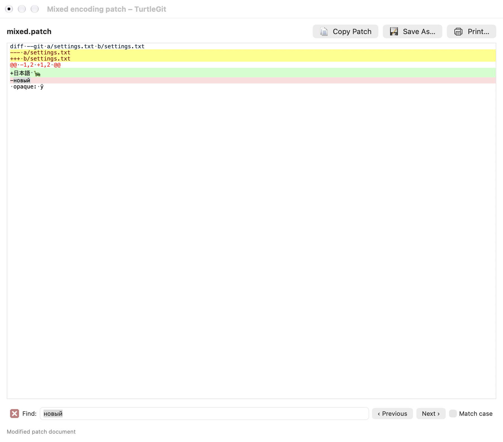
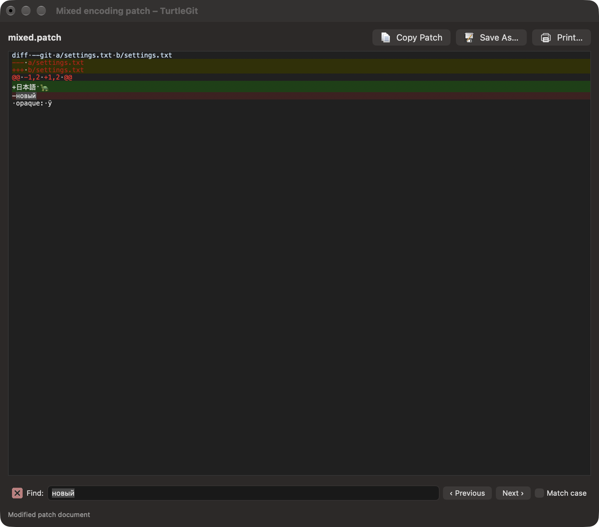

# Byte-backed unified diff editing

The standalone unified-diff editor retains the bytes behind its displayed text.
An edit changes the affected fragments; untouched UTF-8, regional text and opaque
bytes are copied directly into Save, Save As and the private clipboard format.
A mixed UTF-8/regional patch can therefore be edited without converting the entire
document into one code page. Original Patch and serial-import previews remain
read-only, and partial staging continues to use the original Git patch packets.

## Select lines in the gutter

The left gutter numbers the lines of the patch document. Click a number to select
that complete line, including its line ending. Shift-click extends the selection
from its anchor; drag across the gutter to select a range. Dragging beyond the
visible text scrolls the selection. Command-click selects the whole document.
Control-click retains the native context menu.

The gutter uses the editor font and follows light, dark and increased-contrast
appearance. Its width grows when the document needs another line-number digit.
Selection does not edit the patch or convert its bytes. Read-only previews retain
Copy and their existing selected-line or hunk actions; editing remains governed
by the preview's original policy.

## Encoding and control data

Inserted text uses the encoding of the fragment being edited. UTF-8 text can
retain its Unicode characters beside regional text; regional insertions still
need to fit that region's captured code page. ASCII regions in a regional document
keep that captured policy. File BOMs remain separate from editable text, so Save
does not add extra BOMs or remove an actual leading U+FEFF character.

Embedded NUL is data in a patch document, including UTF-16/UTF-32 documents. This
is separate from the compare/merge text encoder, which retains its existing
binary/NUL boundary. Undefined legacy bytes and malformed UTF-8 projections retain
original bytes; a displayed replacement character is not used to regenerate them.
Deleting a projected unit removes the bytes it represents. Native control-character
glyph appearance still requires physical acceptance.

No automatic whole-file conversion or standalone conversion picker is introduced.
An inserted character that cannot fit its selected region reports an encoding
error and leaves the file intact. An unknown, non-round-tripping display mapping
can also refuse a partial edit rather than regenerate uncertain bytes. Unchanged
export and Undo remain available after dismissing the error. Reopening an inherently
ambiguous mixed-codec byte sequence can reclassify its display; an in-memory save
retains the accepted fragment presentation and code pages.

## Save points, Undo and ownership

The byte edit tape retains removed fragments and their encodings. It recognizes
native coalesced Undo/Redo notifications and restores the captured bytes, including
opaque units, rather than guessing them from the restored text. Save keeps that
history and ends native typing coalescence at the save point. AppKit event
grouping still determines how many edits one Undo restores. Replacing the
document and retiring its owner release the tape. Unicode spelling
changes remain real edits even when Swift considers their strings equivalent.

Save As captures an immutable byte/presentation snapshot before opening its file
chooser. The owner blocks editing while the chooser/write is pending. Changed
preferences cannot reinterpret that snapshot. External-change checks, security
scope lifetime, cancellation, retired-owner checks and shared Quit accounting
remain on the existing document-session path. Copy Patch publishes both the exact
current byte snapshot and its native Unicode text representation.

## Source and verification

Pinned TortoiseUDiff `MainWindow.cpp` uses Scintilla's byte buffer and saves its
`SCI_GETTEXT` bytes. The Mac implementation adapts that behavior to native text
controls with retained byte fragments and an explicit legacy-code-page policy.
The [dated checkpoint](qa/unified-byte-buffer-2026-10-17.json) records focused Core
and grouped native coverage, failures and remaining limits. It includes mixed
regions, all supported text codecs, NUL, malformed byte projections, exact Unicode
savepoints, immutable snapshots and Undo across saves, plus actual native editing,
clipboard and file-session ownership. Passing this group does not certify every
Scintilla gesture, physical printing, complete visual parity or signed App Store
acceptance. A same-text replacement of an opaque projection preserves the
original bytes; explicit byte/encoding conversion remains outside this interface.

The checkpoint also records a fixture Undo-group exception and a subsequent
private cursor-window close crash in the broad Help observer. Help now registers
close state only for bound app windows, without asserting a Swift executor from
framework close callbacks. The existing context/F1/sheet/close checks were rerun;
this does not certify all SDK window-lifetime behavior.

