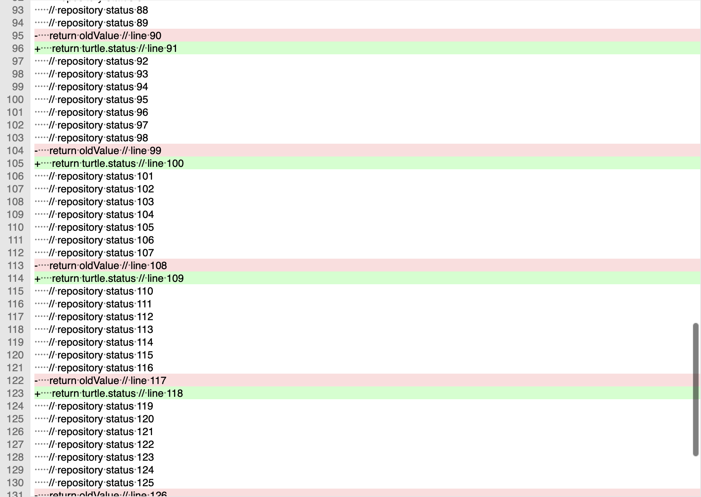
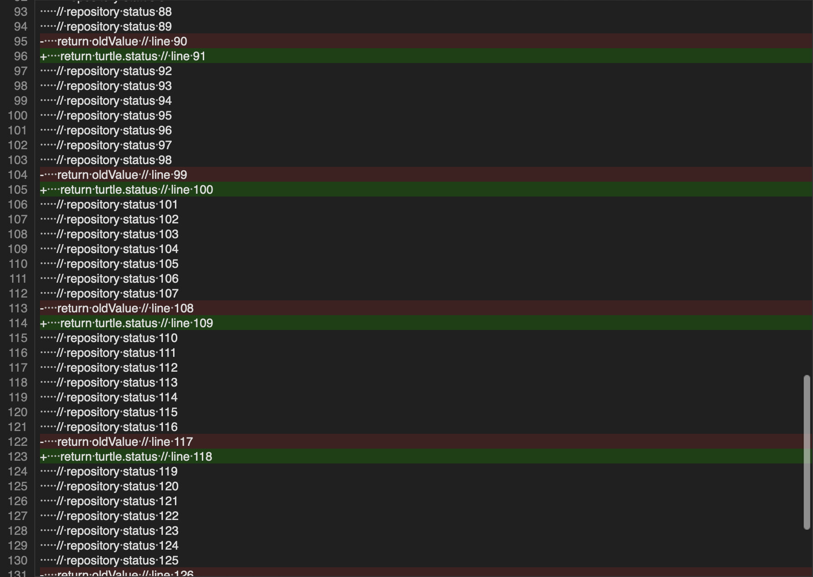

# Unified Diff line-number and selection gutter

The native Unified Diff editor and its read-only patch previews have a line-number
gutter. These are patch-document line numbers, rather than the old/new file
positions inside Git hunk headers. The gutter uses the editor font, reserves
space for the decimal line count plus two digit cells, and updates after edits,
Undo, document replacement and appearance changes.

Click a number to select its entire logical line, including its original line
ending. Shift-click extends from the selection anchor. Dragging keeps the clicked
anchor line fixed, including when reversing direction, and scrolls at the visible
edges. Escape cancels an active drag. Command-click selects all. Control-click
retains the native context menu and its existing colored command icons.
Read-only previews remain read-only; selection feeds their existing Copy and
selected-line/hunk commands. Selection does not regenerate patch bytes.

## Native appearance

Light mode:

Dark mode:

These are actual native editor content renders with private sample data, produced
by AppKit's view PDF output and rasterized by PDFKit. They include the gutter and
text together; they are not physical screenshots of a signed installed window.
Patch-document line numbers include the five header lines in this sample.

## Source contracts and native adaptation

Pinned TortoiseGit commit: `7338078f8ddd924b8cddee35f512f2286072136d`.

| Source | Contract | Native implementation |
| --- | --- | --- |
| `src/TortoiseUDiff/MainWindow.cpp:85–95, 214–215, 628–632`, blob `fc1d4053019e4b8bc5c2a1c08837d19c7c506751` | Install/update the line-number margin; decimal digits plus two cells measured with `8`; other margins disabled | Native `PatchLineNumberGutter` beside `PatchScrollView`, hosted by `PatchTextHost` |
| `MainWindow.cpp:758–773` | Light/dark line-number foreground and background | Native ruler colors, configured editor font and increased-contrast system colors |
| `ext/scintilla/src/Editor.cxx:4744–4770, 4930–4955, 5155`, blob `29892f1497652eaa6f478320f6805762319db8bb` | Complete logical-line click/Shift/drag selection with directional endpoints | `PatchLineIndex`/`PatchLineSelection` in displayed UTF-16 coordinates; native TextKit hit testing |
| `Editor.cxx:4846–4850` | Control-click in the Windows margin selects all | Command-click selects all on macOS; Control-click keeps the native menu |
| `ext/scintilla/src/CellBuffer.cxx:339, 782–797` | Default CR/LF/CRLF boundaries and final empty line | One-pass line-start index, without changing input text or bytes |

The default source gutter selects logical lines. It does not enable Scintilla's
subline-selection option. Wrapped continuation fragments therefore do not get
additional line numbers or separate line selections. This implementation does
not add a wrap setting to Unified Diff.

The ruler draws visible labels from TextKit's first visual fragment and final
empty-line geometry. Horizontal scrolling leaves it fixed beside the text.
The gutter is a native sibling beside the scroll view. Its wrapper owns the
column width; AppKit retains ownership of the scroll view's clip, border and
scrollers. This avoids the text-formatting ruler callbacks that otherwise deduct
the gutter width again when sizing the text view. Native selections use AppKit's public range/affinity API; reconstructing an
arbitrary prior text selection's directional anchor follows that public API,
rather than reading private TextKit state. Font metrics and glyph placement are
native macOS adaptations, not a Windows pixel-identity claim.

## Ownership and original data

The ruler is bound to its exact text view, scroll view, coordinator and source
callback revision. Replacement invalidates an old gesture even when text bytes
are equal. Text edits invalidate an active drag; exact UTF-16 identity keeps NFC
and NFD changes distinct. Closed/retired owners, pending work, Quit and modal
sheets refuse new or queued selections. Dismantling removes observers and ends
tracking. The existing document session and byte-backed editor remain responsible
for editing, Undo, clipboard, Save and partial patch application.

## Verification and remaining work

The [dated checkpoint](qa/unified-gutter-family-2026-10-26.json) records six
focused Core methods passing and the native build and repair attempts. Native
geometry checks exposed overlap and double width accounting in the initial
formatting-ruler approach. The final sibling layout avoids that interaction. The final native build and full gutter checks pass with both system and bundled
Git, including geometry, events, preview Git packets and ownership/cleanup.
Current AppKit parent bitmap caching omits the text child; direct native
text-view caching renders the document, so these two capture paths are recorded
separately. Authored fixtures alone are not a passing result. Full physical mouse/trackpad,
keyboard and VoiceOver acceptance, exact Scintilla multi-click/platform behavior,
Windows font/pixel equivalence, current signed execution, Intel/minimum-OS
execution and complete hosted integration remain separate requirements. This
family does not certify the full Unified Diff viewer or the complete port.

The subsequent [whole-line editing family](UNIFIED-DIFF-LINE-EDITING-PARITY.md)
covers explicit copy/cut/delete, duplication, transpose and indentation. It has
its own source contracts and validation scope; gutter checks do not certify
those operations.
