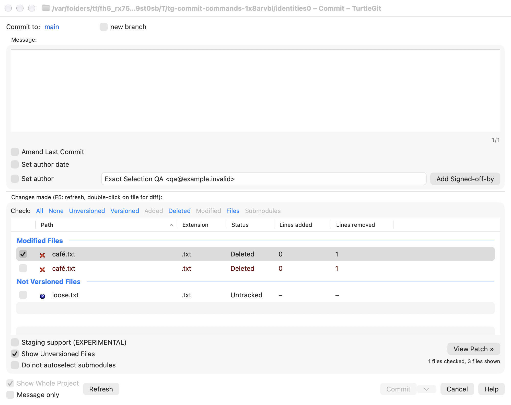
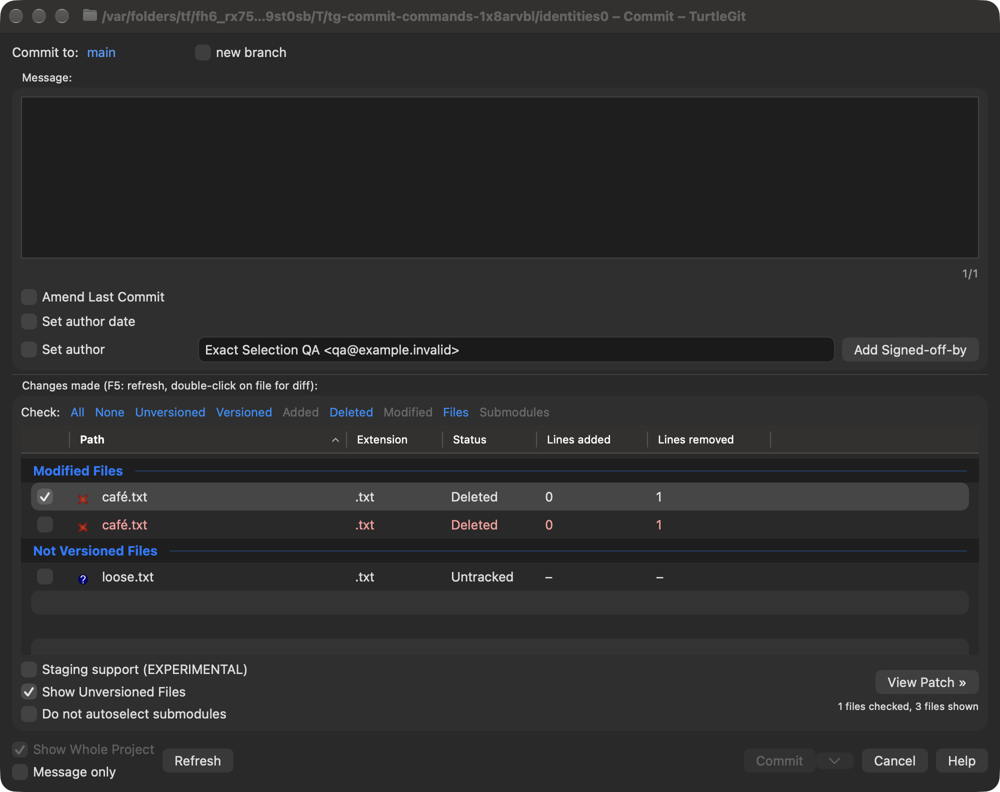
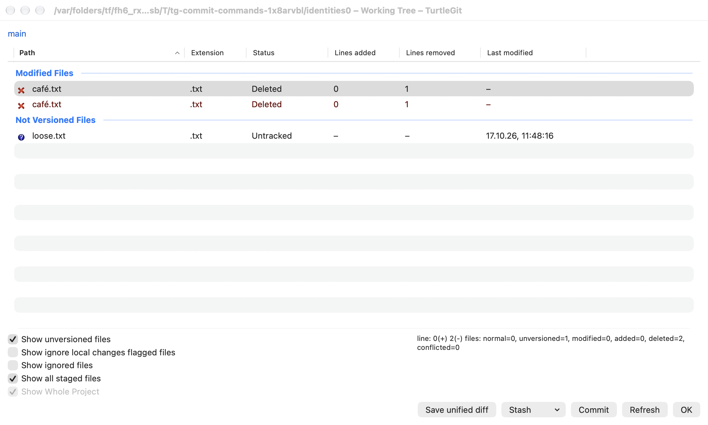
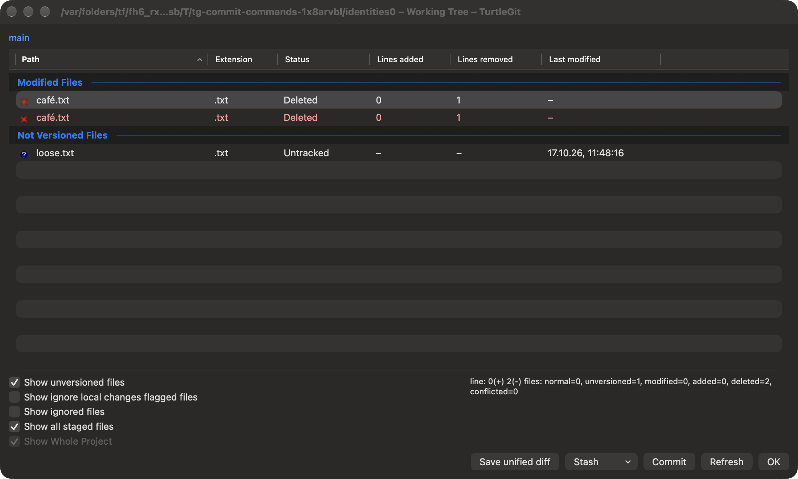

# Working-file identity and metadata

Pinned source: `7338078f8ddd924b8cddee35f512f2286072136d`,
Git.cpp NUL-delimited status/diff readers and
GitStatusListCtrl.cpp::SetGitIndexFlagsForSelectedFiles. The latter looks up each
selected UTF-8 Git path independently in libgit2's index. Swift String equality
instead treats canonically equivalent Unicode spellings as equal, which is
unsuitable for Git index keys.

## Connected read/metadata and index-flag family — October 17, 2026

StatusEntry merges deleted/unversioned copies only for identical UTF-8 path bytes.
StatusEntry and CommitFile equality/hashing retain exact path and rename-source
spellings. The name-status/numstat/raw joins use exact destination keys, so a
canonical alias cannot inherit another file's statistics or submodule type.
Working Tree status, amend-to-parent Commit status and working-tree Log history
retain those keys while joining normal entries, index-only changes, per-path
flags and differences. Explicit row scope matching uses exact bytes. The common-
directory comparator is exact, but its input still comes from filesystem URLs;
full invocation spelling preservation remains open.

GitPathMap carries exact path metadata through Commit's staged/unstaged lists,
Working Tree, Revert, Rebase conflict snapshots, metadata columns, sorting and
clipboard text. Filesystem metadata can still describe one shared physical file
on filesystems that alias the two spellings; its Git keys remain separate.

Index-flag requests deduplicate exact spellings, look up exact stage-zero records
and retain exact updated/unavailable path reports. The locked private-index write
uses NUL-delimited stdin rather than argv, preserving Unicode spelling, leading
dashes, tabs and newlines without changing persistent Git configuration. Stage
objects and HEAD remain unchanged by flag updates.

Finder index flags use the same path map. Absolute metadata keys append the raw
Git suffix to the repository root string; passing that suffix through Foundation
URL path joining can normalize it on macOS and is avoided here. New snapshots include an `indexFlagsV2`
array of path/value records; current readers prefer it. The original `indexFlags`
object is also written deterministically for older installed extension/cache
readers. Old readers retain their previous normalization limits. New readers
accept the old object when the new field is absent; historical distinctions
already lost by an old writer cannot be reconstructed. Duplicate exact record
keys in the new format are rejected.

## Remaining identity migration

The read/metadata checkpoint did not establish complete working-file identity
parity. Its pending Commit/Working Tree row and checked/highlighted selection,
selected operation scopes and restore-copy lookup migration is covered below.
Other dialog selection/operation sets, LFS owner maps and Finder state/overlay/
repository maps remain open. Arbitrary invalid UTF-8 Git paths and filesystem
case/normalization aliases require separate work.
Physical/signed Finder and App Store acceptance remain open.

See [batch evidence](qa/working-file-identities-2026-10-17.json).

The grouped checkpoint passed 48 distinct relevant Core cases across the retained
run and affected repairs. The initial test-target compile needed an explicit
GitPathMap type in the existing clipboard fixture. The first executable Core run
passed 37 unaffected cases and exposed two failing new cases: Foundation URL
normalization collapsed absolute flag keys, and an invalid numstat fixture record
consumed the following row as a rename. Raw Git probes confirmed stdin preserved
both index paths under system and bundled Git. The absolute-key join and fixture
were repaired; the six identity and five amend cases passed, then those same
11 affected cases passed after the amend join migration. Unaffected cases were
not repeated. Both Debug builds passed.

Four grouped native case/engine combinations passed: Commit staging and Working
Tree footer with system and bundled Git. Commit additionally checks exact
statistics sorting and clipboard columns without putting aliases into the still
String-keyed native selection model. All four receivers were reaped and
independently absent. No new visual layout or signed Finder claim is made.

## Native Commit and Working Tree selection — October 17, 2026

Commit's checked/highlighted sets and Working Tree's highlighted set now retain
exact valid UTF-8 path membership. Their SwiftUI table rows use ASCII IDs encoding
exact path bytes. A stored native selection set and an exact raw-path cache bridge
those IDs to Git arguments and captions. Group IDs retain their separate NUL
namespace. Group lookup maps, flag grouping, checkbox multi-selection, marked
context menus, bulk checks and canonical-only selection replacement use the same
identity rules. Changing just the spelling invalidates captured menu targets.

Programmatic native selection replacement explicitly clears the old selection
before selecting the requested rows. A minimal SwiftUI Table with ordinary ASCII
IDs reproduced the empty-binding failure when `selectRowIndexes` directly replaced
a multi-selection with its subset. Refresh and ordinary group-skipping keyboard
navigation use the same replacement adapter as the native regression fixture.
This does not establish a physical mouse-input failure or certify physical input.

Native list refresh restores the exact selected/focused row. Status and Commit
share that native adapter; the Sync conflict table now also uses exact row IDs
and selection through its shared Status model. Existing String-sequence callers
are captured into exact sets at workflow boundaries. This cannot reconstruct
names already collapsed by an older caller's Set<String>.

Commit staging-state and restore-copy maps retain exact keys. Commit's selected
path snapshot, checkbox-index scope/restoration sets, staged mode preservation
and Rebase Split handoff retain exact selection through the temporary index.
Stage/Unstage and temporary-index additions/restores use literal NUL path packets;
empty/NUL-containing entries are refused. Index mode updates use NUL index-info
records, and literal mode lookups disable argv precomposition for that command
only. Persistent Git configuration is unchanged. Native Commit/Working Tree
submodule membership now comes from the already exact submodule-name reader.

The grouped checkpoint covers these two dialogs' file row IDs/checked/highlighted
sets and supersedes their earlier pending migration. Other dialogs (including Log, Add and Revert outer
selection models), wider LFS ownership/Finder state maps, URL invocation scopes,
arbitrary invalid UTF-8 names and physical filesystem alias semantics remain
open. Two Git index names can refer to one physical file on macOS; independent
index identity does not create two independent disk files.

See [selection evidence](qa/working-selection-identities-2026-10-17.json).

The grouped checkpoint passed 67 distinct relevant Core cases across the original
run and affected additions. Ten final native case/engine combinations pass with
system and bundled Git: exact selection, staging, Commit commands, Sync conflicts
and shared file-list refresh. Four updated fixture callers compile without
rerunning unrelated workflows. Initial compile/input/checkbox failures and the
minimal-table diagnosis are retained in the batch record. All recorded owned
receivers were reaped and independently absent. Both raw Commit and Working Tree
light/dark captures were individually reviewed: separate paired rows, single
highlight/check, source icons, status colors, groups and footer fit. Physical
mouse/keyboard, accessibility and signed acceptance remain open.

## Add and Revert continuation — October 17, 2026

The [connected Add/Revert family](ADD-REVERT-IDENTITY-PARITY.md) extends exact
selection through both dialogs' outer checked/highlighted models, scope readers,
marked menus, restoration copies, refresh, Add modes, Revert preparation and Retry.
Revert now uses encoded native row IDs and highlighted-row checkbox rules. Add
context callbacks retain epoch/command/payload receipts. This supersedes the
previously pending Add/Revert outer selection entries; Log, LFS owner and Finder
state maps, URL invocation spelling and filesystem alias semantics remain open.
