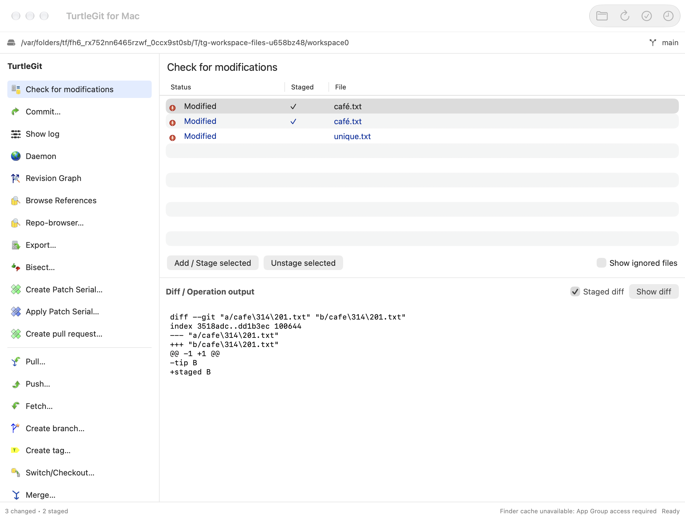
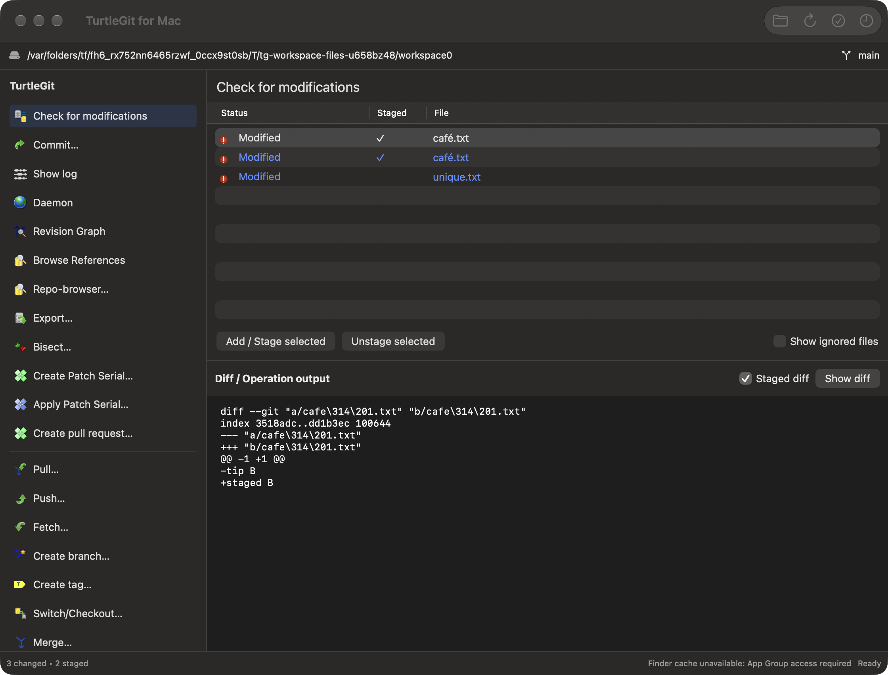

# Workspace file workflows

The macOS workspace is an additional repository overview. The native Working Tree,
Commit, Log and other dialogs remain the TortoiseGit dialog counterparts. This
continuation uses the pinned `7338078f8ddd924b8cddee35f512f2286072136d`
status-list action family, Commit's dropped-file handling and Blame file/history
reads; it does not claim that TortoiseGit has this workspace layout.

## Native selection and captured commands

Workspace rows encode only their native table IDs. Model selections, selected-path
order, refresh intersections and file operations keep exact UTF-8 Git names.
Canonical Unicode peers remain separate rows and can be selected independently or
together. Invalid/hidden IDs are discarded at the table boundary. Status, Staged
and File cells share the saved status palette and native selection contrast.

Context menus use the clicked selection rather than reading a later highlight.
Their one-use receipts belong to one workspace and expire after selection changes,
refresh, filtering, staged-view changes, busy/Quit/modal states, changed comparison
marks or repository context changes. Returning to the previous state does not
revive them. Closed workspace windows cannot claim a receipt. Native activation
opens the captured scoped diff; Copy uses displayed selection order.

The menu retains existing Stage/Unstage/Revert/Clean/Rename/Resolve/Ignore/Delete
routes and adds Move, path-scoped Log, source-gated Blame, Finder reveal, actual
file-URL copying, Copy/Add and relative/full/name text copies. These use the
existing native workflows and original command artwork. No new icon provenance
or Windows drag-menu replacement is introduced here.

Moved/renamed selections retain a pending exact path remap until the replacement
status rows arrive. A multi-item operation accumulates those remaps. Actual
repository refresh then intersects them with the new visible rows. This avoids
losing a newly moved selection because it is absent from the old table snapshot.

## Finder selection and shared viewers

Finder selection expansion now prefers an exact name and locks each chosen parent
namespace before considering a unique filesystem spelling. It cannot select a
child in another canonically equivalent parent. Root selection still includes all
status entries; unique filesystem spellings remain usable with the ordinary Git
index. Collection publishes exact gitlink names independently of ordinary peers.
This does not migrate Finder's entire badge/state-cache representation.

Shared comparison, Blame, conflict and submodule-viewer caches use exact keys.
An ordinary file is not routed to a conflict or gitlink because another spelling
has that state. Comparison and Blame windows retain their own path and contents.
Scoped diff, Blame blob/annotation/history reads and parent matching preserve exact
paths rather than allowing macOS Git argument precomposition to redirect them.
Blame windows use the caller's preference store; production still defaults to the
normal application preferences.

## Dropped files and folders

The shared Add/Commit drop resolver preserves provider path spelling while still
checking physical repository containment, nested repository ownership and metadata
exclusions. Parent symlinks are resolved; a leaf symlink keeps its own identity.
An index-only drop can address an exact peer without moving its filesystem alias.
A unique existing index spelling can also resolve an ordinary filesystem URL.

Commit's ordinary, non-forced Add retains ignored-file errors and per-item results.
Folder drops expand Git's cached/untracked, exclude-standard candidate lists into
exact paths before staging. Existing index names remain unchanged; new scanned
names follow `core.precomposeunicode`. Literal path packets avoid argument
precomposition, and ignored files stay excluded. Add's read-only membership path
uses the same resolver without staging.

## Evidence and remaining acceptance

See [workspace file evidence](qa/workspace-files-2026-10-17.json) for the grouped
Core/native results and repairs. The native receiver hosts the production workspace
view, uses private repositories/preferences/pasteboards, exercises real Stage/
Unstage/Move and checks actual independent comparison/Blame controllers. Finder
reveal is captured rather than launching a Finder window.

Physical mouse/keyboard/context-menu input, complete accessibility, configured
external tools, every source menu/variant and signed Finder/App Store grants remain
open. Local passes do not establish full hosted CI, full dialog parity or signed
distribution. The screenshot section records only the actual owned-view captures.

## Owned native captures

The production workspace view is hosted at its real minimum size for these
light/dark captures. Both raw 2240 × 1704 images were inspected individually. The
source icons, three columns, inactive selected-row contrast and staged patch fit;
the sidebar scrolls. The fixture intentionally disables Finder cache publication,
so its footer does not demonstrate installed Finder integration.

The Debug build, 73 distinct focused Core cases across retained/affected checks,
and ten native workflow/engine combinations pass within the recorded scope. Only
the affected drop suites were repeated after the Git scanning correction; only
the workspace receiver was repeated after the capture-host sizing correction. All
twelve runtime receivers were reaped and independently absent. AppKit reentrancy/
split-layout and unsigned clipboard diagnostics remain recorded acceptance gaps,
not resolved by the passing behavioral assertions.
